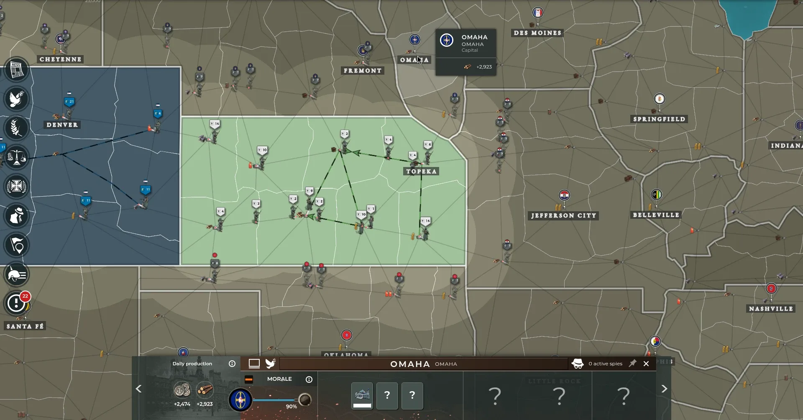
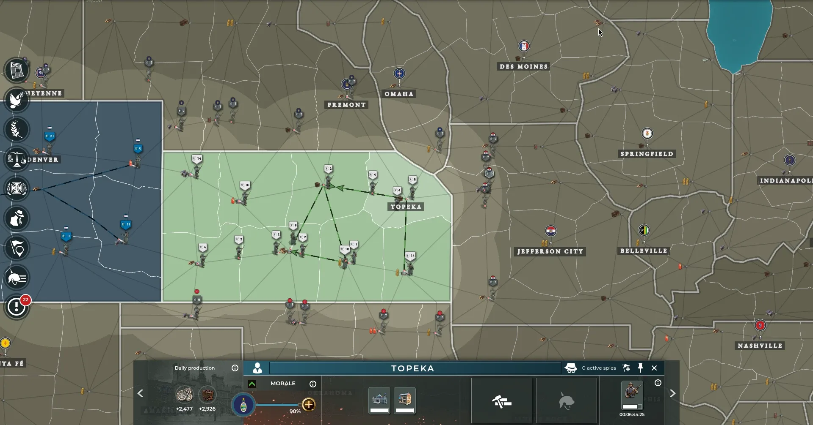
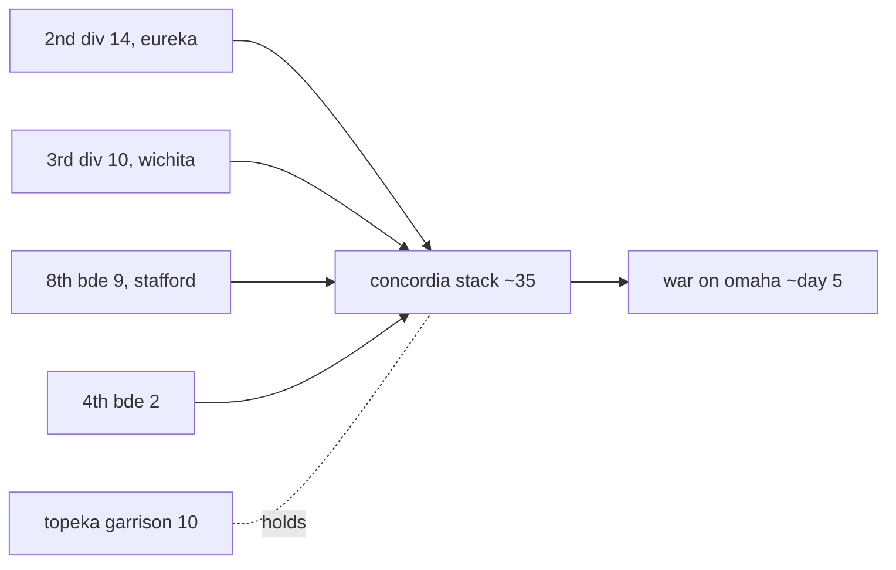

okay so the first orders actually landed this hour. 10:16pm ct.

diplomacy first. german reply went out to the colorado ally: we take omaha, then nebraska, missouri, oklahoma. new mexico, utah and everything west is his. he'd already said at 10:03 he's pushing glenwood springs toward grand junction/utah and wants us covering the east. so the map is split clean. no overlap fights. that's the play, no?

formal coalition didn't happen. supreme looked and only found info/messages on colorado, no coalition button. its read: coalitions here are "apply to an existing one", not "make one with a friend". might create its own later. parked.

oil. it bought 335 @ 12.1 plus the 10% fee = 4,460 money. that's basically the whole wallet. money down to ~1.3k (+885/h).
oil now ~324 at -71/h. so like 4.5 hours of runway. it bought time, not a fix.
fish still not touched. 3.5k at -135/h, ~26h. less urgent, it knows.

recruit button and build queue are premium-locked. it figured out you can still build through each province's production list (cavalry is 6,000). a unit is training in topeka, done ~5am.

scouting omaha:
- 3 provinces: omaha (capital), st. joseph, sioux city
- omaha's 1st army sits at st. joseph, right ne of kansas
- nebraska has a 2nd army at hastings plus a few more on the north border, missouri's 3rd army at carrollton
- strengths are all fogged. so it's walking toward a target it can't size yet

*first target scouted: ai nation omaha (omaha, st. joseph, sioux city)*

the actual move is smart imo. instead of trickling units at omaha, it's converging everything on concordia to make one fat stack:
- 2nd div (14) eureka → concordia, eta ~4:30am
- 3rd div (10) wichita → concordia, ~2:15am
- 8th bde (9) stafford → concordia, ~2:00am
- 4th bde (2) already there
- = ~35 strength once they merge after 4:30am

topeka keeps 1st+13th (10) as the capital garrison. 6th at colby and 5th at stockton stay as reserve.

*10:15pm ct: three units marching on concordia to form the omaha strike stack*

no war declared yet. no fighting yet. nothing after 10:16 in the journal for this hour.

next:
- merge the concordia stack after 4:30am
- fix fish once there's money again
- keep buying oil (it'll need to, ~4.5h of runway lol)
- maybe shift topeka-side units toward st. joseph
- declare on omaha once the stack's ready, ~day 5

raw numbers: [data/2026-11-24.jsonl](../../data/2026-11-24.jsonl)
