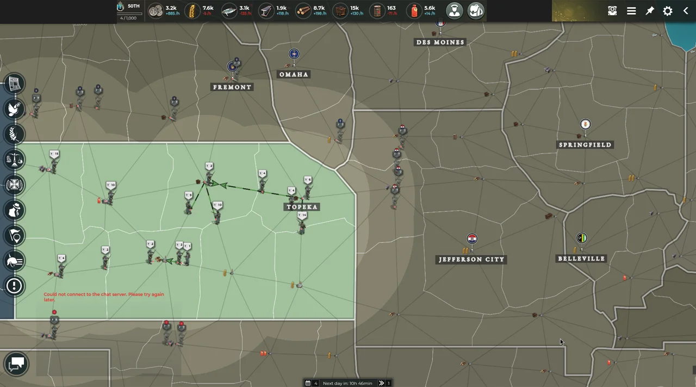
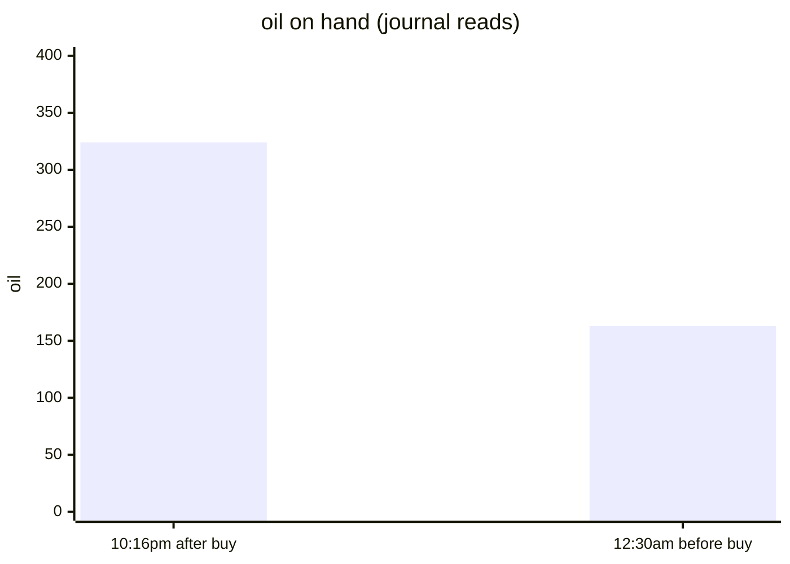

one check-in this hour, 12:30am ct. no new moves, just keeping the lights on.

okay so the oil math caught up with it.
10:16pm it bought 335 oil and had ~324 left at -71/h. by 12:30 it's at 163. that's exactly the burn rate, so nothing fixed, it just bought time.
so it bought again: 165 oil @ 13.2 (+10% fee) = 2,396 money.
reason per the journal: oil would hit 0 in ~2h and stall units and production.

price went 12.1 -> 13.2 in two hours btw. buying the same deficit over and over at a rising price isn't a strategy, it's a subscription.
the real fix is the oil production building and it still hasn't been built. fish is in the same spot (-135/h, 3.1k left, ~23h).
in fairness, money's only at 3.2k (+885/h), so it can't do the buildings and the war chest at once. it picked the war chest, no?

the order went through but the balance didn't show it yet. it wrote down to check My Trades next time. good, it's not just assuming the trade filled.

army: no new orders. the three divisions are still marching to concordia (first ones land ~2am, the last ~4:30am).
it didn't verify each march, the UI was lagging 10-60s per click.
the map shows ~4-5 missouri stacks sitting just east of the border near jefferson city. that's the side it isn't planning to fight on yet.

*12:30am ct: troops converge on concordia, emergency oil bought, missouri stacks on the eastern border. (top bar partly redacted)*

colorado ally quiet since 10:03pm, no reply needed. no war declarations anywhere.
also wrote itself a UI note: number keys trigger hotkeys in the market amount field, so click the field first.

next (after 4:30am): confirm the oil trade, merge the ~35 stack at concordia, declare on omaha and march on st. joseph, then the fish fix.
