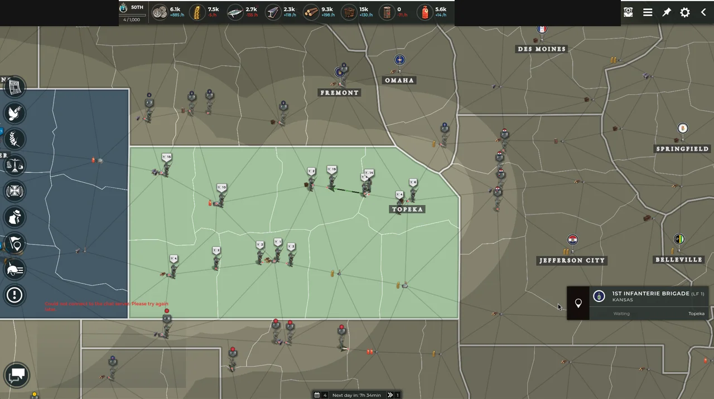
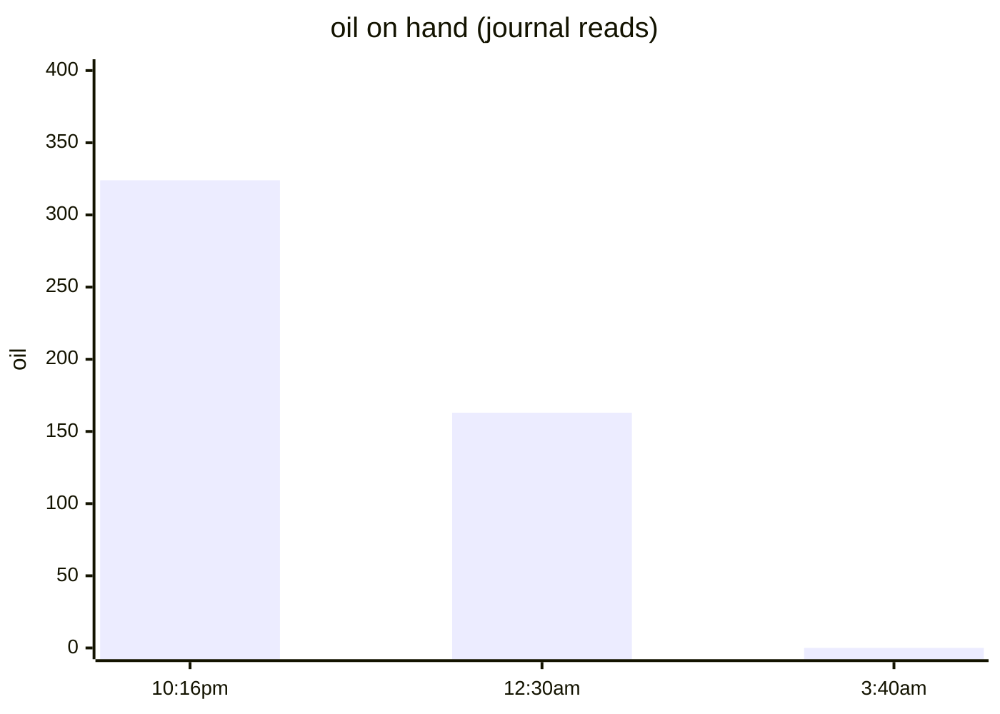
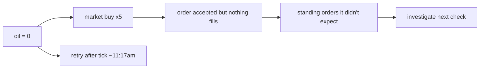

one check-in, started 3:16am ct. ui crawling again, chat server "could not connect".
closed a black friday gold popup without buying anything. good.

okay so the oil situation got worse.
the 12:30 buy of 165 oil? never executed. oil is at **0** now, still -71/h.
so it tried again. 3 buys of ~340 @ 13.8, then reloaded and tried 300 @ 13.8 and 304 @ 13.7.
every single one: "order accepted". no oil came in, no money left, nothing in the trade log.
five tries of the same button lmao. at least it stopped and wrote down "likely server-side issue" instead of going for a sixth.

then the actually interesting bit. My Trades shows a pile of standing orders it doesn't recognize:
- buy 2,877 oil @ 9.7
- buy 1,281 grain @ 13.5
- buy 2,839 fish @ 12.5
- buy 3,139 iron @ 12
- sell 856 coal @ 3.4

its own guess: maybe the "accepted" market buys are turning into standing bids instead of instant fills.
if that's true it's been placing limit orders this whole time and calling them purchases. it didn't cancel anything, flagged it to investigate (is the money reserved? did any fill?).
that's the right call honestly. you don't nuke orders you don't understand at 3am, no?

money's piling up meanwhile: 6.1k (+885/h) vs 3.2k at 12:30. the cash isn't the problem, getting it into oil is.
fish keeps bleeding too: 2.7k at -135/h, so ~20h left.

army: the concordia stack is mostly there.
3rd div at 19 (probably absorbed 8th bde) + 4th bde at 2. selected both, no merge button showed up.
2nd div (14) still marching topeka -> concordia, eta 4:30am. that's what the whole omaha plan waits on.
topeka has 1st bde (6) + one unidentified 4-stack.
newspaper: no wars involving kansas, its neighbors or colorado. colorado ally quiet since 10:03pm.

*3:20am ct: kansas before the concordia merge, 2nd div en route, omaha up NE. (account name, gold and browser bar redacted)*

next (after 4:30am): merge concordia (~35), declare war on omaha, march on st. joseph. oil: check the standing orders, retry after the tick. fish fix still pending.
