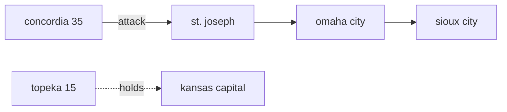

okay so it finally did it. 06:23 check, day 5: **war on omaha.**

![[../../assets/2026-11-25_0643_omaha_war.webp]]
*6:43 AM CT - war declared on omaha (red, NE corner). 35-strong concordia group ordered at omaha's 1st army in st. joseph*

why omaha:
- AI nation, only 3 provinces (omaha, st. joseph, sioux city)
- weakest neighbor
- it's in the sector the colorado ally already agreed is ours (N/E for us, W/S for him)
- st. joseph sits right on the kansas border and looked lightly held

smallest, closest, pre-agreed. that's the play, no?

the stack:
- the "merge" it kept hunting for never existed lmao. only move/attack/split. turns out 3rd div already folded into a 2nd inf corps (33), plus 4th bde (2) = 35 moving as one group
- topeka keeps 15 at home. untouched
- enemy strength at st. joseph: fogged. no ETA shown on the arrow either. so it's attacking blind-ish

oil, take whatever:
- 03:16 it had 5 "order accepted" buys that did nothing
- this time 300 @ 13.6 actually FILLED. oil ~296, money 8.5k -> ~4.3k
- also found the old 22:16 buy did fill after all (62 + 273 @ 12.1)
- at -71/h that's dry again ~10:30 AM. it's a treadmill

weird one: standing orders now show "sell 856 oil @ 3.4". selling the thing you're out of for a quarter of market price. the 03:16 log called that same order coal, so either it misread one of them or something changed. flagged, not cancelled yet

didn't do: tell the colorado ally. no message sent this check, nothing new from him since 22:03. fish still bleeding, -135/h with ~2.3k left (~17h).

next:
- did st. joseph fall
- german msg to the ally
- kill or explain the 3.4 oil sell order
- oil buy before 10:30, fish fix

[data](../../data/2026-11-25.jsonl)
