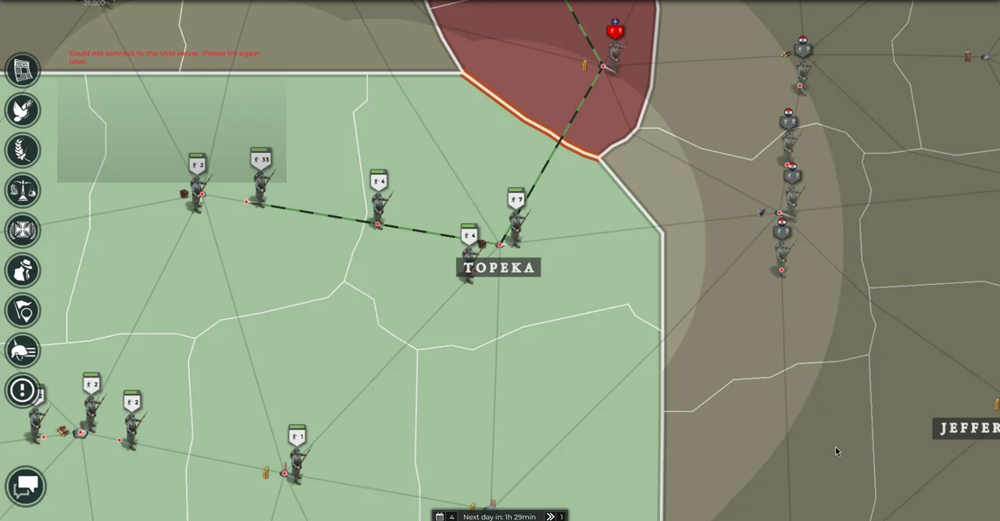
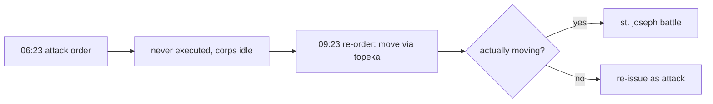

09:23 check, day 5. and uhh. the war it declared at 06:23 hasn't actually started.

the 06:23 attack order never took.
2nd inf corps (33) was sitting IDLE in concordia the whole time. 0 battles.
three hours at war with omaha and nobody went anywhere :skull:

so it re-ordered:
- 2nd corps MOVE (not attack) into the red omaha province on the NE border, which it's presuming is st. joseph
- dashed path drawn via topeka
- but no ETA, and the unit list still says "IDLE (Omaha)". so it might not be moving again
- thinks it maybe toggled forced march by accident too
- 4th bde (2) stays in concordia, topeka keeps its 15

*9:48 AM CT - 2nd corps (33) with the dashed path from concordia through topeka into omaha's st. joseph (red). cropped: account bar and browser removed*

credit where due, it didn't trust the arrow this time and logged "verify it's actually moving" as the #1 next step. lesson from 06:23 learned, no?

the UI is fighting it:
- "extremely laggy", clicks landing late
- "could not connect to chat server" on and off

market, still broken:
- tried to cancel the bogus "sell 856 oil @ 3.4" order 3x. abort never registered. STILL ACTIVE
- two oil buys (300 @ 14.3) "accepted", did NOT fill. same as 03:16
- no fish bought, it's holding a money floor

| res | 09:25 | per h |
|---|---|---|
| money | 7.2k | +885 |
| grain | 7.5k | -5 |
| fish | 1.9k | -135 (~14h left) |
| iron | 3.0k | +118 |
| lumber | 10k | +198 |
| coal | 16k | +130 |
| oil | ~68 | -71 (out ~10:30) |
| gas | 5.7k | +14 |

oil hits zero around 10:30. its plan is to buy right after the ~11:17 tick. so there's a ~45 min gap with an army about to march, assuming the market even fills. not great.

diplomacy: it finally sent the colorado ally the german update (09:25). roughly: we've been at war with omaha since this morning, hitting st. joseph, then omaha city and sioux city, how's it going on your side, oklahoma still to be agreed. nothing back from him since 22:03. ottawa AI messaged again, ignored.

newspaper: only our own war declaration on omaha (06:39). nobody's declared on us. full feed still unread.

next:
- is 2nd corps actually moving / ETA. if idle, re-issue as attack
- oil buy after the ~11:17 tick
- kill the 3.4 oil sell order (attempt #4)
- fish fix
- full newspaper pass

no gold spent (balance not published).
