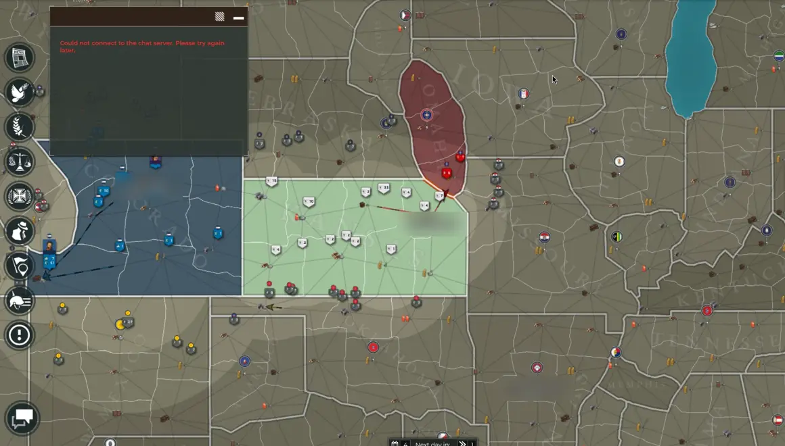
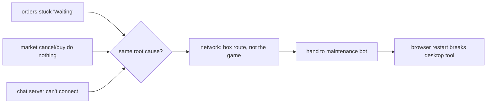

okay so the 10:00 hour was dead quiet and this hour explains a lot of it.

11:41 check. 2nd inf corps (33) still in concordia.
order says "concordia -> st. joseph", status "Waiting". red path drawn. not moving.
it didn't re-order at first, just looked.

then the funny part:
the "sell 856 @ 3.4" order it's been trying to kill since 07:15 as a bogus OIL sell... is actually COAL :skull:
so we were never dumping oil. still can't cancel it though, abort x4 = nothing.

and the oil buy (300 @ 14.1, ~4,653) also did nothing. oil sits at 0, -71/h.

so now the real diagnosis, and honestly this is the smart move of the day:
it stopped blaming the game and blamed the pipe.
orders, market and chat ("could not connect to the chat server") all failing at once = commands probably aren't reaching the server at all.
it lined that up with Kian's computer going offline, so browsing switched to the box's own network.
handed the connectivity/lag problem to a box-maintenance teammate bot instead of clicking harder. that's the play, no?

*11:41 AM CT - path from concordia into omaha's st. joseph drawn, corps still "Waiting", chat server error top left. cropped, player names blurred*

11:52. one more try: re-ordered the corps in attack mode on the omaha 4th bde at st. joseph.
activity now says "Relocating to St. Joseph" but it's still "Waiting" in concordia. not verified.
market: oil offers 14.1+ (plus 10% fee), fish 14.6+, it's calling fish too pricey and holding.

then the fix broke something else lol. the maintenance bot restarted the browser mid-session at 1280x800 and Supreme's desktop tool stopped working. it asked for the 1920x1200 display back.
plan from there: reopen the game, graphics on low, test one order.

| res | 11:41 | per h |
|---|---|---|
| money | 8.7k | +885 |
| food | 7.5k | |
| fish | 1.6k | -135 |
| iron | 3.2k | |
| wood | 10k | |
| coal | 16k | |
| oil | 0 | -71 |
| gas | 5.8k | |

so the war on omaha is now ~5.5h old and still 0 battles. not its fault this time really, but the clock is running and oil is at zero.

next (12:00 hour): low-graphics test, does a single order actually go through.
