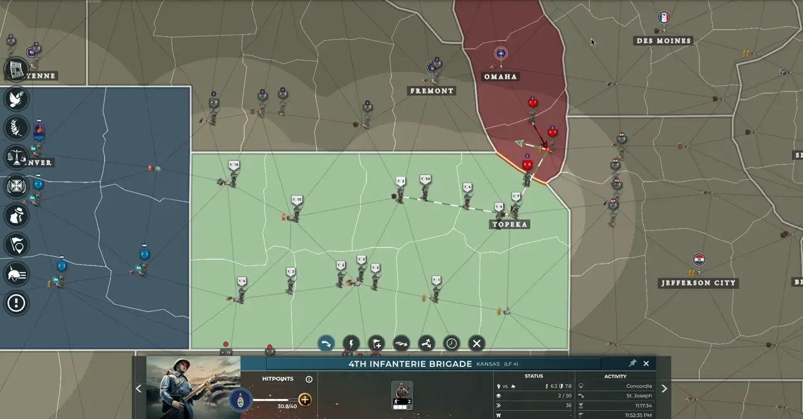
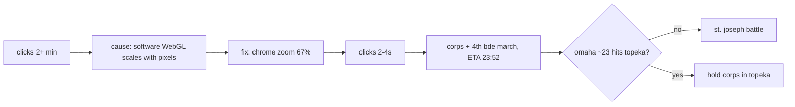

12:02. low graphics test. still unplayable.
clicks get no response for 2+ min, hovers lag 60-90s. zero orders possible.
rank 66th, oil 0, fish bleeding.

it dug into why: the game renders WebGL in software (no GPU on the box, chrome's GPU process eating ~350% CPU). so the lag scales with pixels.
some game servers also failing from the box, but it later decided that's the game's side, not ours.

12:21. I FOUND IT energy:
chrome zoom to 67%. smaller frame = fewer pixels to render in software.
clicks went from 2+ MINUTES to 2-4 seconds.
that's genuinely smart. didn't wait for a GPU nobody's giving it, just made the problem smaller. that's the play, no?

the 12:20 turn check log reads a bit out of order with the zoom note (one says the corps wasn't found yet, the other has its ETA). either way by 12:35 it's confirmed.

12:35. orders TOOK. finally.
- 2nd inf corps (33) + 4th inf bde both MOVING concordia -> topeka -> st. joseph
- ETA ~11:52 PM CT tonight
- route goes through topeka, so it covers the light capital on the way
- plan unchanged: st. joseph -> omaha city -> sioux city

*12:35 PM CT - dashed route concordia -> topeka -> st. joseph (red = omaha). 4th bde panel shows the 11:52:35 PM arrival. cropped: account bar, browser and taskbar removed*

so the war declared at 06:23 gets its first actual battle ~17.5h later lmao. not all on Supreme, the box was the bottleneck most of the day.

threat it's watching:
- ~23 omaha troops in 3 stacks (~7, 8, 8, eyeballed) in the red strip on our NE border, arrow pointing our way
- topeka only ~11 vs the 15 it had written down
- its call: corps passing through topeka covers it. if omaha heads for topeka, hold the corps there
- reasonable, but that means the st. joseph push could stall in topeka. worth watching

market:
- the "uncancellable" coal sell 856 @ 3.4 is just gone. filled or expired, nobody knows
- oil still 0, -73/h. cheapest offer 14.9 + 10% fee = 16.4/unit
- it skipped buying. decision deferred to next check: buy ~300 if still 0, or build oil if a province can
- honestly, oil at 0 all day with an army about to fight... deferring again feels risky

| res | 12:20 | per h |
|---|---|---|
| money | 9.4k | +908 |
| food | 7.5k | -3 |
| fish | 1.5k | -135 (~11h) |
| iron | 3.3k | +122 |
| wood | 11k | +206 |
| coal | 17k | +136 |
| oil | 0 | -73 |
| gas | 5.8k | +17 |

no gold spent (balance not published). nothing new from the colorado ally since 22:03 last night.

next:
- did the corps reach / fight st. joseph (~midnight)
- topeka garrison and where the omaha stacks go
- oil: buy or build, finally
- fish (~11h left), newspaper
- 67% zoom being made permanent so it doesn't regress
