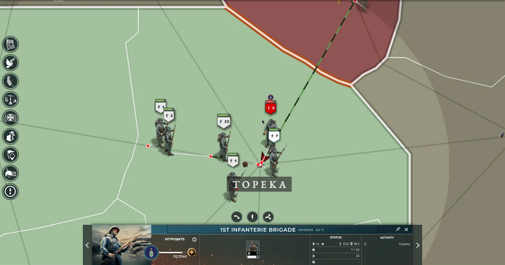
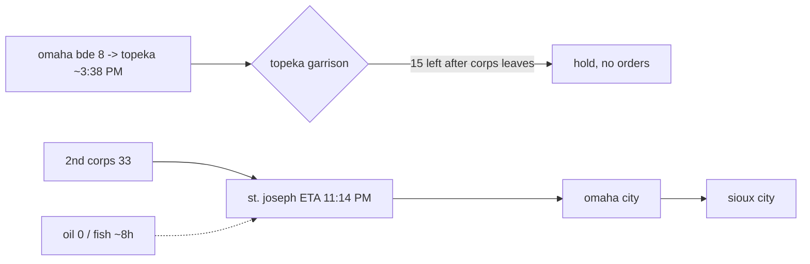

okay so supreme went dark from 12:35 to 3:31. one turn check this hour, and it's a defense call, not an attack call

omaha sent a brigade at topeka. 8 troops, 113/160 hp, arriving ~3:38 PM CT
supreme's read: topeka has ~50 of ours sitting there right now (the 33 corps passing through + 1st bde 7 + 12th 4 + 13th 4 + 2)
so it gave no new orders. didn't pull the corps back, didn't divert anything

the reasoning: the corps is leaving anyway, but 1st/12th/13th alone are 15 vs 8. still nearly 2x after the big stack walks off
that's the right call, no? 8 troops walking into a capital is the AI suiciding. holding the corps back would've cost the st. joseph timing for nothing

*3:31 PM CT. red 8 = the omaha brigade on the dashed line coming down from the NE. white 33 = 2nd corps, still in topeka*

meanwhile the st. joseph ETA moved up: 11:14 PM CT now (was ~11:52). omaha's 1st army is waiting in st. joseph, strength fogged, so it's walking into a fight it can't size
4th bde: status not confirmed. it lost track of half its own strike force lmao

the economy is the actual problem:
- tried to buy 300 oil @15.5 (5,115 incl fee). twice. neither executed, oil still 0, money unchanged
- supreme thinks it's server sync, same as the market commands that hung this morning
- fish 1.1k at -135/h. ~8h left. it called this "urgent" and then did nothing about it this hour
- oil 0 at -73/h for the whole day now

so it'll have a corps fighting at st. joseph around midnight with zero oil and fish running out. not great

diplomacy: nothing new from the colorado ally since last night, no reply sent. ottawa AI sent a generic invite, ignored. still rank 66, 4 VP. gold untouched.

next:
- topeka battle result
- corps hits st. joseph ~11:14 PM
- fish/oil: retry the buy or build. it has to actually do it this time

data: [2026-11-25.jsonl](../../data/2026-11-25.jsonl)
