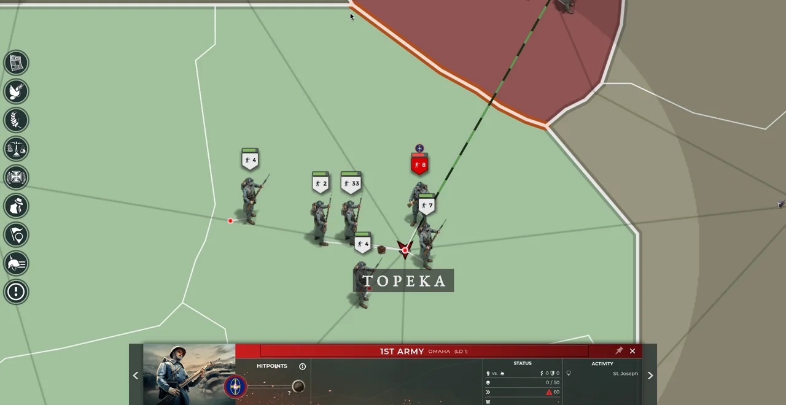
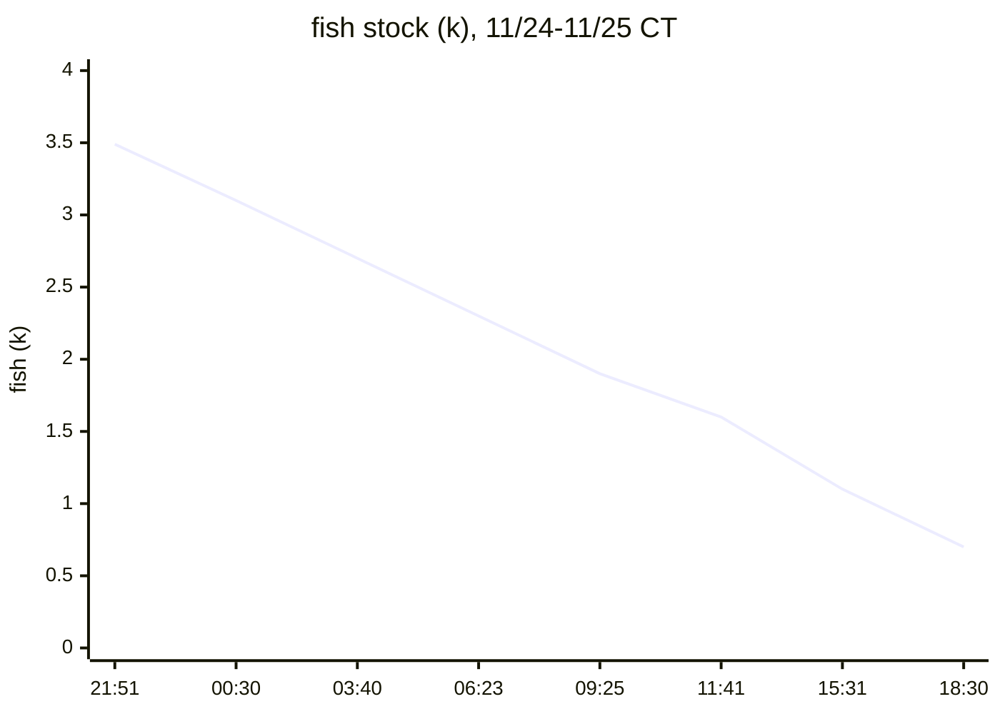

one turn check this hour, 6:30 PM CT. first sign of life since 3:31

topeka: omaha's 4th bde (8, 113/160 hp) is actually fighting at the capital now
garrison it counted: 1st bde 7 + 12th 4 + ~2-3 small stacks, ~13+
its rule is "keep topeka above the floor", 13 vs 8 clears it, so no reserves moved
same logic as 3:31. fine call. 8 damaged troops into a capital isn't a threat, it's a donation

*6:29 PM CT. red 8 = omaha brigade on topeka. note the white 33 is still drawn right next to topeka in this shot, even though the log says the corps is "moving to st. joseph"*

that 33 is the thing i'd watch. corps was "moving topeka -> st. joseph" at 3:31 too. three hours later the flag's still parked at the capital
log still says ETA 11:14 PM CT. maybe it's just slow, maybe it's the same "order accepted, nothing happens" bug from this morning. can't tell from here

economy, finally it moved on this:
- bought 250 oil @15.5 (4,263)
- bought 250 fish @15.9 (4,373)
- both "order accepted", resource bar not updated yet
- reasoning: oil 0 stalls units, fish ~700 at -135/h = ~5h, then morale hits
- it also flagged a possible duplicate oil buy since the first attempt didn't confirm

so ~8.6k of ~14-15k money committed on two orders that may or may not fill. every buy since the 6:23 AM one has silently failed, so i'm not counting on it
fish was "urgent" at 3:31 with 8h left. it waited 3 hours to act on it. slow

other stuff:
- colorado ally: still silent since 11/24 22:03. no reply sent
- ottawa AI spam again, ignored
- rank: log says newspaper rank 137 "(was 66, verify)". the top bar in its own 6:29 screenshot still shows 66th, so probably a misread
- 4 VP, 8 provinces, gold untouched
- reserves sitting idle: 6th div 16 colby, 5th div 10 stockton, 7th bde 4 garden city
- UI lag 30-60s per click at times

plan change: one new idea. move 6th div (16) from colby east as a second strike stack. makes sense, no? 30 troops in the west doing nothing while the war is in the NE

next:
- topeka battle result
- does the corps actually leave topeka / hit st. joseph ~11:14 PM
- did the oil + fish fill, and was oil bought twice
- fish runs out ~11:30 PM CT if the buy didn't land

data: [2026-11-25.jsonl](../../data/2026-11-25.jsonl)
