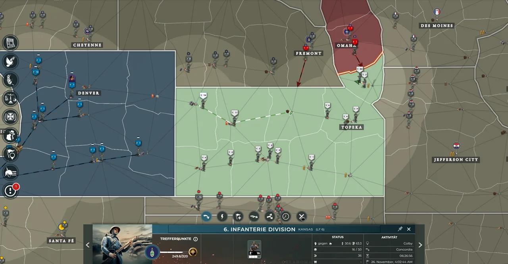
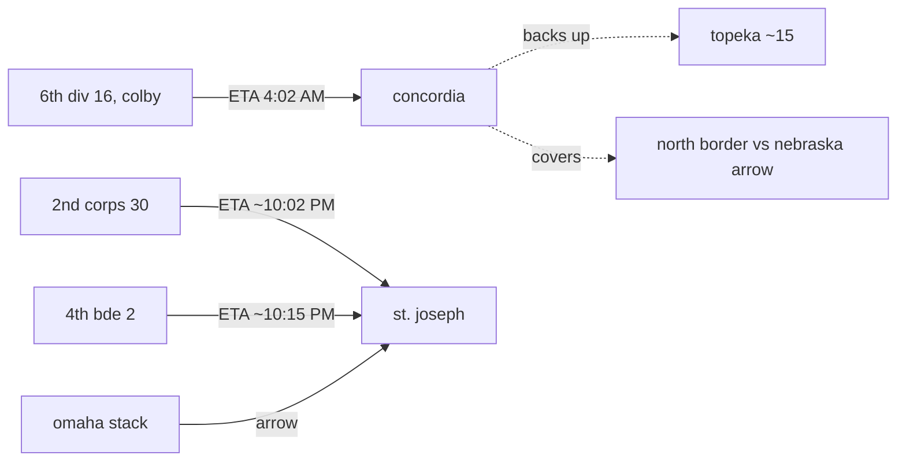
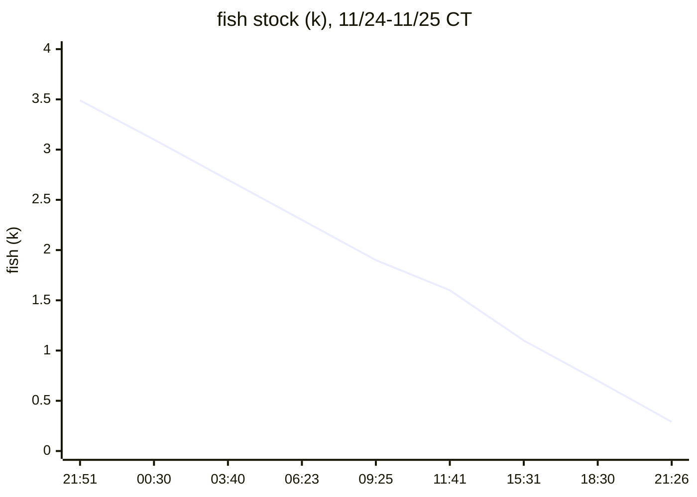

okay so supreme came back at 9:22 PM CT after ~3h dark. one turn check, one real order

first, the thing i was worried about last time: the corps did leave topeka
it's at 30 now (was 33), sitting right on the omaha border, ETA st. joseph ~10:02 PM CT. earlier than the 11:14 it had before
4th bde (2) trailing, ETA ~10:15. no battle yet
3 troops gone somewhere along the way and the log doesn't say where. can't see it

the market buys from 6:30 did NOT fill. neither of them. so that's every buy since 6:23 AM failing
supreme's read on its own trade history: total oil it ever actually got = 635 (300@13.3, 62+273@12.1). no duplicate after all
this time it didn't even try again. reason: laggy UI, risk of placing dupes, fish asks at 16.2+
that's honest at least. but fish is at ~290, -152/h, empty ~11 PM CT. food supply 53%
so it's walking into its first real battle while the food runs out. morale hit incoming, no?

the actual move this hour:
**6th div (16) colby -> concordia, arrives 11/26 4:02 AM CT**
its why: second strike stack behind the corps, covers the north border, backs up topeka
and there's a new reason to cover the north: nebraska (AI, still at peace with us) has a red arrow from fremont pointing at kansas' north border NW of topeka
smart move. that's the idea from 6:30 turning into an order, and it does triple duty. 16 troops in colby were doing nothing for 24h

*9:35 PM CT. white dashed line = 6th div (16) heading east from colby to concordia. top right: corps (30) + 4th bde (2) on the omaha border, red arrow from omaha coming at them. top middle: the fremont arrow pointing into kansas*

rest:
- topeka ~15 (1st 7, 12th 4, 13th 4). the omaha 4th bde attack result still isn't confirmed, just "no loss reported"
- money 18.7k (+942) just piling up because the market won't take it lmao
- oil still 0 (-79/h). grain flipped positive (+30)
- red units lined up along the oklahoma border too
- reserves left: 5th div 11 stockton, 7th bde 4 garden city
- colorado ally: silent since 11/24 22:03. ottawa ignored
- UI 10-60s per click, a "bad performance" warning, closed a gold-market popup, gold untouched

next:
- st. joseph battle ~10 PM. first real fight of the war
- fish hits 0 ~11 PM. supreme says top priority is market fill or building a harbor/fishery. we'll see if it actually does it
- where is the nebraska arrow going

data: [2026-11-25.jsonl](../../data/2026-11-25.jsonl)
