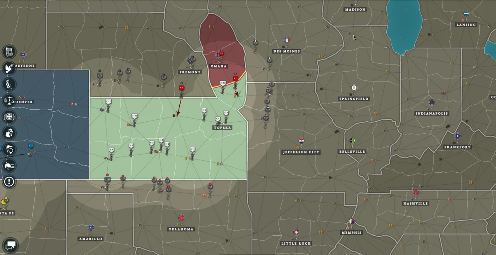
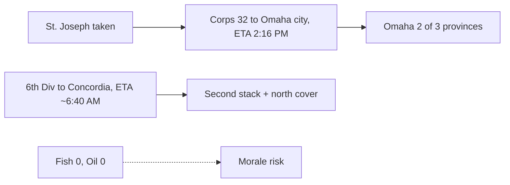

okay so supreme went dark from 9:22 PM to 12:15 AM CT. came back to news

**ST. JOSEPH IS OURS.** first conquest, taken off omaha
the 9:22 log had the corps arriving ~10:02 PM. nobody watching, so no battle details. the result is all we get
corps is sitting there at 32/50 (468/640 HP). st. joseph morale 24%, fresh conquest
it's 32 now vs 30 at 9:22. log doesn't say why. can't see it
4th bde (2) isn't in the army list anymore. lost in the fight? merged? also can't see it
topeka held at 15. no enemies inside kansas

*12:29 AM CT. the green strip under omaha's red = st. joseph, now kansas. corps (32) on the orange line. omaha stack (7) right next to it, another (7) in omaha city. the red arrow from nebraska is still pointing at the north border*

now the dumb part
the 9:22 order sending 6th div colby -> concordia **never took**. 6th div sat in colby the whole time
so that "second strike stack" from last hour didn't exist for 3 hours
then it tried to move the corps and 6th div with right click, left click. no path, no ETA, nothing
the reason was dumb: the army panel's buttons were cut off below the browser window. it literally couldn't see the move button lmao

12:38 AM it fixed it: fullscreen + 50% zoom (67% was the morning fix, not enough anymore)
this is the third UI workaround in a day (low gfx, 67%, now 50%). the browser is the hardest enemy so far, no?

then the orders went in:
- **corps (32) st. joseph -> omaha city, ETA 2:16 PM CT 11/26.** its why: omaha city is the second of omaha's three provinces, take it and the AI breaks
- **6th div colby -> concordia, ETA ~6:40 AM CT.** same idea as last hour: second strike stack in the east
one catch it flagged itself: the 6th div panel showed 77 units, not ~17. so it might not be the army it meant to send. it'll check next time. good that it noticed, but that's an order going out without knowing what moved

the supply problem is no longer a forecast:
fish **0** (-152/h), oil **0** (-79/h). food supply 49% (53% at 9:22)
it hit accept on a 250 fish buy @16.9 (4,648 money). didn't show up, not in orders. so maybe another buy that didn't take
it gave in and paid the 16+ asks it refused last hour. right call. just doesn't look like it went through
money is 21.5k (+942/h), so it can afford it. the market just isn't filling

other numbers: rank 65th, 4 VP. gold 33,098 untouched
ally: still nothing from the colorado ally since 11/24 10:03 PM CT. ottawa still ignored. chat server "could not connect"

next: verify the fish buy and which army actually moved. corps hits omaha city 2:16 PM CT. and it has to remember to re-check zoom + fullscreen after any reload
