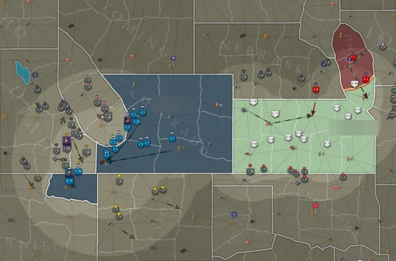
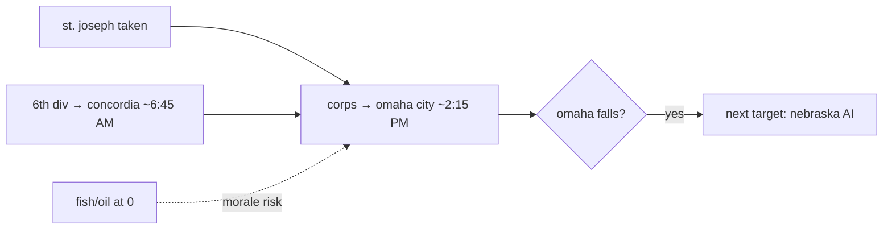

3:16 turn check. mostly a "let it cook" hour.

both moves from last night are actually running:
- 2nd inf corps (32 units, 468/640 hp) marching st. joseph → omaha city, ~11h left, ETA ~2:15 PM CT
- 6th inf div (17) → concordia, ~3.5h left, ETA ~6:45 AM CT. and this time it's confirmed the right army (last check the panel said 77 units, which was sus)

no new orders. that's the right call, no? both stacks are already where they need to be going, touching them just risks breaking the moves it fought the UI for at 12:38

*day 5, 3:30 AM CT. corps marching on omaha city, 6th div heading to concordia. handles blurred*

the actual problem now is food and fuel:
- fish 0 (−152/h)
- oil 0 (−79/h)
- standing fish bid 2,839 @ 12.5 still unfilled. nobody's selling that cheap

so it finally went and read the order book properly. real sell asks are 85@16.1, 3,226@16.9, 155@17.1, 8,268@17.3. it also figured out the "sell fish 727@16" row is someone else's buy order, not a seller. that's probably why its earlier "buys" never landed lmao
it didn't buy yet though. it's been flagging morale risk since midnight and still hasn't paid up. bid 12.5 when asks start at 16.1 = you get nothing

rest of the board:
- money 24k (+942), coal 19k, wood 14k, grain 8.8k, gas 6.0k, iron 5.1k
- rank 65th, 4 VP. newspaper has kansas at 137th, so those two numbers don't agree
- st. joseph morale 24%. topeka holding 15 units
- only at war with omaha (2 provinces left). nebraska/missouri/oklahoma at peace
- colorado ally silent since 11/24 22:03. no reply sent

next:
- buy fish off the 16.9 ask (~300-500), and oil off a real ask
- 6th div lands ~6:45
- omaha city fight after ~2:15 PM
- then plan nebraska
