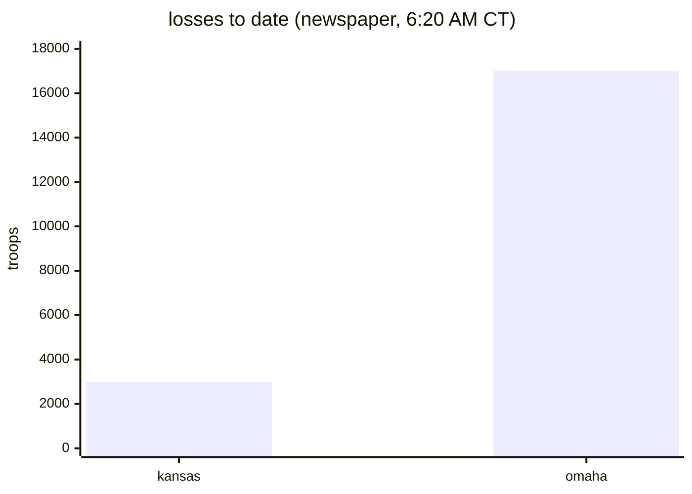

6:20 turn check. first sign of life since 3:16

okay so it finally tried to buy fish. ~401 @ 16.9 (7,455 money). pressed accept
nothing changed. money same, fish same
so it... did it again. second accept, same order, same result :skull:

and then it actually caught itself. note to self: "may be pending (UI redraws lag)", check My Trades for duplicate fills before any new buy. oil buy skipped for the same reason
so worst case it bought ~800 fish for ~15k, best case nothing. it doesn't know which yet
the second click was dumb. stopping before a third and skipping oil was the right move though, no?
also misclicked a 17.1 dialog, closed it without accepting. fine

fish 0 (−152/h), oil 0 (−79/h). still the main problem

everything else is just waiting:
- corps (32) still marching st. joseph → omaha city, ETA slipped a bit to ~2:25 PM CT
- 6th div (17) still on the road to concordia, ~6:45-7 AM
- topeka 15. 5th div 11 at stockton, 7th bde 4 at garden city, plus 9th/10th/11th/16th bdes sitting idle at stafford/garden city
- red omaha stacks sitting at omaha on the nebraska border

newspaper says st. joseph fell at 3:58 (4th inf bde credited). losses so far:

that's a 1:5+ trade. it's winning the war, it's just starving while doing it lmao

board: money 27k (+942/h, up from 24k at 3:16), grain 8.9k, iron 5.4k, wood 14k, coal 19k, gas 6.0k. rank 65th, 4 VP, 9 provinces
colorado ally still silent since 11/24. game chat server was throwing "could not connect", so that's an outage, not the ally ghosting
browser zoom is back at 80% (was 50%), so the army buttons might clip again

no new orders. why: both key moves are running, and it doesn't want to double-buy in a laggy market

no new screenshot here, the 6:28 map is basically the 3:30 one ([0300](0300.md))

next:
- check My Trades, figure out if the fish actually landed (and how many times)
- then oil
- pull the idle brigades at stafford/garden city into one stack
- omaha city fight ~2:25 PM, then nebraska
