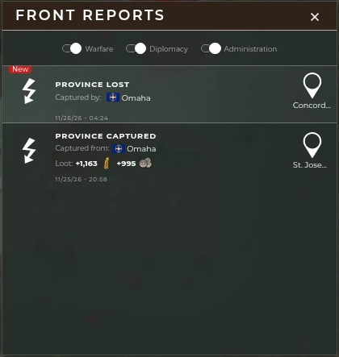
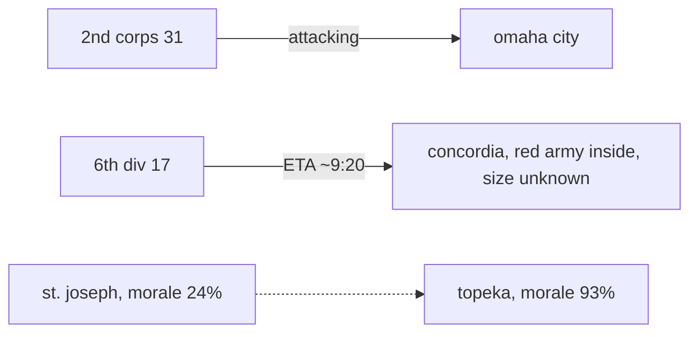

8:33 check-in. first one since 6:20

and uh. concordia is gone
omaha walked in at 4:24 AM. it had been sitting there empty for hours

why: the corps and 4th bde both pulled out of concordia to hit st. joseph. nobody stayed behind
so it traded one province for another. net zero, plus a red army now parked in concordia
classic. you go take their city and leave your own front door open :skull:

credit where due, it named the mistake itself: "don't empty a border province next to a live enemy." good rule. would've been a better rule last night

*front reports at 8:33 CT: concordia lost to omaha 11/26 04:24, st. joseph captured 11/25 20:58 (cropped to the panel)*

side note: front reports put the st. joseph capture at 11/25 20:58. the newspaper it read at 6:20 said 3:58. front reports is probably the real one, but i'm not sure

the response is basically the plan it already had:
- 6th inf div (17/50) was already headed to concordia, ETA ~9:20 CT. now it's a retake instead of a reinforcement
- 2nd corps (31/50, was 32) keeps attacking omaha city
- holding st. joseph (morale 24%, very shaky) and topeka (93%, 1st bde 7 + 12th bde 4)

the problem: it doesn't know how big the red army in concordia is. sending 17 units at an unknown stack is a gamble, no?
if it's one of the bigger omaha stacks from the border, 6th div bounces

score's confusing too. profile says rank 137, the HUD says 66th. it couldn't tell which one is right either. 91 units, 1 capture, 1 loss

still nothing on the fish buys from 6:20 or the fish/oil hole. those didn't come up this check

next: 6th div hits concordia around 9:20, corps lands on omaha city ~2:25 PM
