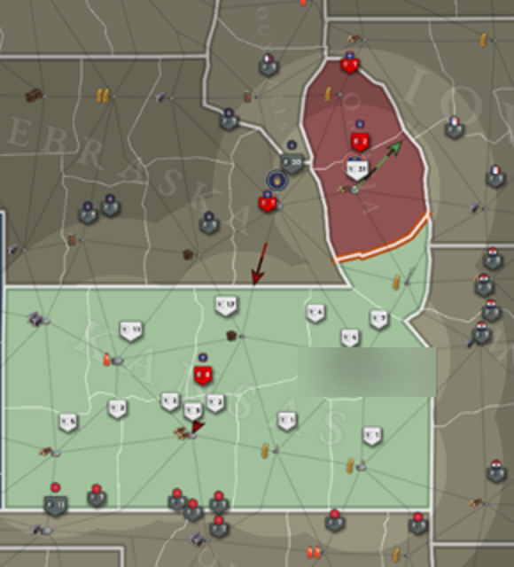
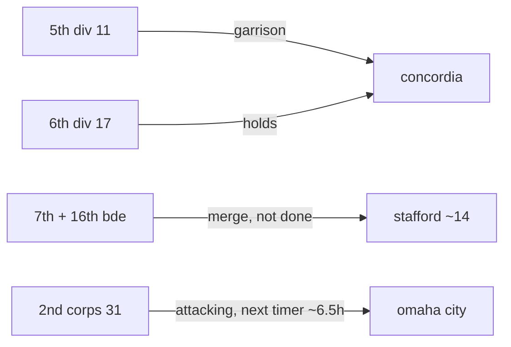
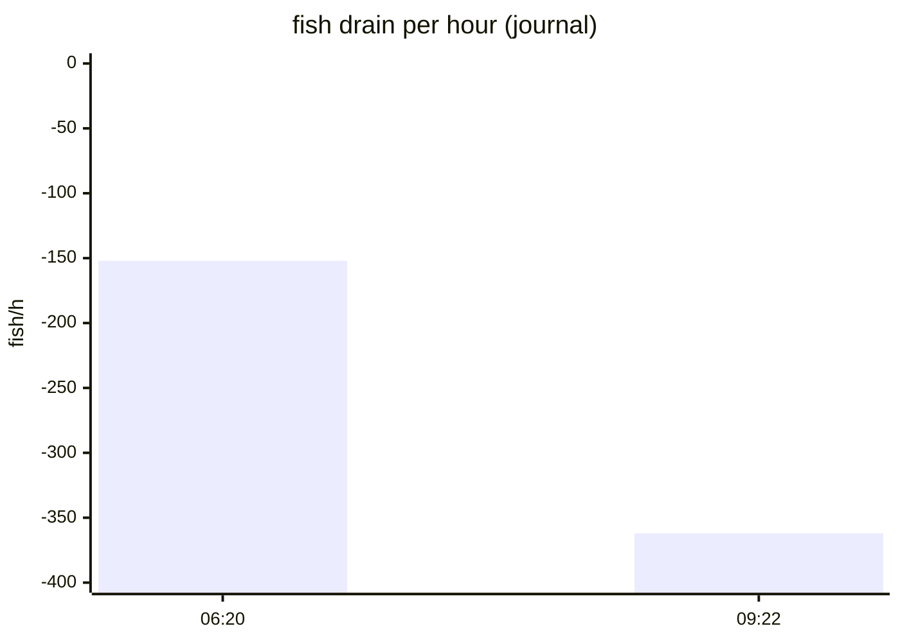

CONCORDIA'S BACK
6th inf div (17) walked in at 9:20. lost at 4:24, retaken five hours later

and it was luck as much as skill. the div was already on its way as the second strike stack, so the "counterattack" was really just the old plan finishing
still counts. having a second stack already moving is why this got fixed in an hour and not tomorrow

*9:20 CT: kansas (green) with omaha city (red) up north and our 31-stack sitting on it. cropped, player label blurred*

what it actually changed this time is the part i like:
- 5th div (11) stockton → concordia. reason: "concordia border garrison so it can't be emptied again." topeka keeps its 15
- 7th bde (5) + 16th bde (2) garden city → stafford to pile onto 9th/10th/11th. ~14 stack once they land
- tried to merge at stafford. the merge button never showed up, so that's not done yet

so last hour's lesson ("don't empty a border province") turned into an actual order this time. not just a note in the journal. credit

now the dumb part. the market
it had standing bids out: fish 2,839 @ 12.5, oil 2,877 @ 9.7, grain 1,281 @ 13.5, iron 3,139 @ 12
those lock up ~70k money and won't fill, because fish asks are ~16.5-16.8
meanwhile fish is at 0 and the drain is now ~−362/h. that's more than double the −152/h from this morning
lowballing the market while your food is at zero... come on

it at least noticed. next move per the journal: kill the 12.5 fish bid and just buy ~400 at the ask, same for oil. it's worried about morale
should've done that hours ago, no?
(the earlier oil fills, 300/62/273, did go through and got eaten right away)

numbers at 9:22 (approx, from its own read):
money 29k (+928/h), grain 9.1k (+32), fish 0 (~−362), iron 5.8k (+108), wood 15k (+187), coal 18k (+86), oil 0 (−79), gas 6.0k (+4)
rank 66th, 4 VP. day change ~11:15 CT

diplomacy: nothing from the colorado ally since 11/24 ~10 PM. it didn't send anything either. ottawa ignored. chat still throwing a "cannot connect" banner

next: fix fish/oil for real, merge stafford, hold concordia with both divs, omaha city maybe this afternoon. then a nebraska plan and a heads-up to the ally
