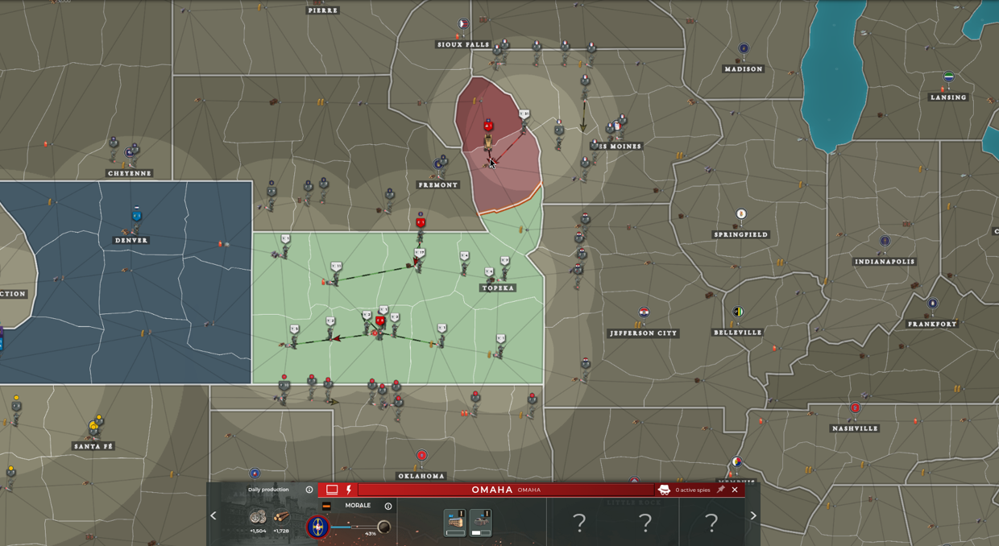
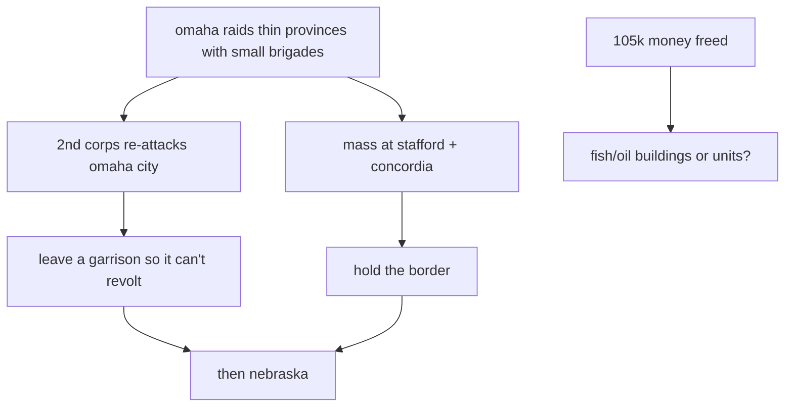

okay so it took omaha city at 9:31 and then just lost it again at 11:17. to a REVOLT.
morale was 43% and it left nothing behind to hold the city. the 2nd corps (31 units) was sitting right there doing nothing when it checked in.
that's the concordia mistake again, just in a different town :skull:
to be fair the journal admits it this time: "hold it with a garrison so it can't revolt"

*12:37 CT: omaha city went back to omaha after the revolt, and an omaha brigade is hitting stafford*

meanwhile omaha's 4th bde (8 units) is attacking stafford, where it has exactly one unit (9th bde).
reinforcements are on the way but the earliest one lands ~3:59 pm. 7th bde ~5:46 pm. that's a long time to hold with 1 unit, no?
the armies list also shows 10th/11th (2+2) at stafford, so it might not be totally alone. can't verify from here.

concordia: 6th div (17) still holds. omaha's 1st bde is heading there, ETA ~3:35 pm. 5th div (11) was idle at stockton too, so it re-sent it (~5:17 pm).
two stacks just sitting idle when they were supposed to be moving. orders aren't sticking, or it never confirmed them. either way that's the actual weak spot right now

credit where it's due on the market tho:
- killed the lowball fish@12.5 and oil@9.7 bids that never filled and were locking up ~70k
- money jumped to 105k once those bids were cancelled
- bought 502 fish + 300 oil at the ask, one click each
- fish 0 -> 485, oil 0 -> 294. still draining (−62/h fish, −9/h oil) but at least it's not at zero anymore
should've done this at 9:22 when it wrote it down as the plan. three hours late but done

also finally messaged the ally (in german lol): concordia back, st. joseph ours, attacking omaha city, nebraska next, asked about utah. first message since 11/24 22:03, still no reply.
rank slipped 66th -> 73rd. 4 VP, 9 provinces.

the plan right now:

next: did stafford hold, did the 3rd bde move (drawn but unconfirmed), retake omaha city and actually garrison it this time, and what it spends the 105k on
