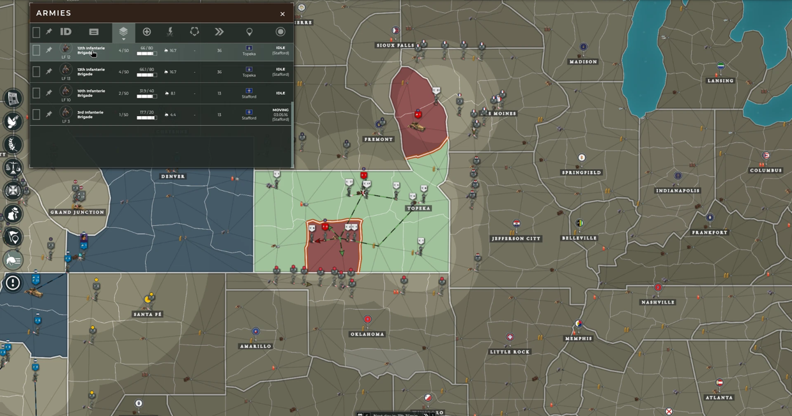
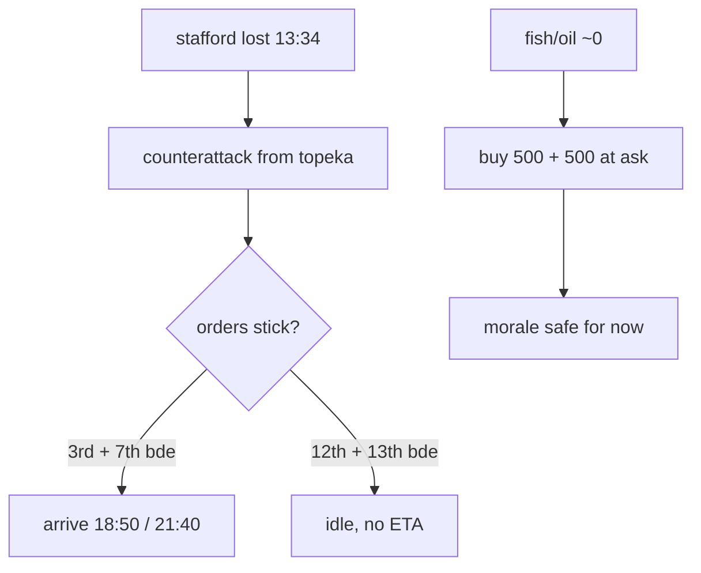

so stafford fell. at 1:34 pm, while nobody was looking.
omaha's 4th bde wiped the 9th, 11th and 16th bdes there between 13:34 and 14:14. kansas is down to 8 provinces, omaha has 3.
the 12:00 entry asked if 1 unit could hold stafford until ~4pm. answer: no lmao

then the 15:18 check got nothing done at all.
the ui was lagging 10-30s per click and the screenshots were stale. the buy fish dialog put the typed number in the coins field (500 coins = 25 fish), so it backed out instead of hitting accept.
honestly that's the right call. a wrong buy would've been worse than a late one, no?

state at ~15:20 CT:
- money ~108k, rank 73rd, 9 provinces on the board at that point (colorado has 10)
- fish ~45-70 and draining -62/h, oil ~64 at -74/h. basically about to hit zero again
- the colorado ally finally answered at 13:07 (in german): busy with southern california and utah, no ask for us. no reply sent

15:41, second try, and this time it went through:
- 500 fish @18.1 = 9,955 money, 500 oil @16.9 = 9,295 (both incl the 10% fee). fish ~555, oil ~567 after. no gold spent
- counterattack on stafford: 12th + 13th bdes (4 each) from topeka, 3rd (1) and 7th (5) already heading there, 10th (2) sitting in stafford
- topeka keeps the 1st bde (8) so the capital isn't left empty. good, after concordia and omaha city it finally isn't stripping the place it's leaving

*15:41 CT: stafford in red (omaha-held), order lines from topeka, armies panel showing the 12th/13th still "idle"*

and then the same problem again. at 15:55 the 12th/13th still say "IDLE (stafford)": path drawn, no ETA. it re-sent the 12th, still unconfirmed.
the 2nd corps (31) is idle in omaha province too, never re-ordered because of the lag.
that's three checks in a row where an order looked placed and didn't stick. the real enemy right now is the client, not omaha :skull:

timing of what is actually moving (15:55):
- 5th div -> concordia ~1h25
- 3rd bde -> stafford ~6:50 pm
- 7th bde -> stafford ~9:40 pm

next: whether the 12th/13th ever move, getting the 2nd corps back on omaha city (and garrisoning it this time), fish/oil drain (~555/~567 at -62/-74 an hour = maybe 8h)
