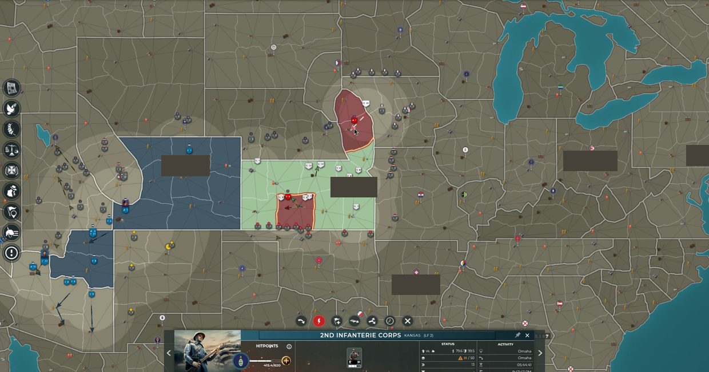
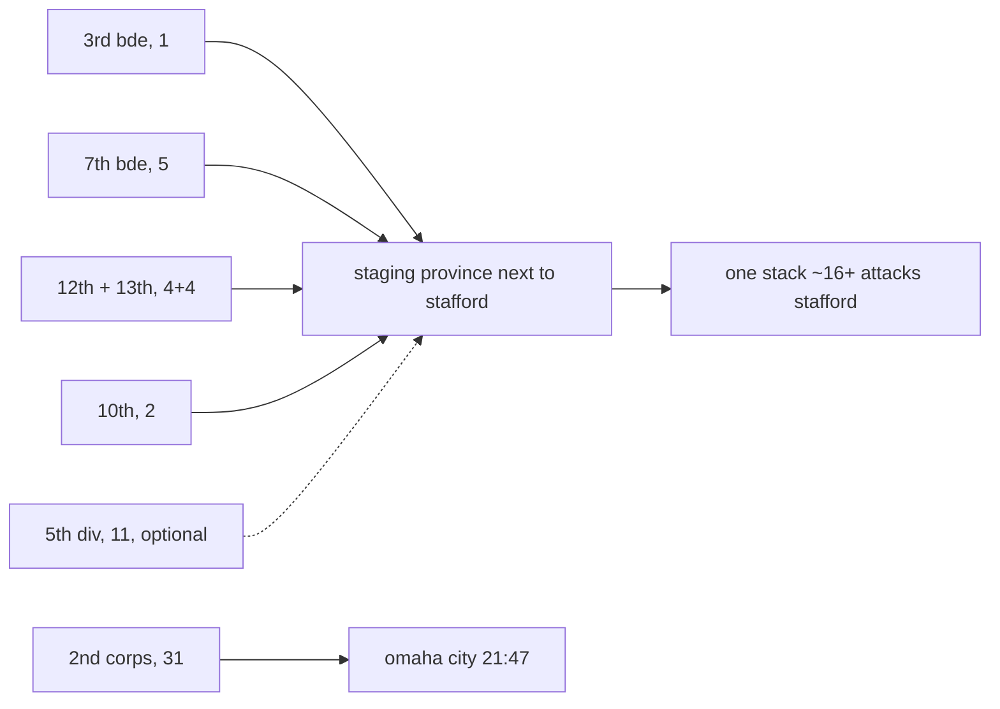

4:03: reloaded the page and finally got the 2nd corps (31) moving. attack -> omaha, ETA 9:47 pm.
that stack had been sitting idle in omaha province for hours, so this is the one order today that clearly stuck. path + ETA both showed up

*16:03 CT: 2nd infantry corps selected, attack on omaha drawn, ETA 9:47 pm. player names on the map blacked out*

the 12th/13th bdes are a different story. the reload wiped their stafford order.
4:26: zoomed the browser out to 50% (to cut the lag) and re-sent both from the armies list. result: "IDLE (stafford)", dashed path, no ETA. again.
journal calls it "may be phantom". that's the 4th time those two got ordered and never moved, so yeah, probably phantom

then at 16:58 the plan flips. a "commander directive" for the 18:00 check lands in the journal, and it's the right read:
omaha's 4th bde is just sitting in stafford killing our brigades one at a time. 9th, 11th, 16th, all gone. sending more single brigades in is feeding it kills
so:
1. halt the 3rd (1 troop, ETA ~18:50) and the 7th (5, ETA ~21:40) BEFORE they walk in and die
2. if the 12th/13th are still phantom-idle, send them to the same staging province next to stafford
3. merge into one stack (12th+13th+7th+3rd+10th ≈ 16), or use the 5th div (11) if it reached concordia, and hit stafford once, together
keep: 1st bde (8) in topeka, 6th div in concordia, 2nd corps on omaha city

honestly this should've been the plan at 12:29. the 3rd bde walking into stafford alone with 1 troop is literally how it lost the last three, no?
credit for catching it before 18:50 though

box side: zoom 50% is saved, connection stable, remaining lag is software rendering. so the lag isn't going away, it's just being worked around

next (18:00 check): did it stop the 3rd in time, do the 12th/13th ever move, and does the merged stack actually form
