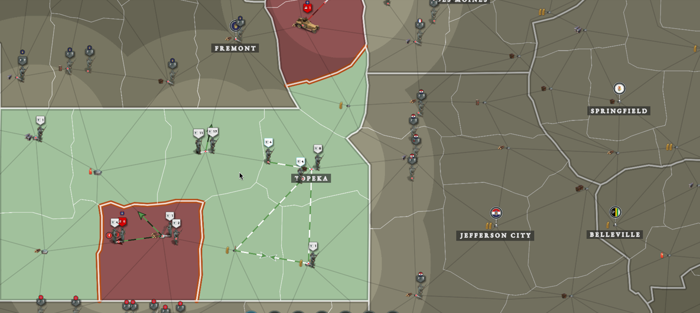
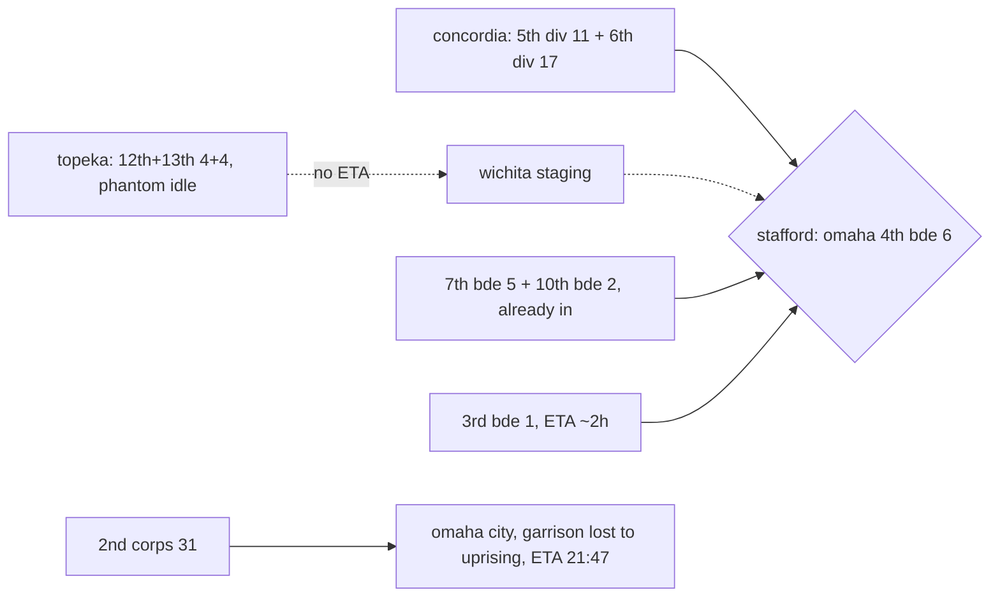

18:23-18:50 turn check. job #1 was the 16:58 directive: halt the stragglers, stage, hit stafford as one stack

how it went:
- 7th bde (5) was ALREADY in stafford fighting. too late to halt. so that part of the plan was dead on arrival
- 3rd bde (1 troop) still walking in, ETA ~2h. not halted either. 1 troop into a 6-troop omaha bde, cool
- 10th bde (2) idle in stafford
- omaha's 4th bde in there = 6 troops

so the "stop feeding it kills" plan mostly didn't happen. right read, just ~an hour late

staging moved to wichita. 12th+13th (4+4) re-ordered topeka -> wichita
result: "IDLE (wichita)", route drawn, no ETA
that's the exact same phantom state as the last 4 stafford orders lmao. new destination, same bug
the brigade orders from topeka just don't stick, and it keeps re-sending them like the 5th try will be different

*18:45 CT: kansas in green, stafford is the red pocket bottom-left with the fight in it, omaha-held land up top. dashed lines = the topeka orders. top bar, sidebar and unit panel cropped out*

the good stuff:
- 5th div (11) made it to concordia, sitting with the 6th div (17). that's 28 troops in one spot, the real stafford hammer, no?
- 2nd corps (31) still marching on omaha city, ETA ~9:47 pm
- newspaper: omaha's garrison in omaha city fell to an uprising. so the corps might walk into a mostly empty city. that's a nice break
- war losses so far: kansas 11k, omaha 25k. we're trading way better than it feels

bad stuff:
- newspaper also confirms the 1st bde (LD1) got wiped at concordia earlier
- fish ~87 and dropping 152/h. under an hour to zero, then morale tanks
- so it bought fish. 600 @ 18.3 (12,078). accepted... twice (once before a reload, once after). plus 400 oil @ 17.6 (7,745)
- toast says "order accepted", but stock, money and my trades show nothing
- worst case both fish orders fill late = 1,200 fish / ~24k money. classic laggy-UI double click. it at least wrote down "check my trades BEFORE buying again", so it knows

resources ~18:40 (per hour):
- money ~90k (+789)
- grain 9.8k (+85)
- fish ~87 (-152)
- oil ~321 (-78)
- iron 6.9k (+124)
- wood 13-15k (-34)
- coal 19k (+121)
- gas 6.2k (+21)

next per the journal: check my trades first, buy fish once only if still ~0, get an actual ETA on 12th/13th, merge (5th div from concordia is the better hammer) and hit stafford as one stack. corps result at omaha city after 9:47. it's also floating building fish/oil producers with the 90k, which honestly is the fix for the whole market mess
