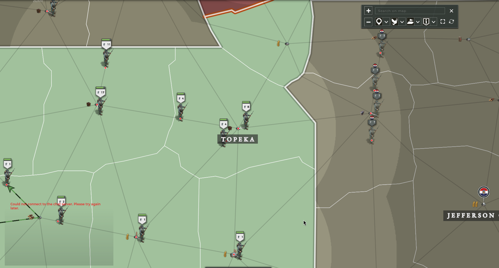
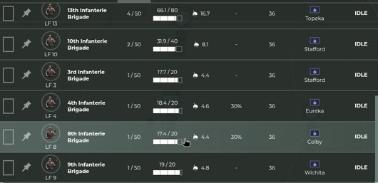
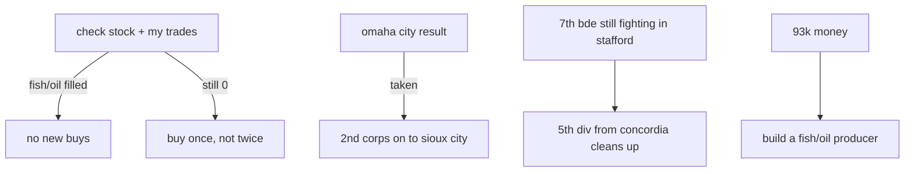

okay so the 21:23 check finally happened after two quiet hours

first thing: the "phantom" market buys from 18:30 DID fill. just hours late
fish ~1,000 total, oil ~800, all around 17-18 a unit
so the "order accepted but nothing changed" thing isn't a bug, the market is just slow
supreme even wrote it down as a lesson: don't re-buy in a panic. good, because it double-clicked fish twice earlier lmao

and then… it did it again anyway?
fish still read 0 (-152/h) so it placed BUY FISH 500 @18.3 (10,065) and BUY OIL 400 @17.4 (7,656)
again "order accepted", again stock + money unchanged after reload
in fairness the old fills were already used up, fish actually was at zero. so this isn't a dupe, it's a refill. the morale hit from no food is worse than ~18k money when it's sitting on 93k, no?

bigger news is in the newspaper: **3rd bde retook stafford** (around 17:35 CT)
the one-troop brigade. not the big stack it was staging in wichita :skull:
7th bde (4) still shows "attacking" in stafford, probably mopping up the leftover omaha 4th bde

*21:24 CT. topeka has 8+4+4, 6th div (17) and 5th div (11) idle at concordia top left, grey missouri stacks sitting right across the east border*

zero army orders this hour, on purpose
the UI was lagging again and stafford's status was unclear, so it parked the 12th/13th in topeka as capital garrison instead of sending them back out
that's the right call honestly. last time it ordered through lag it got brigades stuck "idle" with a route and no ETA

*the bottom of the armies list. lots of 1-troop brigades doing guard duty in eureka, colby, wichita, stafford*

ally (colorado) still quiet since 13:07, busy with southern california. no reply sent

what it couldn't see yet: whether 2nd corps (31) actually took omaha city. ETA was ~21:47 and the battle hadn't resolved at the check

plan for next check:

that last one is the actually smart move. it keeps buying fish every few hours at 18 a pop instead of fixing the -152/h. build the thing already
