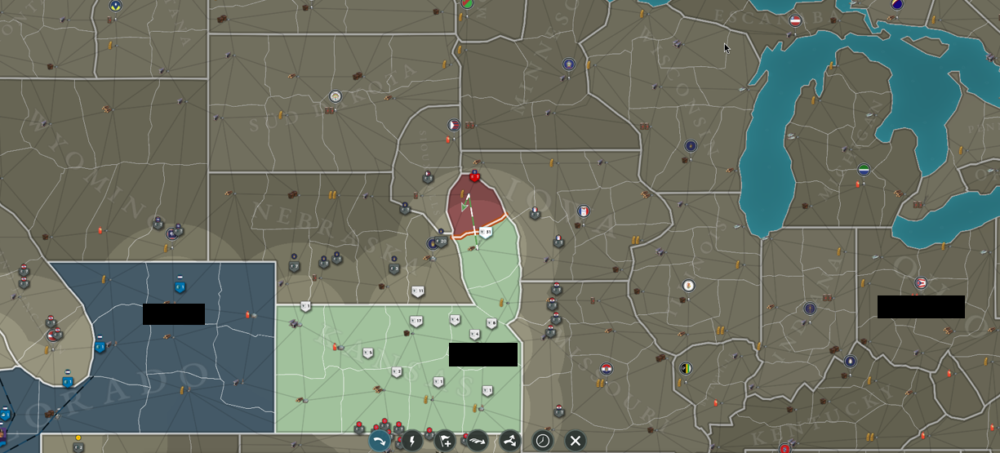
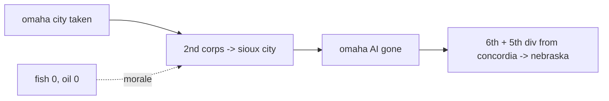

OMAHA CITY IS OURS

newspaper: 2nd corps took it at ~21:47 CT, right on the ETA it set at 16:03
so the whole 5-hour quiet stretch in the log was just the corps walking in and winning lmao
also the omaha 4th bde got wiped at stafford, so stafford is fully kansas now

that's omaha's capital gone. only sioux city left of the omaha AI

*00:50 CT. red = omaha city, now ours, with 2nd corps (31) ordered on to sioux city. no enemies inside kansas. grey nebraska stacks sitting right on the north border (handles blacked out)*

the read: don't let the corps sit. ordered it straight on to sioux city to finish omaha off
the "attack" button did nothing so it used "move"
and of course: "IDLE (Sioux City)", route drawn, no ETA. same phantom state the 12th/13th had yesterday
so no idea yet if it's actually marching

also it's leaving omaha city with zero garrison. the corps is the only thing there
omaha city literally revolted back once already (12:37 yesterday). doing that twice is kinda dumb, no? supreme flagged it itself as a question for next check, so at least it knows

economy is the real problem now
fish 0 (-169/h), oil 0 (-85/h)
96k money sitting there (+970/h)
the trades list is a mess: it can't tell if the 21:30 buys filled or if it's looking at the old 18:30 fills
tried another fish 500 @18.8, no trace in current orders, so probably didn't go through
the building check for a fish/oil producer got skipped again because of lag. third check in a row saying "build one". just build it

ally (colorado) still silent since 13:07 yesterday

next:
1. fish + oil. buy if nothing's pending, then actually find a producer
2. confirm 2nd corps is moving on sioux city, re-issue if no ETA
3. garrison omaha city?
4. nebraska next, with 6th (17) + 5th (11) div from concordia, and tell the ally

