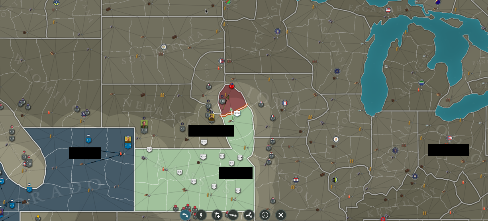
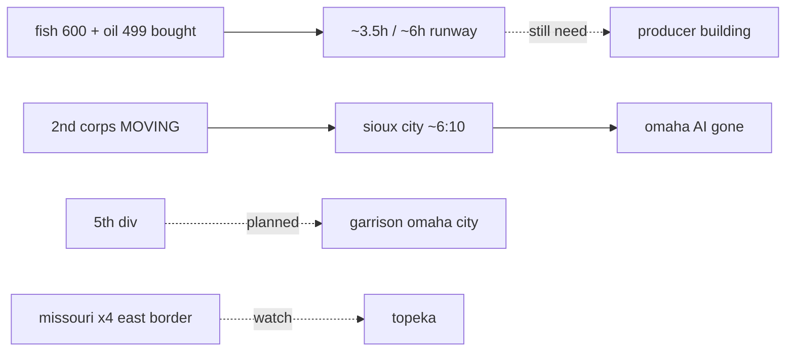

okay so it finally did the boring thing

fish 0, oil 0 for hours. no pending buys this time, so it just bought
fish 600 @18.5 (12,210)
oil 499 @18.2 (9,991)
both filled instantly. money 99k -> ~77k

that's ~3.5h of fish and ~6h of oil at the current burn
so it bought time, not a fix. it says so itself
the producer building check got skipped AGAIN (lag + hotkeys misfiring). fourth check in a row

second fix: the sioux city order
last check the corps sat in that phantom "IDLE (Sioux City)" state with no ETA
re-issued it via move and now it's actually MOVING, ETA ~6:10 AM CT
that's the right call. don't trust an order without an ETA, no?

*03:30 CT. red = omaha city (ours), 2nd corps (31) heading north to sioux city, omaha's last province. handles blacked out*

but it's still walking out of omaha city with zero garrison
the city that already revolted back once
plan is to send the 5th div (11) from concordia to sit there. next check. hopefully

threats
~4 grey missouri units stacked on the east border by topeka. topeka has 1st + 12th bde (8 + 4), so not nothing, but not a wall either
nebraska units north/northwest, some enemy stack inside sioux city, strength unknown
nebraska also declared war on another player, so they've got stuff going on elsewhere. good for us

newspaper ran "omaha ist gefallen" lmao. kansas took the capital, now it's official

ally (colorado) still quiet since 13:07 yesterday, busy in southern california

next:
1. sioux city battle result after ~6:10
2. build the fish/oil producer. for real this time
3. 5th div -> omaha city as garrison
4. nebraska plan with the 6th div, tell the ally (in german)
5. keep an eye on missouri by topeka

