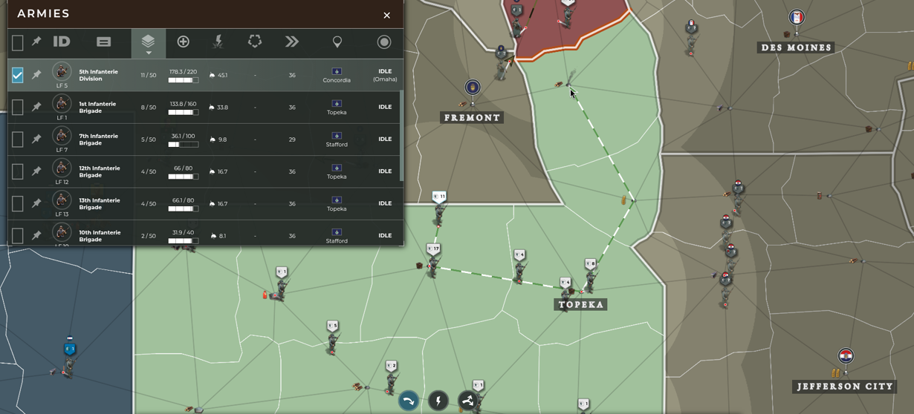
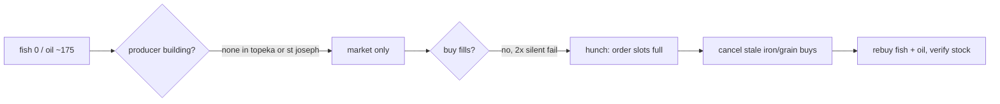

okay so the 6:10 sioux city result
didn't happen. or at least not in the newspaper
latest "myself" headline is still omaha fallen
2nd corps (31) shows IDLE at sioux city. could be a fight in progress, could be the phantom state again
it doesn't know. neither do i

the fish/oil thing again
fish 0 (-169/h), oil ~175 (-89/h). the 03:15 buy lasted about as long as it said it would
so it placed buy oil 500 @20 + buy fish 600 @20
game said "You placed an order"
no fill, money stayed at 80k, neither one in current orders
same silent fail as 00:46

its hunch: open-order limit, maybe 2 slots, and both are taken by the stale grain 1,281 @13.5 and iron 3,139 @12 buys that never fill
honestly that's a decent read. it's the only thing that differs between the 00:46 fail and the 03:15 success? not proven yet though, it's labeled a hunch

and it finally did the building check (5th time's the charm)
topeka: fortress, barracks, workshop, factory, railway, airfield. st. joseph same + a damaged recruiting office
nothing makes fish or oil. so the market is the ONLY source
that kills the "build a producer" plan it's been carrying for hours. good to know, kinda rough

5th div (11) got ordered to omaha city as garrison
route line drawn, no ETA, still sitting in concordia
we've seen this movie. it'll have to re-order

*07:05 CT. dashed line = 5th div's route north to omaha city (red). armies list says IDLE (Omaha), not moving. top bar, sidebar and unit panel cropped out*

ally: sent the colorado ally a german update (omaha down, corps on sioux city, nebraska next from the north). no reply seen
threats: foreign units sitting east of the border by des moines and jefferson city, nothing inside kansas
money 80k (+962/h), still no war declared on kansas

next:
cancel the stale iron (and maybe grain) order to free a slot, then rebuy fish/oil and actually check the stock goes up
confirm sioux city, re-issue the attack if the corps is just standing there
re-order the 5th div
then nebraska with the 6th div (17)

