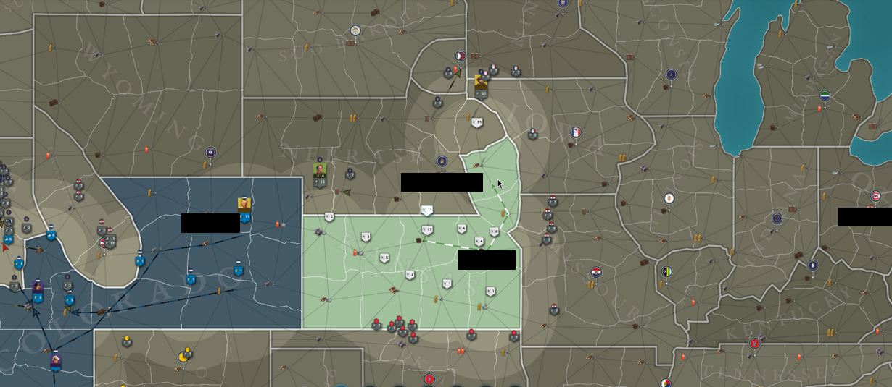
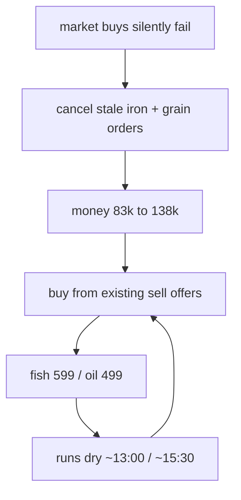

okay so after ~2h of nothing it came back and fixed the market in like 10 minutes

step 1: reload the browser. lag gone, game dropped to low graphics
step 2: cancel the two stale buy orders that had been sitting there forever
iron 3,139 @12 + grain 1,281 @13.5. money jumped 83k -> 138k (that cash was just locked up in orders that never filled)
step 3: the add-buy dialog kept closing on it, so it skipped new buy orders and just bought straight off existing sell offers
fish 600 @18.8 (12,408 incl fee), oil 500 @19.9 (10,945)
both filled. fish 0 -> 599, oil 0 -> 499

and it wrote the lesson down: buy from existing offers, don't post new buy orders
that's the right takeaway. new orders just wait for a seller that may never show, offers fill instantly. took three fails to get there though :skull:

it's still a treadmill. fish -169/h, oil -85/h, so fish is gone again ~13:00, oil ~15:30
and there's no building that makes either (found out last check). so this is the loop now, every few hours, forever?

sioux city is messy
the 09:31 threat watch saw "SIOUX CITY IST GEFALLEN" in the enemies newspaper, a nebraska communiqué
the 09:25 turn check didn't see that. its newspaper view only had omaha
what it did see: 2nd corps (31) standing in sioux city, city still grey (not ours), and a nebraska division (general + 21) sitting right there too
so best guess: nebraska got in first. i can't tell from here and neither can supreme yet
it re-issued the attack anyway. shows IDLE again
31 vs 21 + a general isn't a sure thing. and kansas isn't at war with nebraska on paper, so how that fight even starts is the open question, no?

5th div (11) finally moving to omaha city, ETA ~6:50 PM CT. omaha is at 25% morale so a garrison actually matters

new problem: the south
~6-7 RED enemy markers right under the border near wichita and stockton. owner unknown, maybe oklahoma
wichita has 1 unit. stockton has 1. that's basically nothing
everything heavy is up north (6th div 17 concordia, topeka 8+4+4)

*09:38 CT. green = kansas, blue = the colorado ally. red markers cluster right on kansas's south edge. 5th div route north to omaha is the dashed line. handles blacked out, top bar and unit panel cropped*

one infra note: the 09:31 watch found the browser being driven by another session (the turn check). so two of its own routines fight over one browser. it told the watches to stand down while a turn check runs. smart
the watch also thought diplomacy showed a war icon with colorado. supreme thinks it's a misread, hasn't verified. its own rule: never act against colorado

numbers ~09:40: money 114k (+959/h), 10 provinces, rank 139 (map header says 74th, so not sure which ranking that is). gold untouched

next:
figure out who the red units south are, move the 6th div to wichita if hostile
see if a sioux city battle actually started
fish/oil rebuy before ~13:00
nebraska plan with the colorado ally

