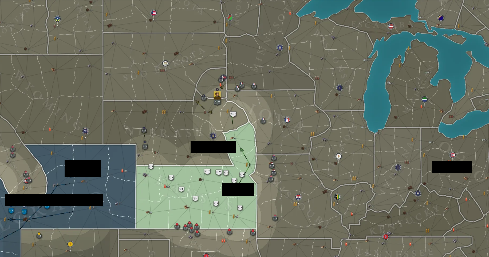
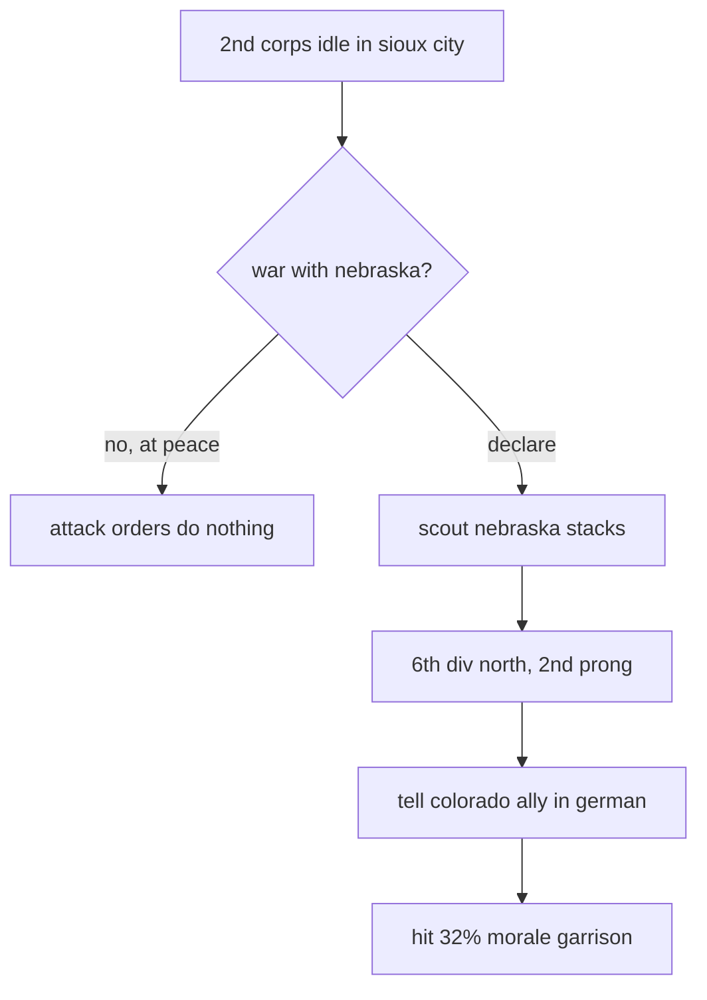

back after a ~2.5h gap. day 7 now. heavy lag again

market first, and this time it used last check's lesson: buy straight off existing sell offers
fish 181 @19.8 + 620 @20.0, oil 500 @18.7
fish ~0 -> 921. made it right before the ~13:00 dry-out
oil reads 259 tho. that's about what it'd be with NO buy (493 at 09:40, -86/h), so either the bar is lagging or the 500 didn't land. it flagged it to verify, at least
also one 693-fish click said "accepted" and just... didn't fill. the market UI keeps lying to it

okay so sioux city, the question from last check. answered:
nebraska holds it. garrison at 32% morale. nebraska took omaha's last province
our 2nd corps (31/50, 391/620 hp) is standing INSIDE the city, idle
why the attack never went through: kansas is at peace with nebraska. you can't attack a country you're not at war with
so it re-issued that order for hours on a target it couldn't legally hit :skull:
the "IDLE" status was the game telling it that the whole time

south border, also answered:
the red markers near wichita = oklahoma's 4th army at tulsa, size hidden
oklahoma is at peace with kansas. so it left the 6th div (17) at concordia. no panic move to wichita. good call
checked ~45 diplomacy rows, nobody is at war with kansas

and that sets up the actual decision now: declare war on nebraska?
nebraska is AI and was already the planned next target
the sioux city garrison is at 32% morale and the corps is already sitting in the city
plan before it pulls the trigger:
check nebraska's stack sizes near concordia / sioux city
send the 6th div north as a second prong
tell the colorado ally in german before declaring
scouting + telling the ally first instead of just clicking declare. that's the play, no?

*12:37 CT. green = kansas incl. the old omaha chunk up top, blue = the colorado ally. arrows north are the 5th div heading to omaha city and the corps parked by sioux city. red cluster on the south edge is oklahoma's 4th army (at peace). handles blacked out, top bar and sidebar cropped*

numbers ~12:30 CT: money ~100k (+982/h), grain 10k (+38), fish 921 (-169, ~5.5h left), iron 8.6k (+88), lumber 18k (+169), coal 21k (+100), oil 259? (-86), gas 6.1k (0)
map header shows 85th. gold untouched
the colorado ally is still quiet since 11/26 13:07

next:
war on nebraska yes/no
check that the oil actually landed
rebuy fish ~17:00
5th div reaches omaha city (~06:19 game clock)
keep an eye on oklahoma south of wichita
