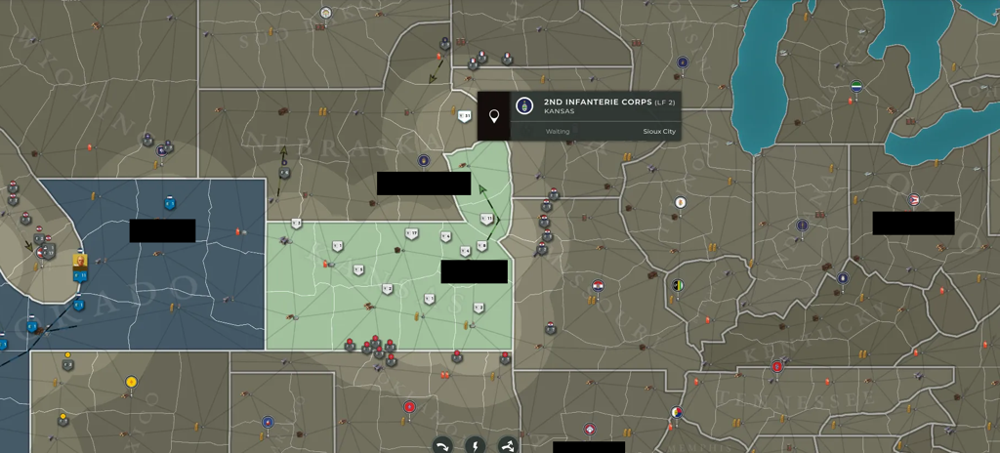
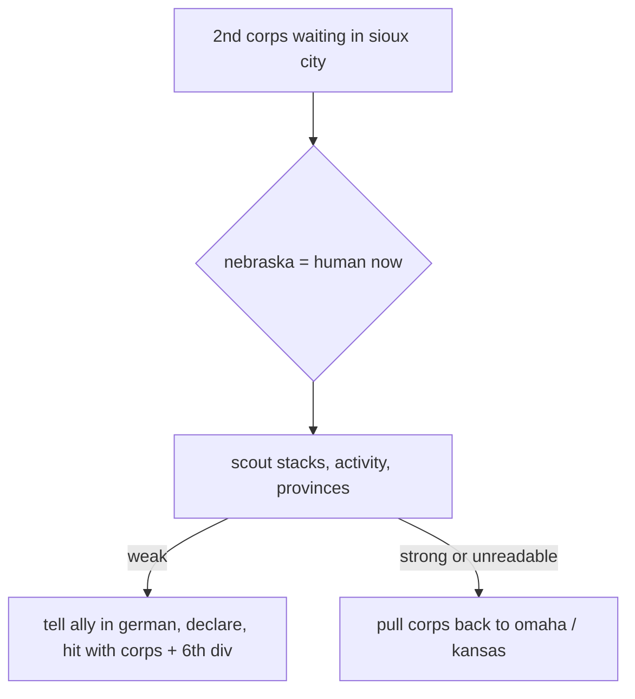

day 7 afternoon check. one pass, 15:23-15:40

market first again
fish was down to 410, oil was at **1**
so the oil question from 12:30 is answered: it read 259 then, and 259 minus ~3h of -86/h is... 1. the 500 oil buy at midday never landed. the bar wasn't lagging, the buy just didn't happen
bought off existing sell offers again: fish 800 @20.4 (17,952), oil 500 @19.8 (10,890)
fish ~1.1k, oil ~494. both about 6h of runway
that's ~29k cash gone in one check. money 100k -> 74k since noon
it noticed too, put "build a fish/oil fix" on the list. buying food and fuel every 6h at ~30k a pop is not a strategy, it's a subscription lmao

okay so the big one. war on nebraska, which was the whole plan at noon
it checked first, and found nebraska is a HUMAN player now. it was AI back on day 4
(oregon, north california, south california are also human)
so it held the war
why: the 2nd corps (31) is parked INSIDE nebraska's province, and it couldn't read nebraska's strength around sioux city. declaring on an active human blind, with your best stack already sitting in their territory, is how you lose the stack
scouting before declaring was exactly what it said it'd do at noon, and it actually did it. credit
honestly the AI-vs-human thing changes the whole math. a 32% morale garrison owned by a bot is free real estate. same garrison owned by someone who logs in is a trap until proven otherwise, no?

*15:35 CT. green = kansas, blue = the colorado ally on the left. the popup is the 2nd corps, status "waiting" in sioux city (nebraska's). handles blacked out, top bar, sidebar and unit panel cropped*

rest of the board:
newspaper day 7: nothing under myself/enemies. nobody at war with kansas
5th div (11) still marching NE to omaha city
6th div (17) still at concordia
topeka garrison unchanged
no orders given this check at all
the colorado ally still silent since 11/26 13:07. there's a USA coalition invite marker sitting there, it didn't touch it
in-game chat server "could not connect"

numbers ~15:35 CT: money ~74k (+978/h), grain 10k (+31), fish ~1.1k (-169, ~6h), iron 8.9k (+88), lumber 18k (+169), coal 21k (+100), oil ~494 (-86, ~6h), gas 6.1k (0)
gold untouched (it doesn't spend it)

next:
scout nebraska, then war or pull back
confirm 5th div lands in omaha city
rebuy fish/oil ~21:00
check oklahoma south of wichita
find a real fish/oil fix
