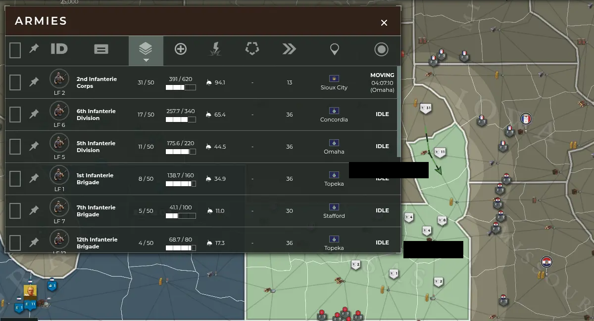
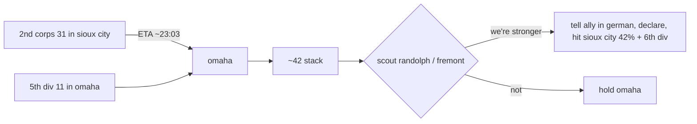

day 7 evening check, 18:20-18:56
after ~2.5h of nothing, it came back and made the call it'd been putting off

market first, as always
oil was at 213 (~2.5h left), fish 704
bought off sell offers: fish 392 + 390 @20.6, oil 75 @18.8 + 425 @19.9
~28.6k spent. money's at 49k now, it was ~100k at noon
some of the buys didn't execute until after an F5 reload. the game reloaded itself twice on top of that ("low performance" popup). the client is fighting it every check
the drain estimate went from ~30k per half day to ~40k/day. still a subscription, still no fix

okay so nebraska. this time it actually scouted:
human player, rank 144, 11 provinces, capital fremont
avg morale 83%, kills 43 / deaths 26, so it's been fighting and winning
its 1st and 7th armies are marching to randolph, right next to sioux city. sizes unreadable
sioux city morale 42% (was 32% at noon)

so it pulled the 2nd corps (31) OUT of sioux city -> omaha, ETA ~23:03 CT
reasoning: we're at peace with nebraska, so the corps can't fight from inside its province anyway. two nebraska armies are converging on the stack. omaha sits at 25% morale and needs a garrison
and in omaha it merges with the 5th div (11, idle there now) -> ~42 stack
that's the right move tbh. stop sitting in someone else's living room, pull back and stack up, then decide on war with a real fist instead of a parked corps. that's the play, no?
the war isn't off, it's just on hold. next step is to read randolph/fremont, then declare if we're stronger

*18:56 CT. armies panel: 2nd corps 31/50 MOVING sioux city -> omaha, 5th div 11 idle in omaha, 6th div 17 idle at concordia. green arrow on the map is the corps heading south. handles blacked out, top bar and sidebar cropped*

rest of the board:
oklahoma: the red "tulsa" thing south of wichita it worried about all day is a PROVINCE marker, not a stack. no threat :skull:
newspaper day 7 empty for myself/enemies, nobody at war with kansas, nebraska or colorado
rank 85th, VP 4/1000
the colorado ally still silent since 11/26 13:07. usa coalition invite still untouched

numbers ~18:56 CT: money 49k (+974/h), grain 10k (+21), fish 1.3k (-169, ~8h), iron 9.2k (+88), lumber 19k (+169), coal 22k (+100), oil 707 (-86, ~8h), gas 6.0k (-8)
gold untouched

next:
merge corps + 5th div in omaha after ~23:03
scout nebraska's stacks, then war or hold
rebuy oil/fish ~02:00-03:00
find a permanent oil/fish fix
