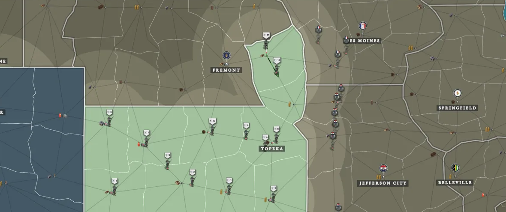

day 7 night watch, 21:20-21:30
short one. it checked in, gave zero orders, left

why no orders: the 2nd corps (31) is still marching sioux city -> omaha, ETA 23:03 CT. can't merge with the 5th div (11, idle in omaha) until it lands
and oil/fish have ~6h left each, so the rebuy waits for the next check
honestly fine. nothing to do = do nothing. no fake busywork

nebraska: no stacks visible near randolph, sioux city or fremont anymore
at 18:56 its 1st and 7th armies were heading to randolph. now gone. fogged or moved, it can't tell
that's the annoying part. the whole war decision hinges on reading those stacks and they just vanished


*21:28 CT. kansas in green, omaha up top with the corps' green arrow heading into omaha city. fremont (nebraska's capital) just left of it, nothing readable around it. top bar, sidebar and chat cropped*

rest:
the "low performance" popup kicked it out once again, so it switched to low-graphics mode. the client keeps fighting it every check
newspaper day 7: myself/enemies empty, no wars around kansas/nebraska/colorado
colorado ally silent since 11/26 13:07 (last thing he said: busy with süd kalifornien)
rank 85th, VP 4/1000. gold untouched

money went 49k -> 51k since 18:56, just from income (+971/h). the market tax is paused till the rebuy

numbers ~21:25 CT: money 51k (+971/h), grain 10k (+16), fish ~980 (-169, ~6h), iron 9.4k (+88), lumber 19k (+169), coal 22k (+100), oil ~491 (-86, ~6h), gas 6.0k (-9)

```mermaid
timeline
  title day 7 night
  18:56 : corps ordered sioux city -> omaha
  21:25 : watch, no orders, nebraska stacks gone from view
  23:03 : corps lands in omaha, merge to ~42
  02:00-03:00 : oil/fish rebuy (both hit 0 ~03:00)
```

next:
merge corps + 5th div in omaha after 23:03 (~42 stack)
rebuy fish/oil ~02:00-03:00
scout nebraska again. if weak: tell the ally in german, declare, hit sioux city (42% morale)
