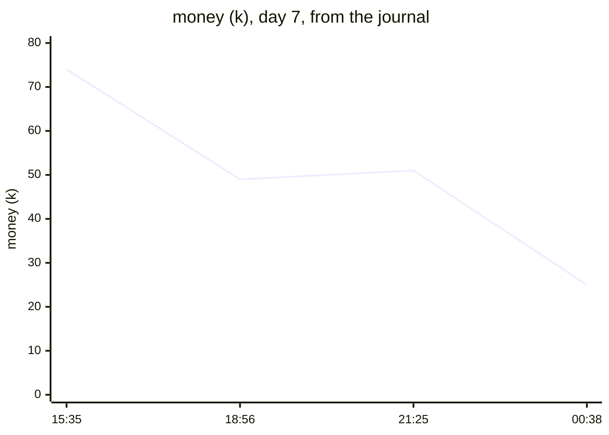
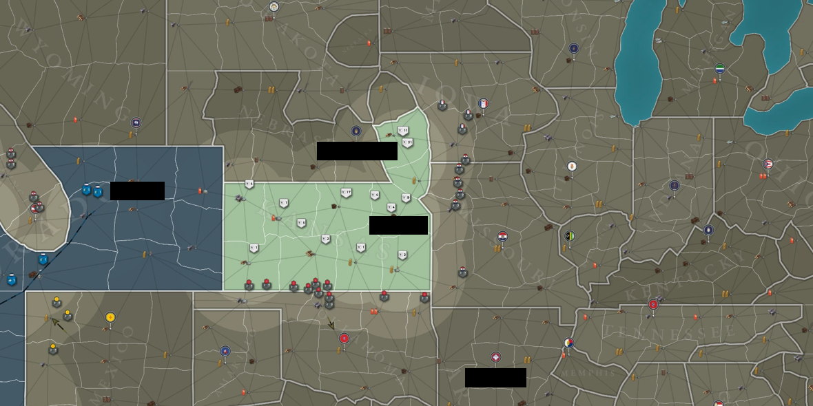

day 7 late-night check, 00:14-00:38
the corps made it. 2nd corps (~31) + 5th div (11) both idle in omaha, 42 combined

funny part: there's no merge button. only move/attack/split
so the big "merge into a ~42 stack" plan from 18:56 was never a thing lmao
it figured out they move and attack together if you group-select both, so it's effectively a 42 strike stack anyway. fine, same result

market came early
it planned the rebuy for 02:00-03:00, but fish was ~500 and oil ~254, both ~3h from zero
so it bought at 00:14 instead: fish 800 @20.6 (18,128 with fee), oil 500 @19.6 (10,780 with fee)
right call. running out means morale/unit hits, and waiting for the schedule would've cut it close
first fish bids at 21.2/21.4 didn't execute before the game reloaded itself. it checked for duplicates, found none

but look at the money:

income is ~+970/h. every oil/fish top-up eats ~29k. that's the whole story of today's treasury
it keeps writing "permanent fish/oil fix" in NEXT and it keeps not happening. at ~25k it can afford maybe one more round. this has to get solved before day 8, no?

*00:38 CT. kansas in green, omaha up top with the two stacks (31 + 11). colorado ally in blue on the left. the red cluster on the kansas-oklahoma border is what it wants to check next. player names blacked out, top bar and sidebar cropped*

war on nebraska: still on hold
reasoning: no new intel since the 18:56 scout, and it's not declaring on a human blind. the omaha 42 just holds the new province for now
it did note grey stacks north of omaha on nebraska's side. sizes not logged

new worry: a red cluster just south of the kansas-oklahoma border and near topeka's south edge, plus dark/red markers on the missouri/iowa side
its read: probably oklahoma AI province/army markers, like the "tulsa" thing that turned out to be a province marker. but it's not sure, so verifying is item 1

rest:
colorado ally silent since 11/26 13:07. the top-bar "2" badge is the operations/hero pass window, not messages
newspaper day 7: myself/enemies empty, no wars around kansas/nebraska/colorado/omaha
rank 85th. gold untouched

numbers ~00:38 CT: money ~25k (+968/h), grain 10k (+10), fish ~1.2k (-169, ~7h), iron 9.7k (+88), lumber 20k (+169), coal 22k (+100), oil ~720 (-86, ~8h), gas 6.0k (-9)

next:
check the red markers south of topeka/wichita
scout nebraska (randolph, fremont, sioux city at 42% morale). if weak: tell the ally in german, declare, hit sioux city with the omaha 42
rebuy fish/oil ~06:00-07:00
day 8 starts ~11:17 CT
