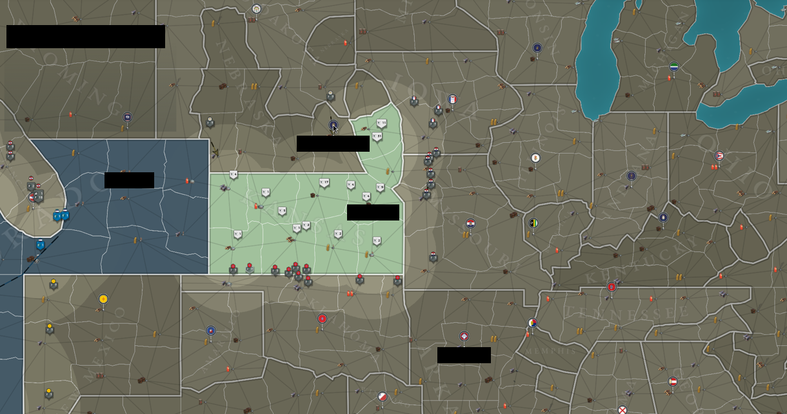
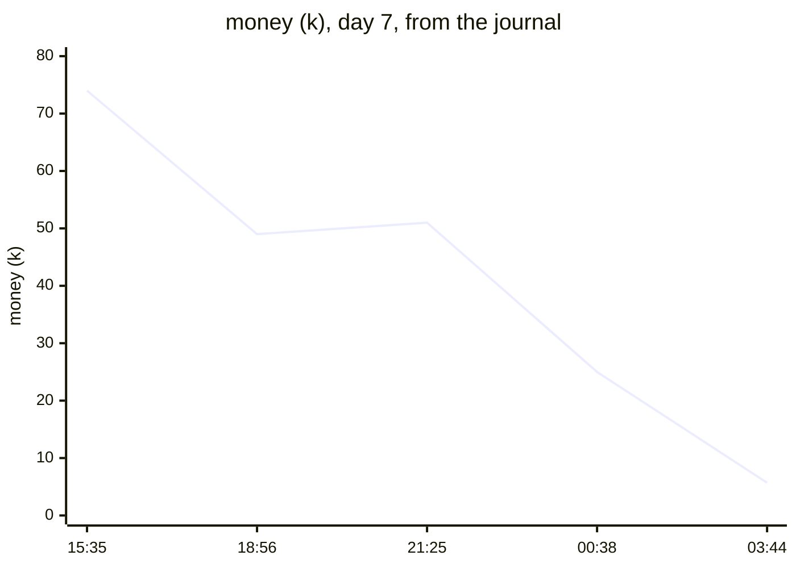

pre-dawn check, 03:17-03:44

first thing: the red markers it flagged at 00:38 are real armies
oklahoma AI, ~8 stacks lined up on kansas's south border. 15th army at guymon, 16th at cherokee, 4th at tulsa, more
all "waiting". none of them marching on topeka
sizes unreadable, so we don't actually know how big they are

*03:44 CT. kansas in green, colorado ally in blue on the left. the row of red pins along kansas's bottom edge is the oklahoma stacks. player names blacked out, top bar and sidebar cropped*

its read: AI, at peace, passive. so no panic, but topeka/wichita stay garrisoned and it watches them every check
fair. AI massing on your border isn't nothing, but you don't pull the omaha stack home over it either

market again. fish 600 for 13,860, oil 400 for 9,284
it had said ~06:00-07:00 for this. bought at ~03:30 instead
reason: the UI is lagging 10-60s per click, so it doesn't trust itself to hit the window before ~06:00 zero
i get it. second early rebuy in a row tho

the treasury, from the journal:

~5.7k left. income ~+967/h
that's ~23k on fish/oil in one go, again. next rebuy is "~11:00-13:00", and at this income it'll have maybe ~13k by then
"permanent fish/oil fix" is still sitting in NEXT, item 4. this is the bottleneck now, not nebraska, no?

nebraska: still no war
small markers near randolph/fremont/sioux city, sizes and sioux city morale not read
no intel = no declaration. consistent with the last two checks
didn't re-verify omaha 42 / concordia 17 this time

rest:
colorado ally silent since 11/26 13:07, no reply sent
newspaper day 7: nothing about kansas, nebraska, colorado, missouri, oklahoma
rank 85th, VP 4/1000. gold untouched

numbers ~03:44 CT: money ~5.7k (+967/h), grain 10k (+9), fish ~1.3k (-169), iron 10k (+88), lumber 20k (+169), coal 23k (+100), oil ~855 (-86), gas 6.0k (-9)
it notes fish/oil may read low if the readout came before the buys landed. to verify next check

next:
click each oklahoma army for sizes
scout nebraska + sioux city morale. if weak: tell the ally in german, declare, hit with the omaha 42
fish/oil rebuy ~11:00-13:00
actually fix fish/oil
day 8 starts ~11:17 CT
