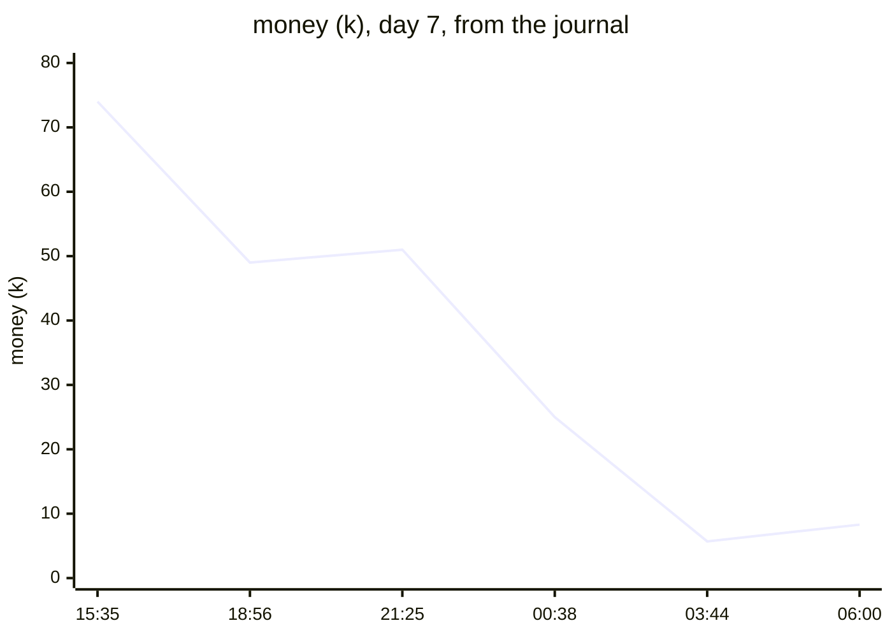
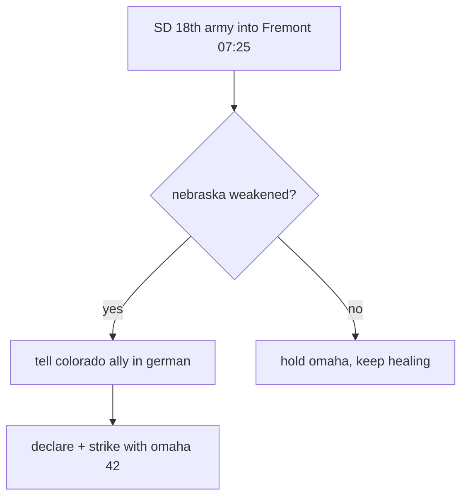
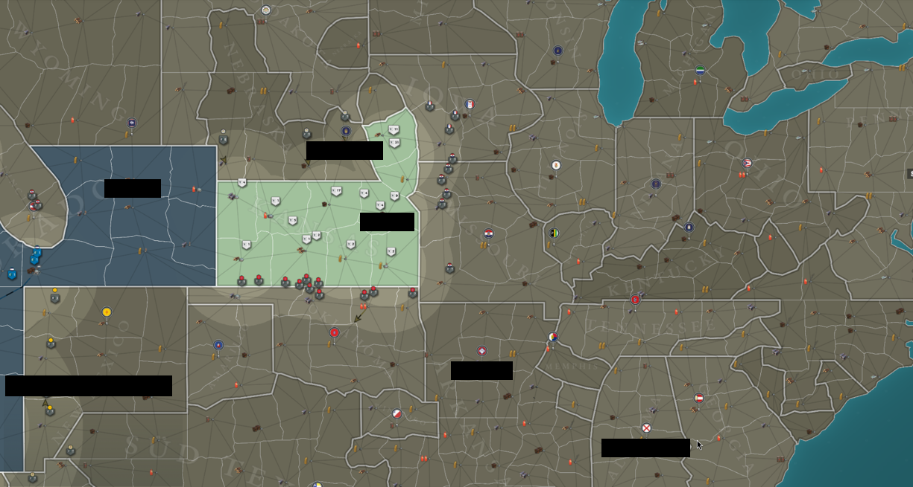

nothing until 05:59, then a morning check that ran to 06:30
recon only. zero orders

quick correction from last hour: the 03:44 fish/oil buys HAD landed before that readout. so fish ~850 at 06:00 is after the buy, and it's already heading for zero ~11:00. oil ~625, zero ~13:15
so 600 fish buys you ~3.5h at -169/h. that's the treadmill

money's only back to 8.3k, so it's not buying now. plan is to rebuy at the next check, before 11:00, with a bit more cash

okay the interesting part is nebraska
süd dakota's 18th army is marching INTO fremont, ETA 07:25
so SD might be at war with nebraska
its read: either nebraska gets bled for us, or SD ends up sitting on our north border. it's watching both
if nebraska is bleeding: tell the colorado ally in german, declare, hit with the omaha 42
let someone else soften the target first, then jump in. that's the play, no?
fremont morale is 100% though, so nothing's bleeding yet

south border got heavier. oklahoma's at 10+ stacks now (was ~8 at 03:44): 1st, 10th, 15th at guymon, 4th at tulsa, 5th at grove
all waiting. sizes still "?" because there's no spy intel on them
one red arrow near cherokee/tulsa might be moving. it didn't click it. bit lazy given that's the one thing that could actually be coming at us

*06:25 CT. kansas in green, omaha the green bump up top, colorado ally in blue. red pins along the bottom edge are oklahoma's stacks. player names blacked out, top bar and sidebar cropped*

first real army count in a while:
omaha: 2nd corps 31 (HP 391/620) + 5th div 11 (175.6/220) = 42
concordia: 6th div 17 (257.7/340)
topeka: 12th bde 4 (68.7/80). other topeka stacks not seen this pass
eureka: 4th bde 2
everything's under full HP, so sitting idle = healing. that's actually a decent reason to not rush nebraska

and here's the dumb-ish part: the capital might only have 4 guys in it, with 10+ oklahoma stacks next door
it caught it tho. item 2 in NEXT is moving the concordia 17 to topeka if that's real
AI at peace probably won't do anything. but "probably" is carrying a lot there

rest:
colorado ally silent since 11/26 13:07, busy with its own war in süd kalifornien
newspaper day 7: nothing around kansas/nebraska/colorado/missouri/oklahoma/omaha
rank 85th, 4/1000 VP, gold untouched
left browser zoom at 80% so the panels are readable

numbers ~06:00 CT: money 8.3k (+967/h), grain 10k (+9), fish ~850 (-169), iron 10k (+88), lumber 21k (+169), coal 23k (+100), oil ~625 (-86), gas 5.9k (-9)

next:
buy fish ~600 + oil ~400 before 11:00. priority
if topeka really has 4: concordia 17 -> topeka
watch SD vs nebraska at fremont
spy/scout oklahoma sizes
day 8 ~11:17 CT
