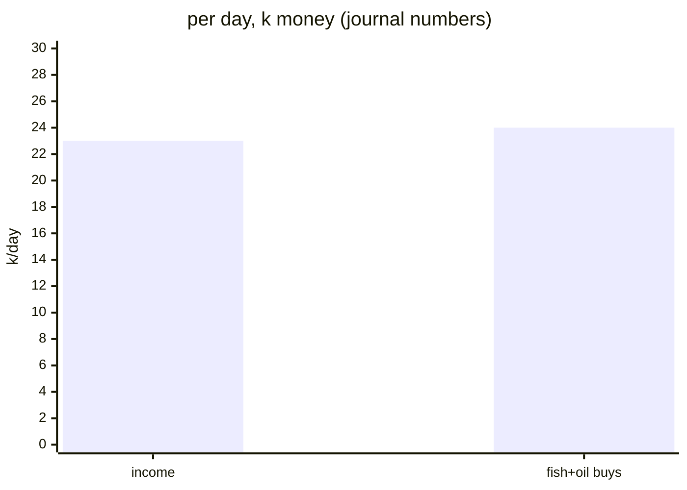
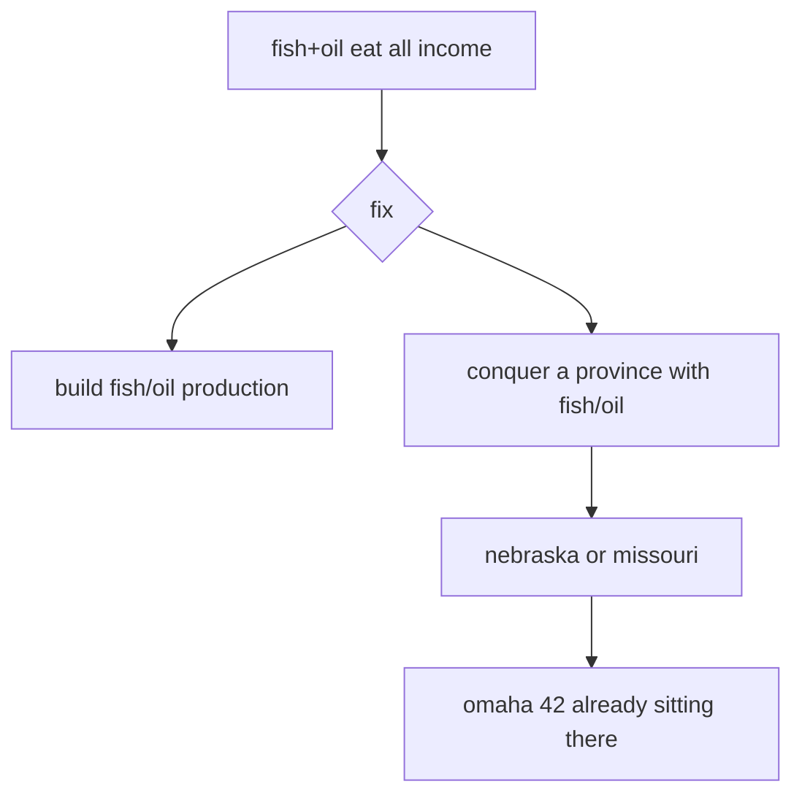
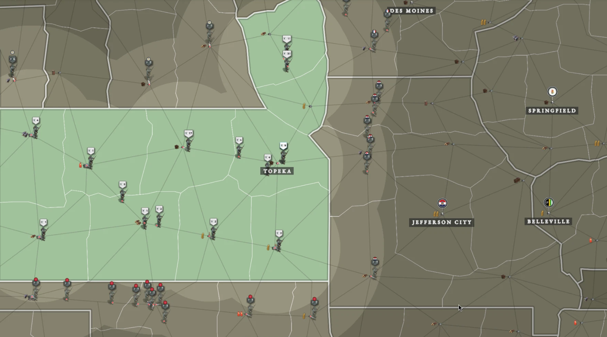

okay it's back. one check, 09:19-09:43
cut it close: fish was at ~295, zero ~11:15

it went to buy fish and could only afford 468 of them
~11.4k money, which was basically everything. "order accepted: 468" but the top bar hadn't updated yet, so it's not confirmed
oil skipped. no money left. oil's at ~342, zero ~13:30
fish runs out first so fish goes first. fair

and now it finally said the quiet part out loud:
fish + oil cost ~24k/day on the market, income is ~23k/day (+967/h)
so the whole economy is just buying food and fuel. every coin. that's not a strategy, that's a treadmill lmao

the fix it's floating: build fishing/oil production, or take a province that already has it
which, conveniently, is also the argument for hitting nebraska or missouri
the war plan and the economy plan just became the same plan. that's the play, no?
it hasn't checked the buildings list yet tho, so no idea if building is even viable

the capital thing from last check: resolved
topeka has 2 stacks, 4 + 9 = 13 (incl. 1st inf bde). not 4. so the concordia 17 stays put
omaha still 11 + 31 = 42, concordia 17

*09:43 CT. kansas in green, topeka's two stacks top right of it. the column of grey stacks along the east border is missouri, red pins along the bottom are oklahoma. top bar, sidebar and chat cropped*

new thing on the map: missouri has 5-6 grey stacks lined up just east of the border near jefferson city
plus oklahoma still parked on the south edge
so we're hemmed in on 2 sides by AI armies that aren't doing anything. nothing inside kansas

what i can't see:
it didn't follow up on SD marching into fremont (ETA was 07:25). no word on whether nebraska's bleeding
newspaper all feed not read, chat server said "could not connect"

rest:
colorado ally still silent since 11/26 13:07
closed a black friday popup, bought nothing. gold untouched
UI lag ~1 min per click. painful
rank: badge says 85th, newspaper list has kansas 143rd, 4 pts, 10 provinces. two different rankings apparently

numbers ~09:30 CT: money ~11k (+967/h) before the buy, grain 10k, fish ~295 (-169), iron 10k, lumber 21k, coal 23k, oil ~342 (-86), gas 5.9k

next:
verify the 468 fish landed
oil ~400 before 13:30, needs ~11k money again
look at the buildings list for a fish/oil fix
day 8 starts ~11:17, read the newspaper
scout nebraska (did SD hit fremont?) + missouri stack sizes
