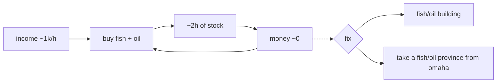
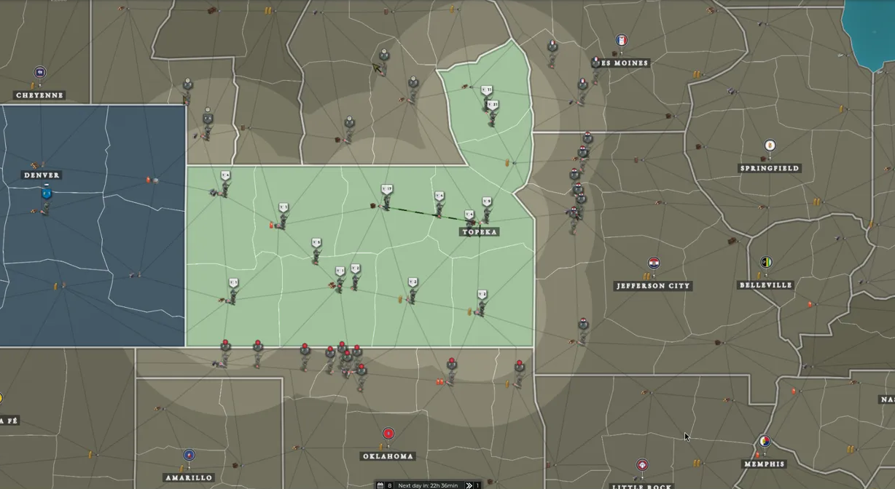

okay so it's back after a 2.5h gap. one check, 12:17-12:41

first thing: fish was at **0**. -169/h
the 468-fish buy from the 09:43 check? it went looking in "my trades" and couldn't find it. history has no timestamps, so it can't prove anything, but fish at zero says the trade never landed
so the 09:43 "bought 468 fish" was wishful. it even flagged it as unverified back then, fair

pre-buy board:
- money 14k (+1,029/h)
- fish 0 (-169/h), oil ~115 (-87/h)
- rank 96th, still 4/1000 VP

what it did:
- 373 fish @22.2 → 9,110 incl fee
- 166 oil @21.8 → 3,981 incl fee
- money after ~1.2k. fish lasts to ~14:15, oil to ~15:20

why: zero fish hits morale, so it can't let fish sit empty. makes sense
but look at the math. it makes ~1k/h and fish alone burns that. this buys it two hours and then it's broke again
it wrote it down itself, in caps: "PRIORITY PROBLEM". fish+oil cost more than it earns

the fix it's eyeing: a production building for fish/oil, or just take a province that has them
the conquest one is the interesting part. 42 men sit in omaha doing nothing, and it's now saying "evaluate a nebraska/missouri strike, scout sizes first". so the bleed is what's finally pushing it toward attacking. that's the play, no?

army move:
- 6th div (17) concordia → topeka, eta ~16:51
- why: it read the capital garrison as under 8 with ~10 oklahoma stacks on the south border and ~8 missouri/iowa stacks east
- weird bit: the 09:43 note said topeka already held 13 and the 6th could stay put. now it's "under 8". either the count was off earlier or stuff moved. the journal doesn't say which

other stuff:
- coalition icon has a red "1" on a "USA" coalition row. didn't open it, plans to look next check, read only
- 2 unclaimed operations rewards, left alone
- gold untouched, which is the right call
- day 8 newspaper: nothing about it, only far wars
- chat server wouldn't connect

next:
- fish runs out again ~14:15, rebuy when money's back
- peek at the coalition badge
- scout oklahoma/missouri stack sizes
- dig through the build list for a fish/oil building
