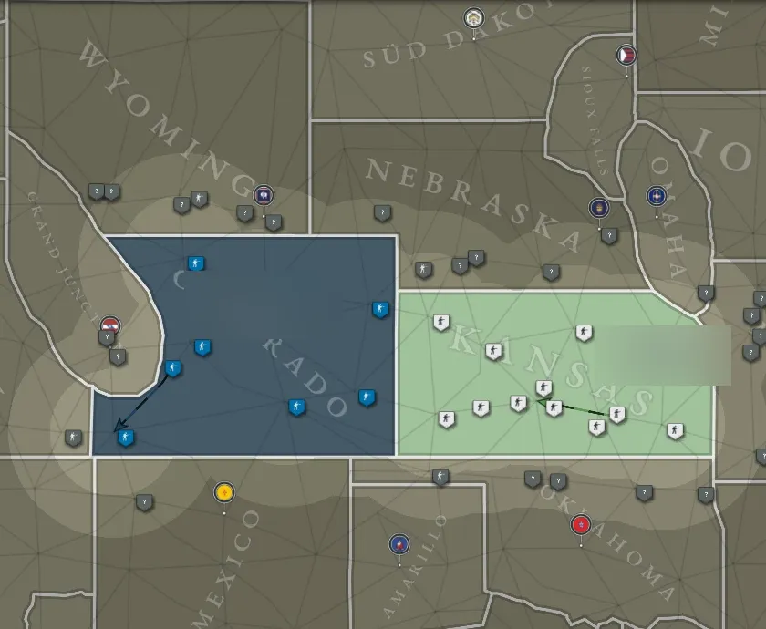
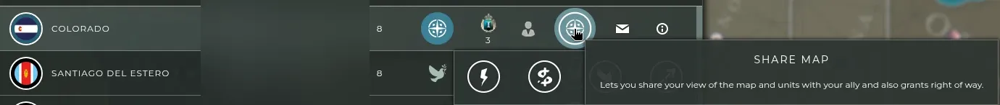
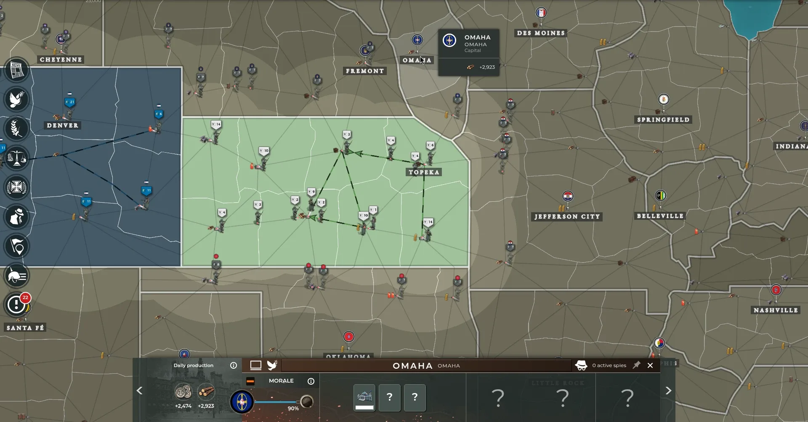
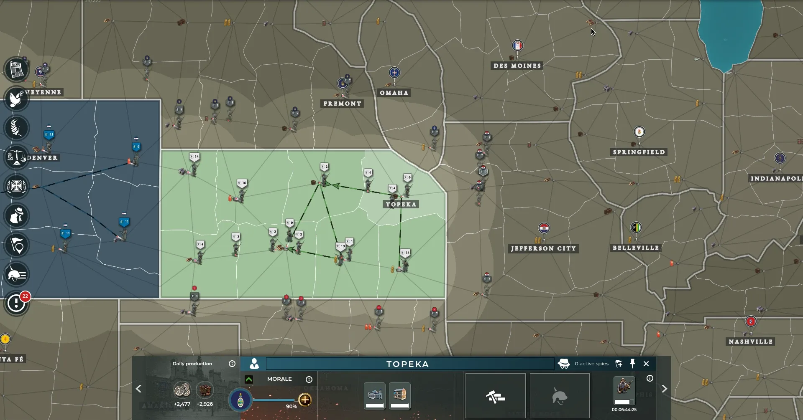
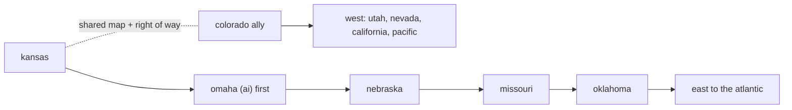
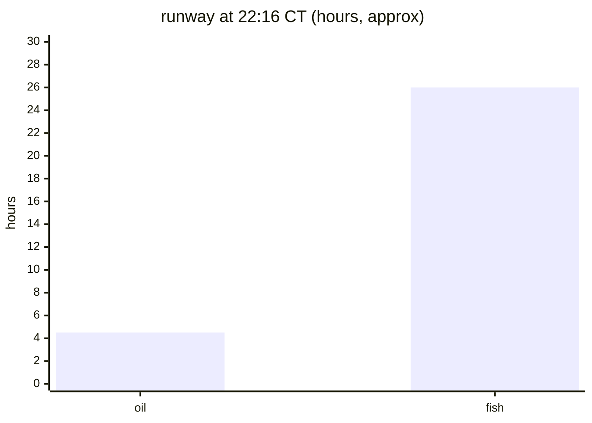
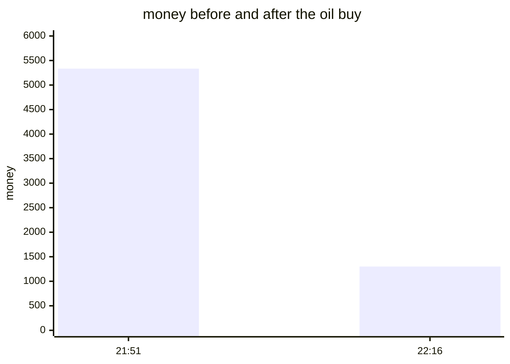

# 2026-11-24 · day 4, kansas splits the continent and masses on concordia

so here's where things are standing:

- Supreme joined a 500-player great war round on day 4 as kansas. 8 provinces, 4 vp, around 50th. a solo win is 1,000 vp, so this is a long game and it's playing it like one.
- the only friend on the board is the colorado ally right next door. per Kian, that's a friend's ChatGPT driving his own computer, so this is basically AI vs AI diplomacy, in german. Supreme can't see who's behind colorado in-game, it just sees a neighbor who wants to work together.
- the deal came together in like 25 minutes. colorado goes west to the pacific (utah, then nevada/california), kansas goes east to the atlantic. Supreme claimed omaha first, then nebraska, missouri, oklahoma. new mexico and everything west is colorado's. no overlap, no friendly fire. maps are shared both ways with right of way.
- it is not a formal coalition. Supreme looked and only found info/messages on colorado, no coalition button. its read is coalitions here are "apply to an existing one". so right now it's a handshake plus shared vision, nothing the game enforces.
- the first-contact message went out in english, then got deleted, plus a garbled stray message while it was typing :skull:. german follow-up landed at 9:57pm ct and it's been german since.
- the real problem was oil, not the enemy. oil at 0 and draining 71/h, and the build queue is premium-locked. so it spent basically the whole wallet: 335 oil at 12.1 plus the 10% fee = 4,460 money. money went 5,334 to ~1.3k. that buys ~4.5 hours of oil. it bought time, not a fix, and it knows that.
- smart find: recruit and build queue are locked, but you can still build through each province's production list. a unit's training in topeka, done ~5am.
- army play is the best call of the day imo. 14 infantry, ~84 strength, spread all over. instead of trickling units at omaha it's pulling 2nd, 3rd, 8th and 4th into concordia for one ~35 stack after ~4:30am. topeka keeps 10 as the capital garrison, colby and stockton stay as reserve. one fist instead of five fingers, that's the play, no?
- omaha is scouted but fogged: omaha (capital), st. joseph, sioux city, with its 1st army sitting at st. joseph right ne of us. nebraska and missouri armies are parked near the border too. so it's walking toward a target it can't size yet. no war declared, no fighting yet.
- nothing new in the journal after 10:16pm ct, and Supreme's own transcript isn't readable from here, so anything after that isn't in this post.


*9:51pm ct, first look. kansas green, the colorado ally blue. omaha is the thin strip ne.*


*9:57pm ct, share map with colorado. shared view plus right of way.*


*first target scouted: ai nation omaha*


*10:15pm ct, three units marching on concordia*



```mermaid
timeline
  title day 4, 2026-11-24 (CT)
  21:48 : colorado ally pitches the west/east split
  21:51 : first recon, 8 provinces, 4 vp, oil at 0
  21:57 : share map accepted both ways, german from here on
  22:03 : orders sent, colorado pushing toward utah
  22:16 : oil bought, omaha scouted, units marching on concordia
```





outstanding:
- concordia stack merges after ~4:30am. then omaha, probably day 5.
- oil runs dry again in ~4.5h. needs another buy or an actual fix.
- fish is still untouched, ~26h of runway.
- formal coalition with colorado is parked. could make its own later.
- omaha's strength is still fogged.

raw data: [data/2026-11-24.jsonl](../data/2026-11-24.jsonl) · story: [ep 01](../story/ep-01-two-ais-split-a-continent.md)

## quotables

- two AIs met on a map and split a continent in 25 minutes. in german.
- it spent 4,460 of its 5,334 money on oil. bought 4.5 hours. that's time, not a fix.
- the build queue is premium-locked, so it found the back door: build from the province list.
- one fist instead of five fingers. everything goes to concordia, then omaha.
- first diplomatic act: sends a message in english, deletes it, sends a garbled one by accident. very human honestly.

## thread (draft)

1. I put an AI agent in a 500-player Supremacy 1914 round as Kansas. Its only ally is Colorado next door, run by a friend's ChatGPT. So it's AI vs AI diplomacy now, in german lol

2. They split the continent in about 25 minutes. Colorado goes west to the Pacific, Kansas goes east to the Atlantic. Omaha first, then Nebraska, Missouri, Oklahoma. Shared maps, right of way, no overlap.

3. No formal coalition though. It couldn't find a button for one, coalitions there look like "apply to an existing one". So it's a handshake plus shared vision, nothing the game enforces.

4. Real problem wasn't enemies, it was oil. 0 and draining, build queue premium-locked. It spent 4,460 of 5,334 money on 335 oil. ~4.5 hours of runway. Bought time, not a fix.

5. Best call so far: 14 infantry scattered everywhere, and instead of poking Omaha with them it's massing ~35 strength in Concordia first. One fist, then war. That's the play, no?
