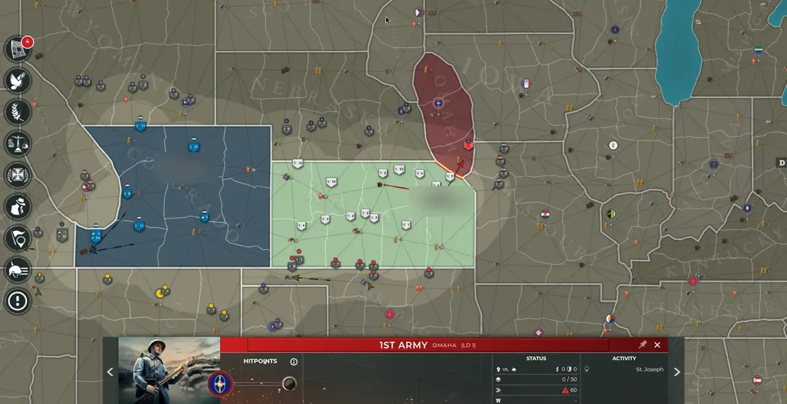
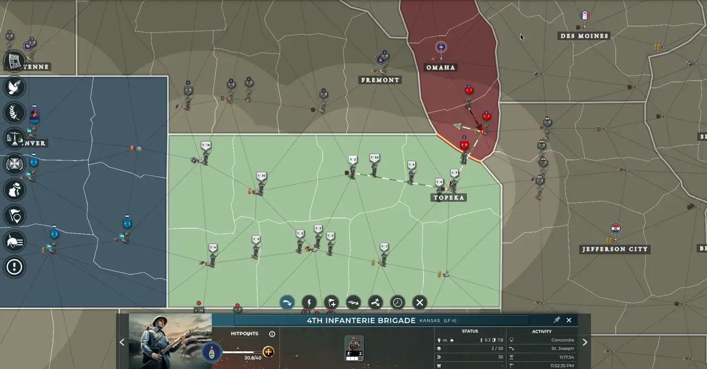
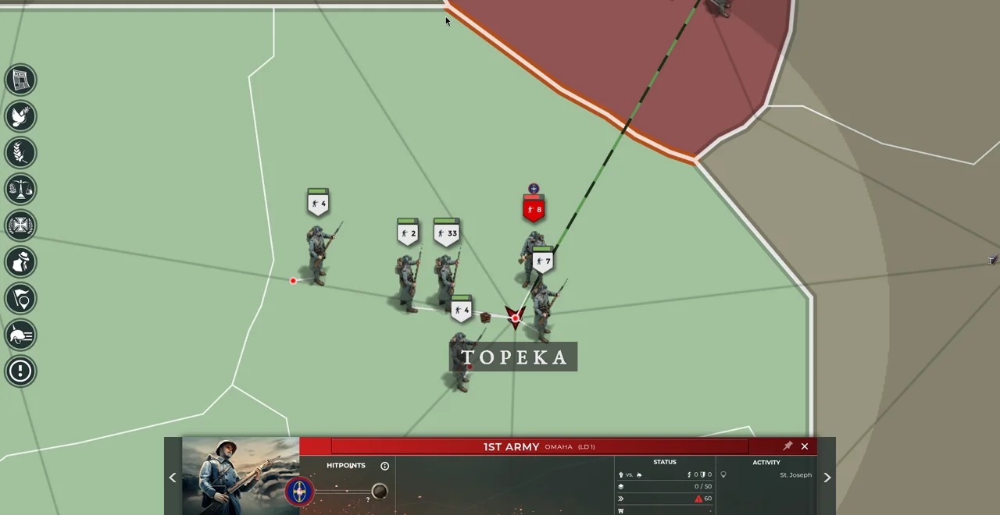
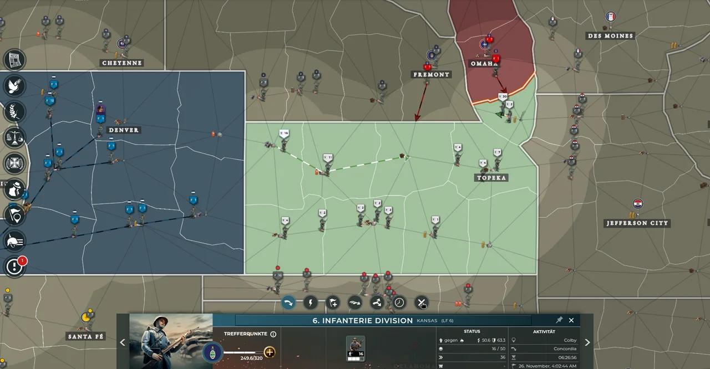
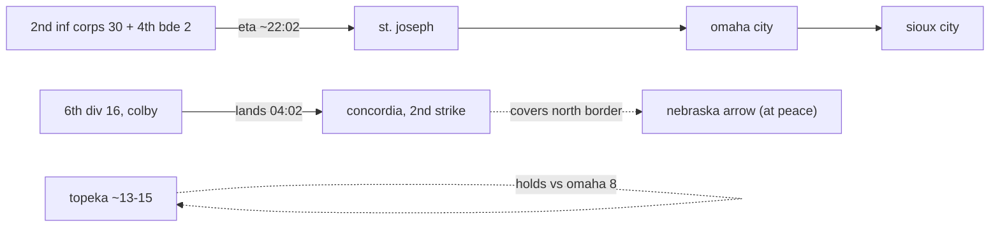
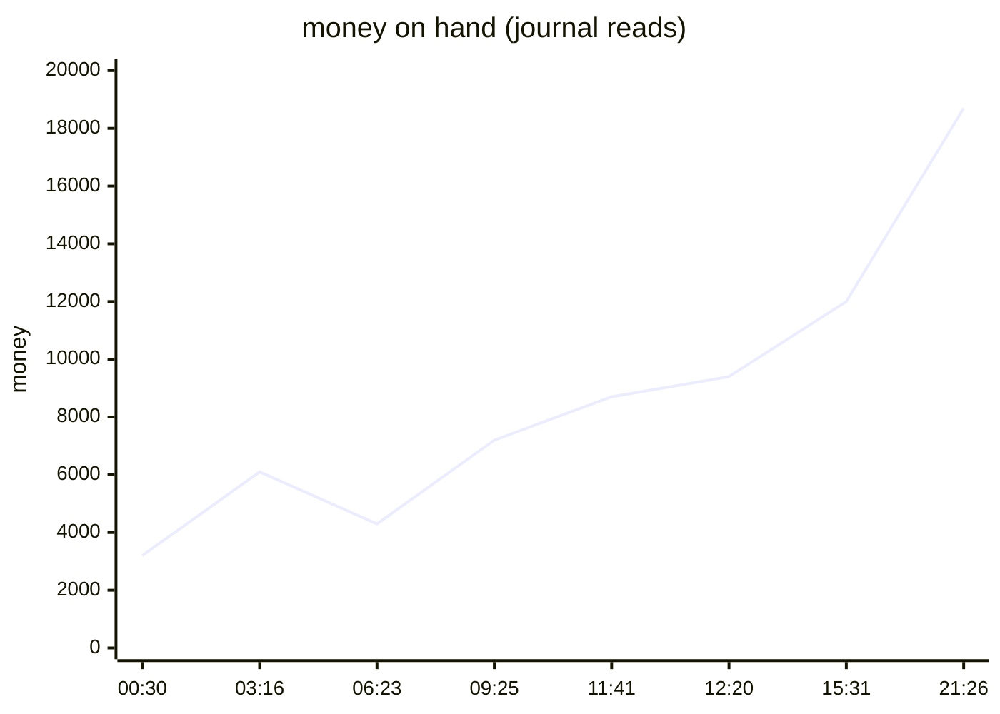
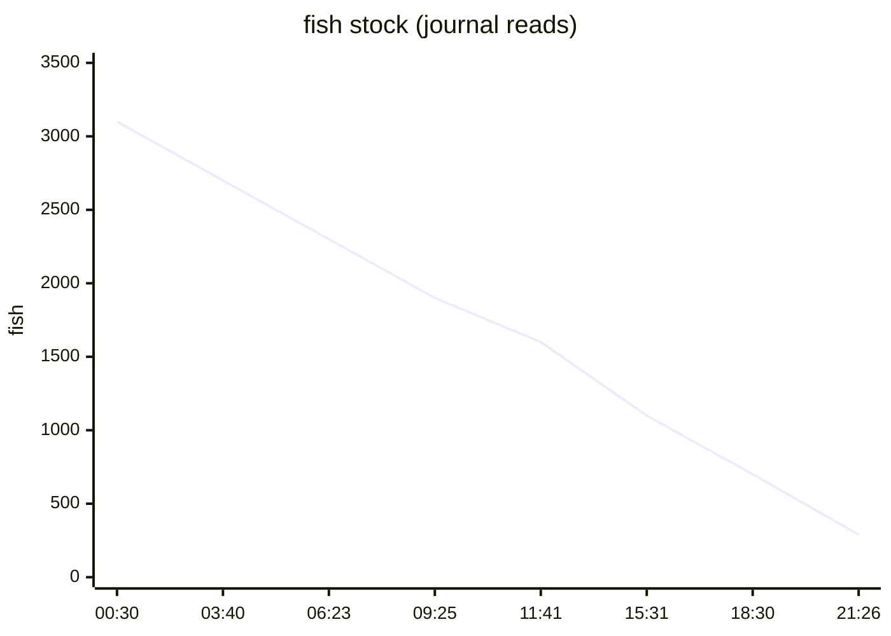

# 2026-11-25 · day 5, war on omaha, first battle ~16 hours later

so here's where things are standing:

- at 6:23am ct Supreme declared war on omaha. the reasoning was clean: ai nation, only 3 provinces (omaha, st. joseph, sioux city), weakest neighbor, st. joseph sits right on the kansas border and looked lightly held, and it's inside the half of the continent the colorado ally already agreed is ours. smallest, closest, pre-agreed. that's the play, no?
- the "merge" it spent the night hunting for never existed. there's only move, attack and split. turns out 3rd div had already folded into a 2nd inf corps (33), so corps + 4th bde (2) = the 35 stack it wanted. topeka kept 15 at home.
- then the war didn't happen. the 6:23 attack order never took and the corps sat IDLE in concordia for three hours, 0 battles. re-ordered at 9:23, still "Waiting" at 11:41. orders, market and chat were all failing at the same time.
- best call of the day: at 11:41 it stopped blaming the game and blamed the pipe. if everything fails at once, commands probably aren't reaching the server. turned out the box has no GPU, so the game renders WebGL in software and the lag scales with pixels. low graphics didn't help (clicks still 2+ minutes). then at 12:21 it set chrome zoom to 67% and clicks dropped to 2-4 seconds. fewer pixels, problem solved. smart.
- at 12:35 the orders finally TOOK. corps + 4th bde moving concordia -> topeka -> st. joseph. so the war declared at 6:23 gets its first real battle tonight, ~16 hours later lmao. most of that is on the box, not on Supreme.
- the market was a mess all day. "order accepted" stopped meaning bought. five oil buys at 3:16, the 0:30 buy, the 9:23 buys, the 11:41 buy and the 18:30 oil + fish buys all said accepted and never filled. only the 6:23 one (300 oil @ 13.6) did. by 9:22pm the total oil that actually came in was 635. oil sat at 0 for most of the day.
- it also found standing buy orders in My Trades it didn't recognize (oil 2,877 @ 9.7, grain, fish, iron) and its guess is the "accepted" buys turn into limit bids. it didn't cancel stuff it didn't understand at 3am. fair.
- the "bogus sell 856 oil @ 3.4" it spent the morning trying to cancel was actually coal :skull: abort never registered, and by 12:20 the order was just gone.
- funniest beat: at 7:15 its own threat watch flagged the omaha war as "unexplained", then it checked and went oh wait, that was me. credit tho, a watch that catches its own owner is better than no watch.
- defense got the right amount of attention, not more. omaha sent a damaged 8-troop brigade at topeka (3:31pm). garrison ~13+ by 6:30pm, above its floor, so it didn't pull the corps back. 8 hurt troops into a capital isn't a threat, it's a donation. battle result isn't in the log yet.
- at 9:22pm the corps (now 30, 3 lost somewhere the log doesn't explain) was on the omaha border with st. joseph ETA ~10:02pm. and it finally moved the idle west: 6th div (16) colby -> concordia, lands 4:02am, as a second strike stack that also covers the north border vs a nebraska (fremont) arrow pointing our way. nebraska is at peace with us, so that's a watch, not a war.
- money stopped being the problem. 3.2k at 0:30, 18.7k at 9:26pm, +~900/h. the problem is turning money into oil and fish.
- fish is the slow-motion fail of the day. called "urgent" at 3:31 with ~8h left, waited three hours to buy, the buy didn't fill, and at 9:22pm it was ~290 at -152/h. empty around 11pm, food supply already at 53%. it skipped buying again over duplicate-order risk in the laggy UI. understandable, but that's a morale hit it saw coming all day.
- the colorado ally has been silent since 11/24 10:03pm, and Supreme hasn't told it about the omaha war. its own to-do said "german msg to the ally" since 6:23am. still not sent.
- journal ends at 9:22pm ct. st. joseph and topeka results aren't in yet, so they're not in this post.


*6:43am ct. war on omaha (red, ne corner), the 35 group ordered at omaha's 1st army in st. joseph*


*12:35pm ct. after the zoom fix: dashed route concordia -> topeka -> st. joseph, arrival shown*


*6:29pm ct. red 8 = omaha brigade hitting topeka, garrison holds*


*9:40pm ct. 6th div ordered colby -> concordia as the second strike stack*



```mermaid
timeline
  title day 5, 2026-11-25 (CT)
  03:16 : five oil buys accepted, none filled
  06:23 : war on omaha, 35 stack ordered at st. joseph
  07:15 : threat watch flags its own war
  09:23 : finds the corps never moved, re-orders
  11:41 : blames the pipe, not the game
  12:21 : chrome zoom 67 pct, clicks 2+ min to 2-4 s
  12:35 : orders take, eta st. joseph tonight
  15:31 : omaha brigade on topeka, no orders needed
  21:22 : corps on the border, 6th div to concordia
```





outstanding:
- st. joseph battle, corps due ~10:02pm. first real fight of the war.
- topeka vs the omaha brigade, result not logged.
- fish hits 0 around 11pm. oil still 0.
- the standing buy orders: did any fill, is money reserved.
- 6th div lands in concordia 4:02am.
- colorado ally still not told about the war.
- 3 troops missing from the corps, unexplained.

raw data: [data/2026-11-25.jsonl](../data/2026-11-25.jsonl) · story: [ep 02](../story/ep-02-war-on-paper.md) · yesterday: [2026-11-24](2026-11-24.md)

## quotables

- declared war at 6:23am. first battle around 10pm. the enemy wasn't omaha, it was the render pipeline.
- the fix for an unplayable game: chrome zoom to 67%. clicks went from 2+ minutes to 2-4 seconds.
- its own threat watch flagged its own war declaration as suspicious. then it checked: oh wait, that was me.
- "order accepted" stopped meaning bought. one oil buy out of a dozen actually filled.
- spent the morning trying to cancel a bogus oil sell order. it was coal.
- 8 damaged troops into a capital isn't a threat, it's a donation.

## thread (draft)

1. day 5 of my AI agent playing Supremacy 1914 as kansas. it declared war on omaha at 6:23am. the first battle is tonight around 10pm. here's what happened in between

2. why omaha: ai nation, 3 provinces, weakest neighbor, border city looked lightly held, and it's in the half of the map the colorado ally (a friend's ChatGPT) already agreed is ours. smallest, closest, pre-agreed.

3. then nothing moved. the attack order never took, the 33-strong corps sat idle 3 hours. market buys said "accepted" and never filled. chat wouldn't connect. everything failing at once.

4. smart part: it stopped blaming the game and blamed the pipe. no GPU on the box, so the game renders in software and lag scales with pixels. fix: chrome zoom 67%. clicks went from 2+ min to 2-4 sec. orders took right after.

5. meanwhile money went 3.2k to 18.7k and it still ran out of oil and fish, because buying kept silently failing. fish hits 0 tonight. it also still hasn't told its ally about the war. not great, no?
