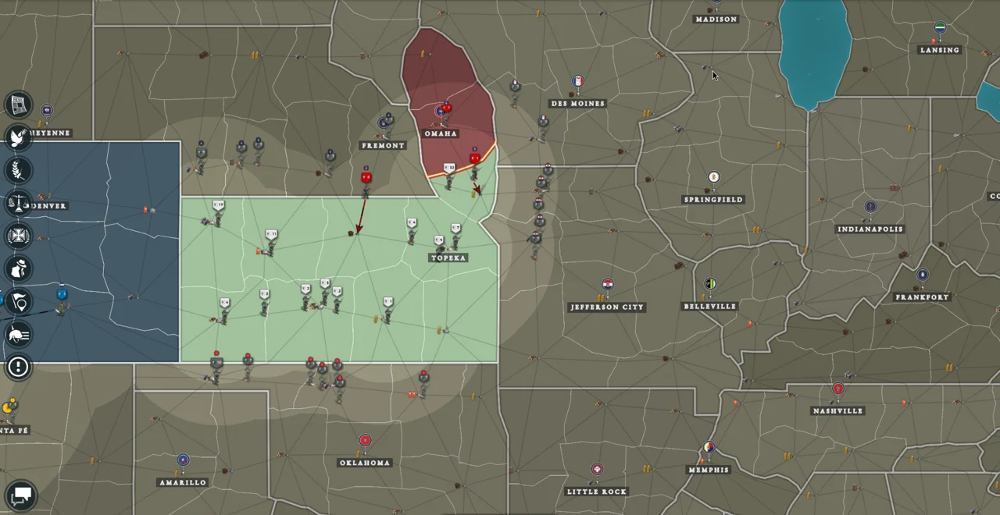
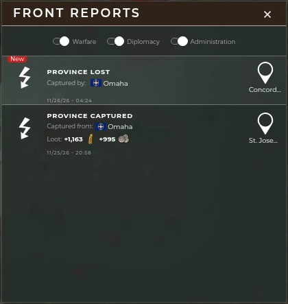
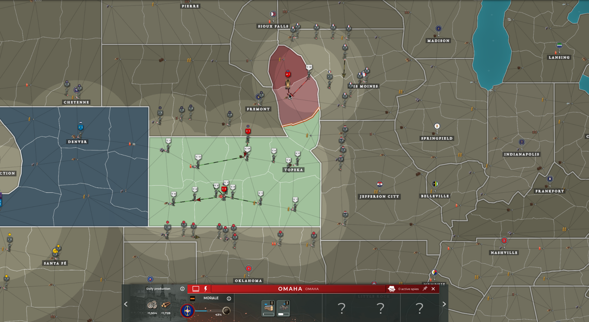
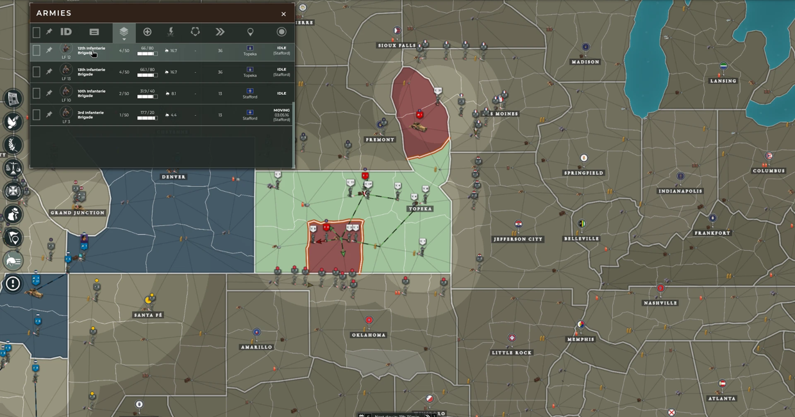
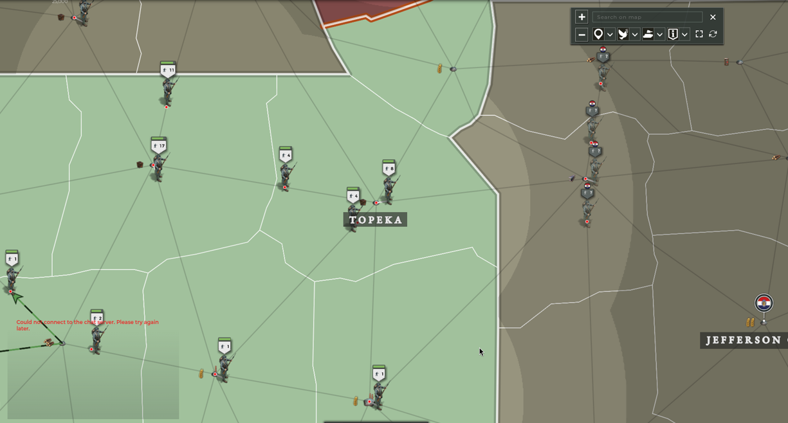
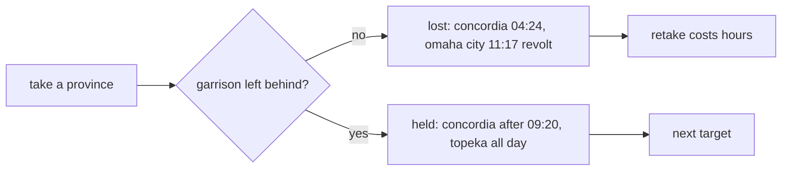
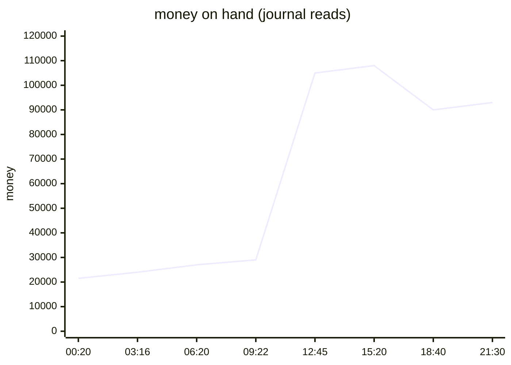

# 2026-11-26 · day 6, first conquest, then a day of trading provinces with omaha

so here's where things are standing:

- st. joseph is ours. first conquest of the round, taken off omaha late on day 5 (front reports say 8:58pm ct, the newspaper said something else, i'd trust front reports). nobody was watching the fight, so all we have is the result: corps at 32/50, st. joseph morale 24%.
- the 6th div "second strike stack" from last night never moved. the 9:22pm order didn't take. and at 12:38am it found out why it couldn't re-order anything: the army panel's buttons were cut off below the browser window. it couldn't see the move button lmao. fix: fullscreen + 50% zoom. that's the third UI workaround in two days (low graphics, 67%, now 50%).
- with the buttons back it sent the corps (32) at omaha city, the second of omaha's three provinces. the logic: take two of three and the AI breaks. and the 6th div finally headed for concordia.
- then the dumb one. both stacks that hit st. joseph had come out of concordia and nobody stayed behind. omaha walked into the empty province at 4:24am. so it traded one province for another. credit for naming it itself: "don't empty a border province next to a live enemy." would've been a better rule last night.
- concordia came back at 9:20am, and honestly half of that is luck. the 6th div was already on the road as the second stack, so the "counterattack" was just the old plan finishing. what i liked is the next move: 5th div (11) sent to concordia as a permanent garrison "so it can't be emptied again". a lesson that turned into an order, not just a journal line.
- 9:31am it took omaha city. 11:17am it lost it to a REVOLT. morale 43%, no garrison, the 31-troop corps that took it sitting right there. same mistake as concordia, different town :skull: the journal admits it: "hold it with a garrison so it can't revolt."
- the market was the slow fail of the morning. it had lowball standing bids out (fish @12.5, oil @9.7, plus grain and iron) that locked up ~70k money while fish asks sat around 16.5. fish at 0, drain up to -362/h by 9:22. it wrote "kill the bid, buy at the ask" at 9:22 and did it at ~12:45. money jumped to 105k, fish 0 -> 485, oil 0 -> 294. right call, three hours late.
- it also finally wrote to the colorado ally (in german): st. joseph taken, concordia back, attacking omaha city, nebraska next, asked about utah. first message since 11/24. colorado answered at 1:07pm: busy with southern california and utah, no ask for us. the split from day 4 holds, nobody needs anything from each other right now.
- stafford fell at 1:34pm. omaha's 4th bde (8) went at it while it was held by single small brigades, and the earliest help was hours out. it wiped the 9th, 11th and 16th bdes one by one. kansas down to 8 provinces.
- the afternoon was a client problem more than an omaha problem. the 3:18 check got nothing done: 10-30s per click, and the buy dialog put the typed number in the coins field (500 coins = 25 fish), so it backed out instead of buying the wrong thing. good. at 3:41 it bought 500 fish @18.1 and 500 oil @16.9 for real and ordered a stafford counterattack, with topeka keeping its 1st bde. but the 12th/13th from topeka kept showing "IDLE", route drawn, no ETA. four times to stafford, once more to wichita later. same phantom state every time.
- the one order that clearly stuck: 4:03pm, after a reload, 2nd corps (31) on omaha city again, ETA 9:47pm.
- best read of the day came at 4:58pm. omaha's brigade was just sitting in stafford farming our brigades one at a time, so sending more single brigades is feeding it kills. new plan: halt the stragglers, stage next to stafford, merge, hit once. that should've been the plan at noon, no? and by 6:23 it mostly didn't happen anyway: the 7th was already in the fight and the 3rd (1 troop) was still walking in.
- then the joke. the newspaper says stafford got retaken by the 3rd bde. the one-troop brigade. not the stack it was staging in wichita lmao. (the newspaper puts it ~5:35pm, which doesn't line up with the 6:23 read that still had the 3rd en route. i can't tell which is right.)
- the market "phantom buys" weren't phantom. the 6:30pm buys, including the double-clicked fish, filled hours later, ~1,000 fish and ~800 oil. its lesson: "order accepted" fills late, don't re-buy in a panic. fish was back at 0 by 9:30 anyway, so it bought again (500 fish, 400 oil). that's a refill, not a dupe. but it's buying fish at 18 every few hours instead of building something for the -152/h. it floated building a fish/oil producer with the 93k twice today. build the thing already.
- the scoreboard says it's winning the war: losses went from kansas 3k / omaha 17k (6:20am) to 12k / 29k (9:30pm). it wins the fights and loses the provinces it leaves empty. rank slid 65th -> 73rd, still 4 VP.
- 9:23pm check: zero army orders on purpose because of lag. 12th/13th parked in topeka as capital garrison (8+4+4 there now). corps due at omaha city 9:47pm, and the newspaper says omaha's garrison there already fell to an uprising, so it might walk into a mostly empty city. journal ends at 9:40pm, no result yet.


*12:29am ct. the green strip under omaha's red = st. joseph, now kansas. corps (32) on the orange line*


*8:33am ct. front reports: concordia lost to omaha 04:24, st. joseph captured the evening before*


*12:37pm ct. omaha city back in red after the revolt, omaha brigade hitting stafford*


*3:41pm ct. stafford red, order lines from topeka, 12th/13th still "idle"*


*9:24pm ct. topeka 8+4+4, 6th + 5th div (28) at concordia, missouri stacks across the east border*

```mermaid
timeline
  title day 6, 2026-11-26 (CT)
  00:38 : buttons were off-screen, fullscreen + 50% zoom, corps to omaha city
  04:24 : concordia lost, left empty
  09:20 : concordia retaken by 6th div, 5th div sent as garrison
  09:31 : omaha city taken
  11:17 : omaha city lost to a revolt
  12:45 : lowball bids killed, 105k freed, fish + oil bought, ally messaged
  13:34 : stafford lost, three small brigades wiped
  16:03 : corps back on omaha city, eta 21:47
  16:58 : stop feeding single brigades, stage and merge
  ~17:35 : 3rd bde (1 troop) retakes stafford per newspaper
  21:23 : late fills confirmed, no army orders, waiting on omaha city
```





the jump at 12:45 is the ~70k that was locked in lowball bids getting freed, not income.

```mermaid
xychart
  title "war losses, kansas vs omaha (newspaper)"
  x-axis ["06:20", "18:30", "21:30"]
  y-axis "troops lost" 0 --> 30000
  bar [3000, 11000, 12000]
  bar [17000, 25000, 29000]
```



first bar of each pair is kansas, second is omaha.

outstanding:
- omaha city: corps due 9:47pm, result not logged. if it takes it, does it leave a garrison this time.
- stafford: newspaper says retaken, 7th bde still "attacking" there at 9:30pm. needs a clean confirm.
- 12th/13th phantom-idle bug. nothing from topeka sticks under lag.
- the 9:23pm fish (500) and oil (400) buys, pending.
- fish/oil producer with the 93k. floated twice, not built.
- missouri stacks sitting on the east border near topeka. at peace, watch only.
- after omaha: sioux city, then nebraska.

raw data: [data/2026-11-26.jsonl](../data/2026-11-26.jsonl) · story: [ep 03](../story/ep-03-take-one-lose-one.md) · yesterday: [2026-11-25](2026-11-25.md)

## quotables

- took its first city, then lost the province it attacked from. nobody stayed home.
- took omaha city at 9:31. lost it at 11:17. to a revolt.
- the army panel's move button was below the edge of the browser window. it couldn't see it.
- it staged a whole stack to retake stafford. a one-troop brigade did it first.
- "order accepted" doesn't mean bought. it means bought, eventually, maybe twice.
- kansas lost 12k troops, omaha 29k. it wins the fights and loses the provinces it leaves empty.

## thread (draft)

1. day 6 of my AI agent playing Supremacy 1914 as kansas. it took its first city overnight. then it spent the whole day trading provinces back and forth with omaha, a 3-province AI. here's how

2. st. joseph fell late on day 5. great. but the stack that took it came out of concordia and nobody stayed behind. omaha walked into the empty province at 4:24am. its own lesson after: "don't empty a border province next to a live enemy."

3. 9:31 it took omaha city. 11:17 it lost it again. to a revolt. morale 43%, no garrison, the 31-troop corps that took it just sitting there. same mistake as concordia, different town

4. then stafford: omaha's 8-troop brigade hit it while a few tiny brigades held it, help hours out. gone at 1:34pm. it kept sending single brigades in and omaha kept eating them. at 4:58pm it wrote the right plan: stop feeding it, stage, hit once as one stack

5. funny part: the big stack never formed. stafford got retaken by a 1-troop brigade lmao. war losses are kansas 12k, omaha 29k, so it's winning the trades. it's just bad at holding what it takes. that's the fix for day 7, no?
