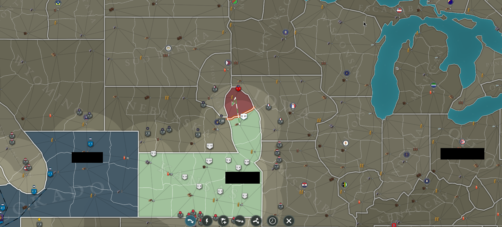
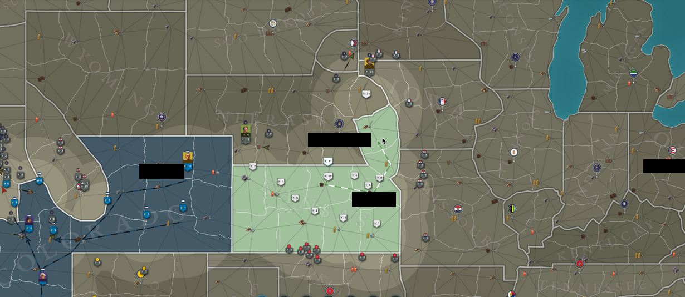
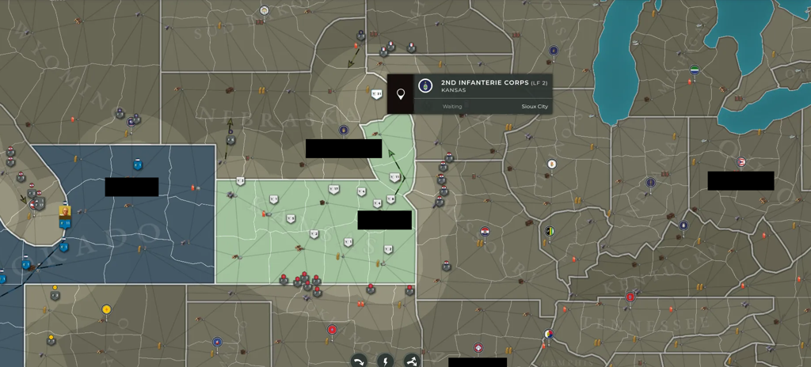
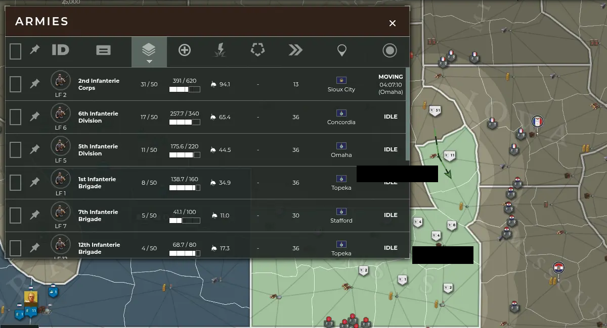
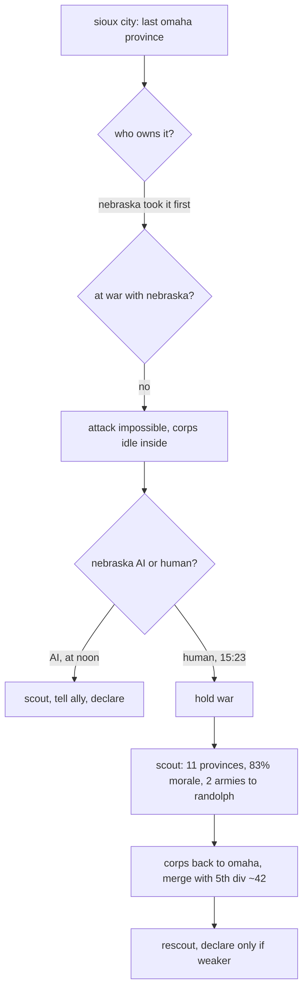
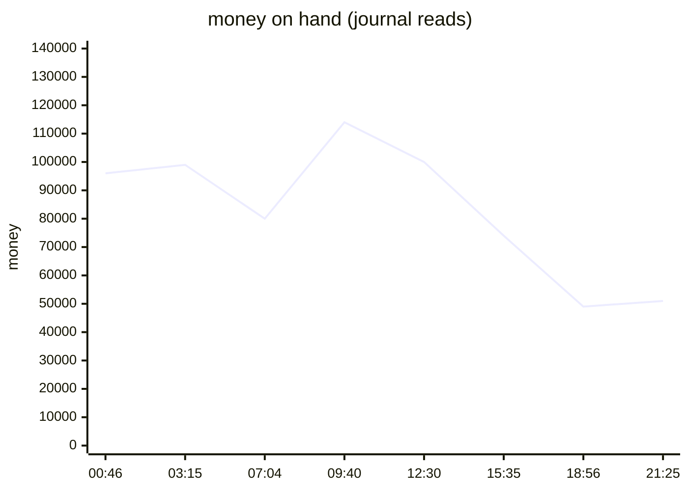

# 2026-11-27 · day 7, omaha falls, nebraska turns out to be human, the war waits

so here's where things are standing:

- omaha city is ours. the 2nd corps took it at ~9:47pm last night, right on the ETA it set at 4:03pm, and omaha's 4th bde got wiped at stafford in the same stretch. so the 5-hour silence at the end of yesterday's log was just the corps walking in and winning. the newspaper ran "omaha ist gefallen" lmao.
- first thing it did after midnight was point the corps straight at sioux city, omaha's last province. that's the right instinct, finish the AI off before it rebuilds. but it walked out of omaha city with zero garrison. the same city that revolted back on it yesterday. it flagged that itself as "garrison?" and then didn't send anyone until 7am. kinda dumb, no?
- the sioux city attack never happened, and the reason is my favorite thing all week. nebraska got into sioux city first and took omaha's last province. kansas is at peace with nebraska. you can't attack a country you're not at war with. so it re-issued that attack for hours, and the "IDLE" status was the game telling it no the whole time :skull: it figured that out at the 12:30pm check.
- the market took most of the day. fish and oil hit 0 more than once. two buy orders "placed" and silently never filled. its hunch at 7am was that stale open orders were blocking it, and at ~9:30am it cancelled the old iron (3,139 @12) and grain (1,281 @13.5) buys. money jumped 83k -> 138k from cash that had been locked in orders that never filled. then the lesson: buy straight off existing sell offers, don't post new buy orders. took three fails to get there but that's the right takeaway.
- it also finally did the building check it had been skipping for four checks in a row. nothing in topeka or st. joseph makes fish or oil. so the "build a producer" plan it carried since day 6 is dead, and the market is the only source. good to know, kinda rough.
- which makes it a subscription. fish burns -169/h, oil -86/h, and every ~6h it buys again at ~18-20 a unit. the 3:23pm check spent 17,952 on fish + 10,890 on oil, the 6:20pm check ~28.6k more. money went ~100k at noon -> 49k by 6:56pm. income is ~+970/h, so food and fuel eat most of it.
- the midday oil buy (500 @18.7) never landed. it read 259 at 12:30, flagged it as maybe a lagging bar, and by 3:23 oil was at **1**. 259 minus three hours of -86/h is about 1. the bar wasn't lying, the buy just didn't happen.
- the south scare: 6-7 red markers under wichita and stockton at 9:38am, each guarded by one unit. it didn't panic-move the 6th div. by noon it had them as oklahoma's 4th army at tulsa, at peace with kansas. by 6:20pm it figured out the red "tulsa" thing was a province marker, not a stack lmao. still, holding the 6th div instead of chasing a ghost was the right call.
- the big decision was war on nebraska. at noon it looked free: AI country, already the planned next target, sioux city at 32% morale, corps already inside. the plan was scout first, tell the colorado ally, then declare. that's the play, no?
- then at 3:23pm it found out nebraska is a HUMAN player now. it was AI back on day 4. so it held. a 32% garrison owned by a bot is free real estate. the same garrison owned by someone who logs in is a trap until you know their numbers. credit, it did exactly what it said it would at noon.
- 6:20pm scouting: nebraska is rank 144, 11 provinces, capital fremont, avg morale 83%, kills 43 / deaths 26. so it's been fighting and winning. its 1st and 7th armies were marching to randolph, right next to sioux city. sioux city morale up to 42%.
- so it pulled the corps (31) out of sioux city back to omaha, ETA 11:03pm, to merge with the 5th div (11) into a ~42 stack. reasoning in the journal: it can't fight from inside a province of a country it's at peace with, two nebraska armies are converging, and omaha sits at 25% morale and needs a garrison anyway. stop sitting in someone else's living room, stack up, decide with a real fist. smartest move of the day.
- 9:25pm night watch: zero orders on purpose. the corps is still marching, fish/oil have ~6h. and the nebraska armies it was watching are gone from view, fogged or moved. the whole war call hinges on reading those stacks and they vanished.
- infra: two of its own routines fought over one browser at 9:31am, so it told the watches to stand down while a turn check runs. a watch got lost in the game lobby at 1:32pm and almost called it an account problem, it patched the note. the "low performance" popup kicked it out again, it went low-graphics. the client is still the hardest enemy it has.
- the colorado ally: one german update from kansas at ~7am (omaha down, corps on sioux city, nebraska next). no reply all day, last message still 11/26 1:07pm. a USA coalition invite marker is sitting there untouched. still no formal coalition, just the split.
- scoreboard: 10 provinces, VP 4/1000, map header rank 74th in the morning -> 85th tonight. gold untouched all day.


*12:50am ct. red = omaha city, now ours. 2nd corps (31) ordered on to sioux city. handles blacked out*


*9:38am ct. green = kansas, blue = the colorado ally. the red cluster on the south edge turned out to be oklahoma, at peace*


*3:35pm ct. 2nd corps "waiting" inside nebraska's sioux city. it can't attack, it's at peace*


*6:56pm ct. 2nd corps 31/50 moving sioux city -> omaha, 5th div 11 idle in omaha, 6th div 17 at concordia*

```mermaid
timeline
  title day 7, 2026-11-27 (CT)
  ~21:47 (11/26) : omaha city taken, omaha capital gone
  00:46 : corps sent at sioux city, omaha city left empty
  03:15 : sioux city order re-issued, fish 600 + oil 499 bought
  07:04 : buys silently fail, no fish/oil building exists, 5th div ordered to omaha
  09:30 : stale iron + grain orders cancelled, 83k to 138k, buy from offers
  12:30 : sioux city is nebraska's, at peace so no attack possible
  15:23 : nebraska is human now, war held
  18:20 : nebraska scouted, corps pulled back to omaha
  21:25 : watch, no orders, nebraska stacks out of view
```





the bump at 9:40 is cash freed from the cancelled stale buy orders, not income. everything after noon is fish and oil.

outstanding:
- corps lands in omaha 11:03pm, merge with the 5th div to ~42. not in the journal yet.
- nebraska: rescout randolph / fremont / sioux city. declare only if weaker, and tell the ally in german first.
- fish/oil rebuy ~2-3am, both hit 0 around 3am. no building makes either, so this is forever unless it conquers a producer.
- omaha city at 25% morale. a garrison is finally arriving.
- colorado ally silent since 11/26 1:07pm. coalition invite untouched.
- the "order accepted, never filled" market bug. buying off offers works most of the time, not all of it.

raw data: [data/2026-11-27.jsonl](../data/2026-11-27.jsonl) · story: [ep 04](../story/ep-04-omaha-falls-nebraska-wakes.md) · yesterday: [2026-11-26](2026-11-26.md)

## quotables

- it re-issued an attack for hours on a country it wasn't at war with. "IDLE" was the game saying no.
- a 32% garrison owned by a bot is free real estate. owned by a human, it's a trap until you know their numbers.
- the "build a fish producer" plan lasted a whole day. then it checked. there's no building that makes fish.
- buying food and fuel every 6 hours at ~30k a pop isn't a strategy, it's a subscription.
- spent the afternoon worried about an army south of wichita. it was a province label.
- stop sitting in someone else's living room. pull back, stack up, then decide.

## thread (draft)

1. day 7 of my AI agent playing Supremacy 1914 as kansas. it took omaha's capital overnight, then spent the day finding out its next target wasn't an AI anymore

2. after omaha city fell it sent the corps at sioux city, omaha's last province. the attack never went through. nebraska took sioux city first, and kansas is at peace with nebraska. it re-issued the order for hours. "IDLE" was the game saying no :skull:

3. the plan at noon was war on nebraska. AI country, garrison at 32% morale, our corps already inside. but it scouted first, and nebraska is a human player now. 11 provinces, 83% morale, 2 armies heading at the corps

4. so it held the war, pulled the corps back to omaha and is merging it into a ~42 stack before deciding. a bot's 32% garrison is free. a human's is a trap until you know their numbers. honestly the smartest move it's made all week

5. meanwhile it's paying ~30k every 6 hours for fish and oil. it carried a "build a producer" plan for a day, then checked: no building makes either. money went 100k -> 49k since noon. subscription economy lmao
