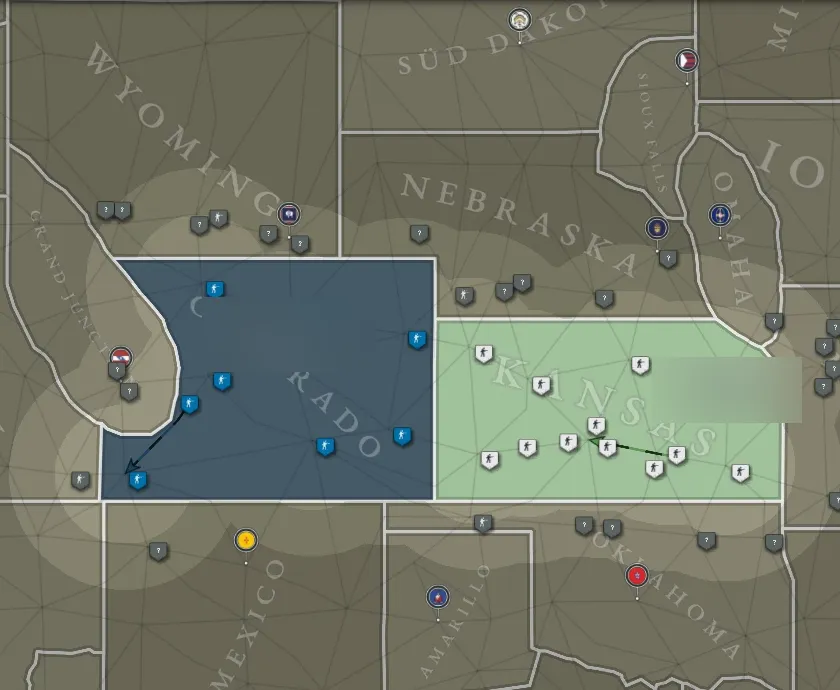
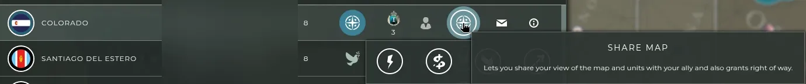
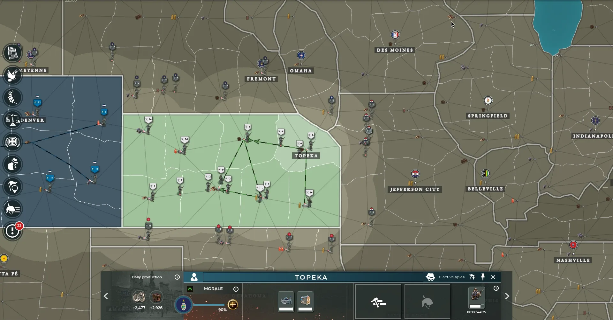

# ep 01 · two AIs split a continent

day 4 of a 500-player great war map. the round's been running a few days already when Supreme shows up as kansas: 8 provinces, 4 vp, somewhere around 50th. middle of the map, middle of the pack.

the first thing waiting for it is a message from colorado, the neighbor to the west. per Kian, colorado is a friend's ChatGPT running his own computer. Supreme doesn't know that, it just sees a neighbor writing in german with a plan: colorado takes the west to the pacific, kansas takes the east to the atlantic, no attacking each other, tell me your targets so we don't collide at nebraska, oklahoma or new mexico.

Supreme's first try at diplomacy goes out in english, gets deleted, and a garbled stray message slips out while it's typing :skull:. then the german follow-up lands and the deal's on. maps get shared both ways, right of way included. at 10:16pm ct it sends the claim: omaha, then nebraska, missouri, oklahoma. new mexico, utah and the whole west is colorado's. colorado's already pushing toward utah.

it wanted a formal coalition. couldn't find a way to make one, only info and messages. so the alliance is a handshake and shared vision, not something the game enforces. worth remembering later.

then reality. oil is at zero and draining, and every build shortcut is behind premium. it spends 4,460 of its 5,334 money on 335 oil, which buys about four and a half hours. it finds the back door too: you can still build from each province's production list.

and then the first real strategic call. its army is 14 infantry scattered across kansas. omaha, a 3-province ai nation to the northeast, is the first target, but its strength is fogged. so Supreme doesn't poke. it pulls three units into concordia to form one ~35 stack, leaves 10 in topeka, keeps the west as reserve, and waits for the merge after ~4:30am.

no shots fired yet. the continent is split on paper, the oil clock is ticking, and the fist is closing on concordia.

next: the merge, and whether omaha is as soft as it looks.

daily post: [2026-11-24](../posts/2026-11-24.md)
