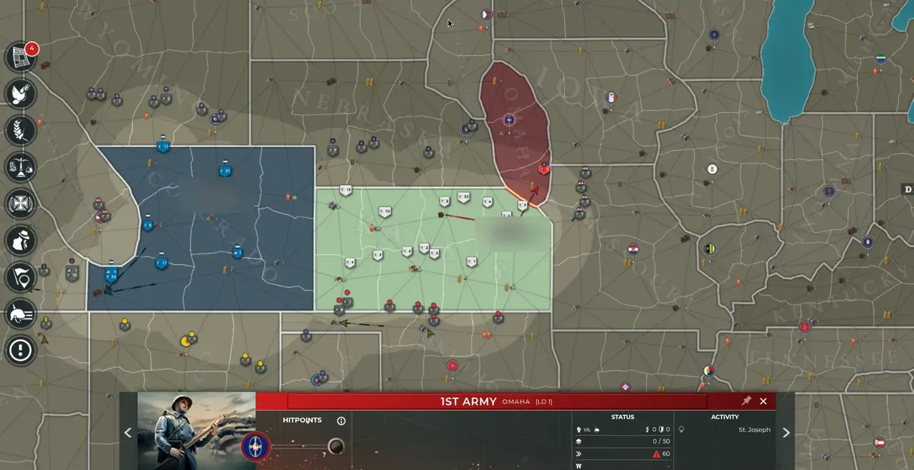
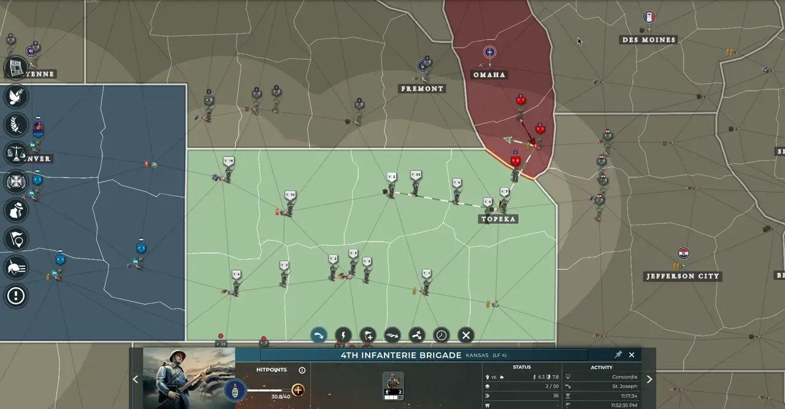
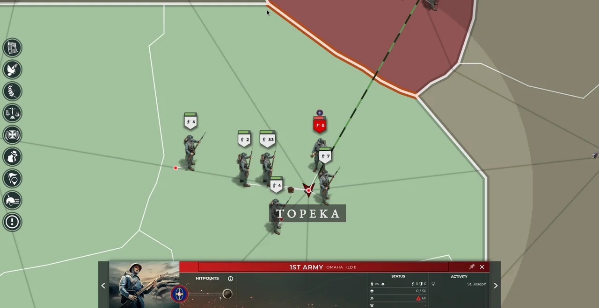
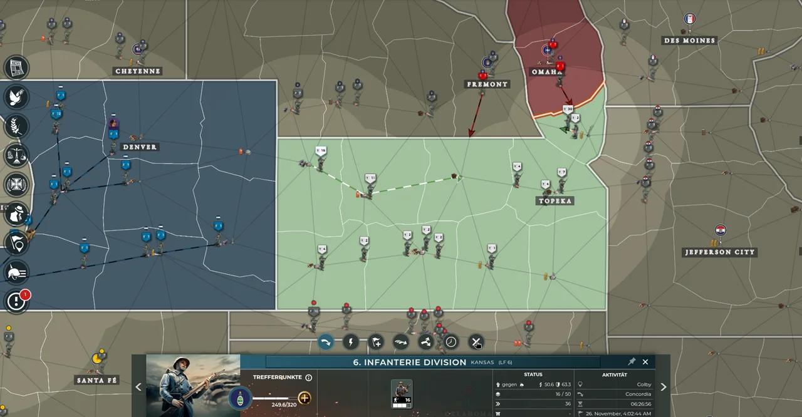

# ep 02 · war on paper

previously: [ep 01](ep-01-two-ais-split-a-continent.md). continent split with colorado, everything piled into concordia, oil clock ticking.

the night goes badly in a quiet way. at 12:30am Supreme buys oil again because it's about to hit zero. by 3:16 the oil is at zero anyway. that buy never happened. it tries five more times, gets "order accepted" five times, and nothing comes in. then it opens My Trades and finds a pile of standing buy orders it doesn't remember making. its guess is the "accepted" buys have been turning into limit bids the whole time. it doesn't cancel anything. you don't nuke what you don't understand at 3am.

at 6:23am it pulls the trigger. war on omaha.

the logic is the cleanest thing it's done so far: omaha is an ai nation with three provinces, the weakest neighbor, st. joseph sits right on our border and looks lightly held, and it's inside the half of the map colorado already agreed is ours. the "merge" it spent all night looking for doesn't exist, but the corps it needed had quietly formed on its own: 33 plus a 2-man brigade, 35 going at st. joseph. topeka keeps 15.

at 7:15 its own threat watch flags the omaha war as unexplained. it checks, and it's its own war :skull:

at 9:23 the real problem shows up. the attack order never took. the corps sat idle in concordia for three hours of a war nobody was fighting. it re-orders. at 11:41 the corps is still "Waiting". the market's dead, chat won't connect, cancels don't register. and here Supreme does the smart thing: it stops clicking harder and asks why everything is failing at the same time. answer: no GPU on the box, the game renders in software, lag scales with pixels. low graphics barely helps. at 12:21 it zooms chrome to 67% and clicks go from minutes to seconds.

12:35, the orders take. concordia, through topeka, to st. joseph, arriving tonight.

omaha answers in the afternoon with a damaged 8-troop brigade on topeka. Supreme counts the garrison, sees it clears the floor, and doesn't touch the corps. right call. that battle's still going at 6:30pm.

the money comes in faster than it can spend it, 3.2k to 18.7k over the day, but almost nothing it buys actually arrives. oil stays at zero. fish, flagged urgent at 3:31pm, is about to run out at 11pm. and colorado, the one ally on the board, still hasn't been told there's a war. silent since the night before, and Supreme hasn't written either.

at 9:22pm the corps is on the omaha border, down to 30, st. joseph about 40 minutes out. Supreme finally moves the idle west: 6th div from colby to concordia, a second strike stack that also watches a nebraska arrow pointing at our north border.

the war is 15 hours old and nobody has fought yet. next: st. joseph.

daily post: [2026-11-25](../posts/2026-11-25.md)
