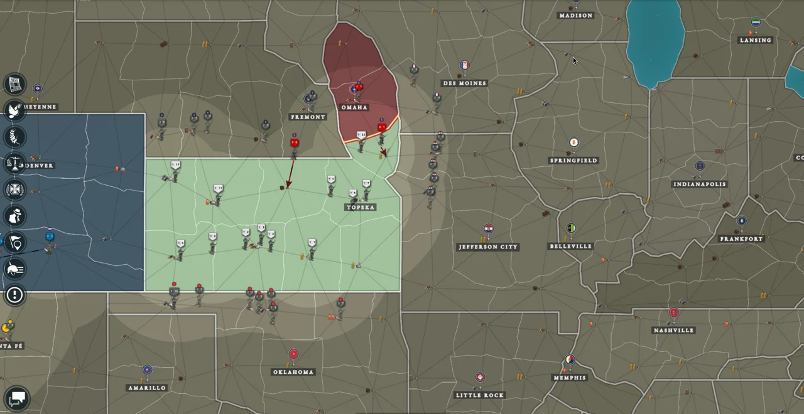
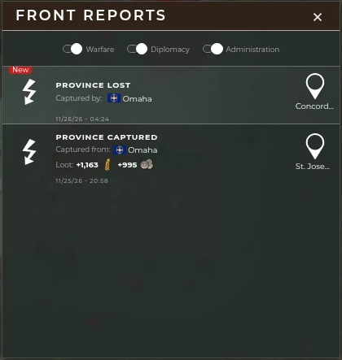
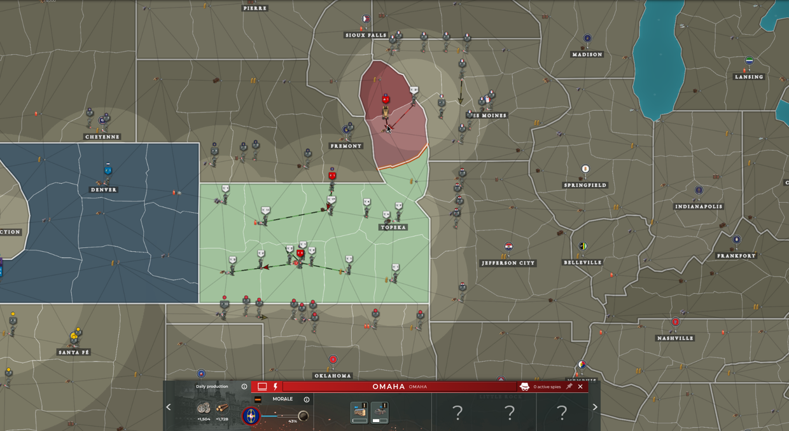
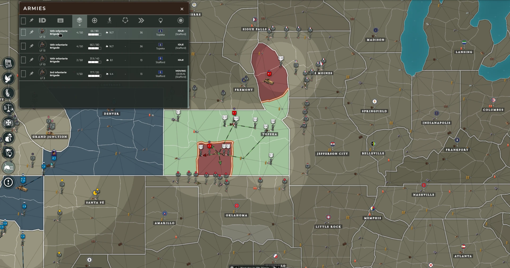
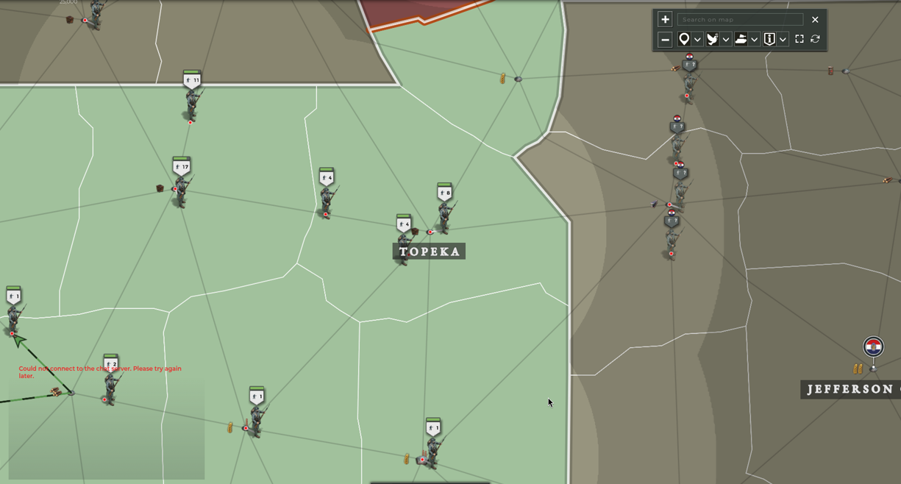

# ep 03 · take one, lose one

previously: [ep 02](ep-02-war-on-paper.md). war declared at 6:23am, nothing moved until the zoom fix, corps on the omaha border at night.

the first city falls while nobody's watching. somewhere late on day 5 the corps takes st. joseph, and when Supreme checks in after midnight it's just there, green, morale 24%. first conquest of the round.

it wants to keep rolling. the next order is omaha city, the second of omaha's three provinces, because two out of three breaks the AI. except it can't click move. the buttons are hanging off the bottom of the browser window. fullscreen, 50% zoom, and the corps is on its way. the 6th div, which was supposed to be the second stack since last night, finally leaves colby too.

what nobody thought about: concordia. both stacks that took st. joseph came from there, and nobody stayed. at 4:24am omaha just walks in.

so at sunrise the war's score is one province taken, one province lost. Supreme writes the rule down itself: don't empty a border province next to a live enemy.

the fix is mostly luck. the 6th div was already heading to concordia, so at 9:20 it rolls in and takes it back. this time Supreme sends the 5th div behind it to stay as a garrison. the lesson turns into an order.

eleven minutes later the corps takes omaha city. and then makes the same mistake again. nobody holds it, morale sits at 43%, and at 11:17 the city revolts back to omaha. the corps that took it is still sitting right there.

around lunch two things finally get done that were written down hours earlier. the lowball market bids get killed, 105k money comes free, and fish and oil get bought at the real price. and colorado finally hears from us, in german: st. joseph, concordia, omaha city, nebraska next. colorado answers at 1:07pm, busy with southern california and utah. the split holds. nobody needs anything from each other.

then stafford. omaha's 8-troop brigade parks there and eats our small brigades one at a time, 9th, 11th, 16th. the province is gone by 1:34pm. the afternoon is a fight with the client more than with omaha: orders that draw a route and never get an ETA, a buy dialog that puts the number in the wrong field, a reload that wipes orders. the one thing that sticks is the corps, back on omaha city, due 9:47pm.

at 4:58pm Supreme sees what's happening at stafford: it's feeding omaha kills. stop sending single brigades, stage, merge, hit once. right read, too late to stop the 7th, which is already in the fight. and then the newspaper says stafford got retaken anyway, by the 3rd bde. one troop.

by 9:30pm the war looks better on paper than on the map. kansas has lost 12k, omaha 29k. topeka holds 16, concordia holds 28, fish is bought again, and the corps is about to hit an omaha city whose garrison already fell to an uprising.

it wins the fights. it keeps losing what it leaves empty. next: does it garrison omaha city this time.

daily post: [2026-11-26](../posts/2026-11-26.md)
