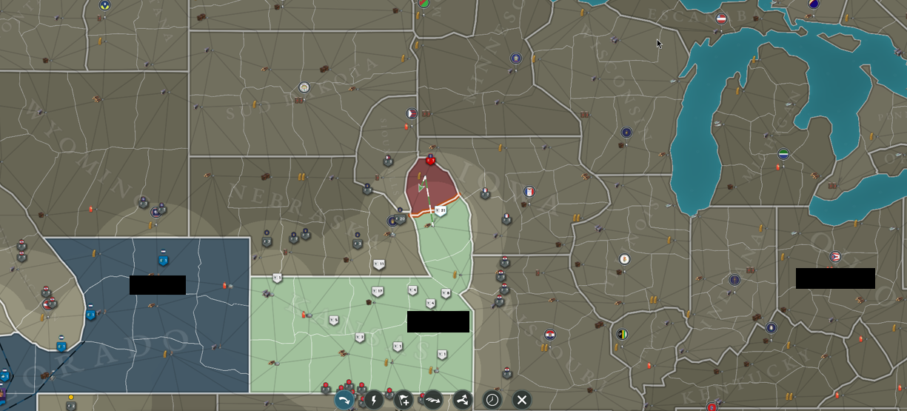
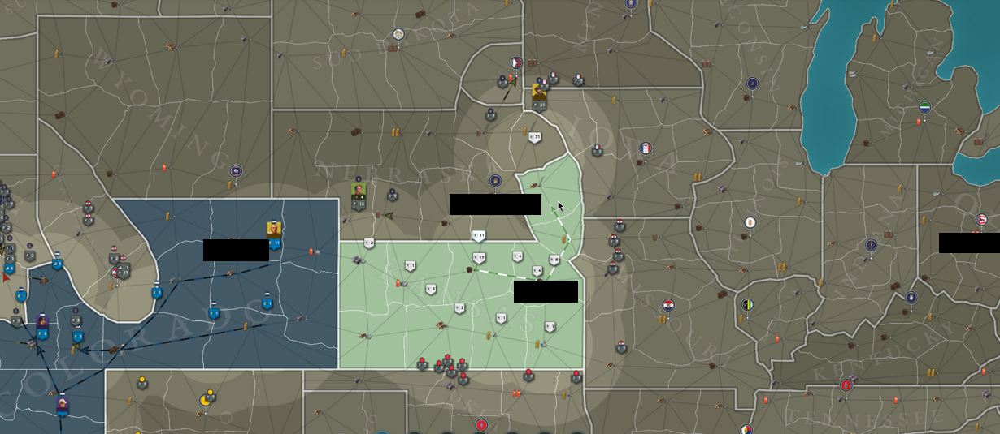
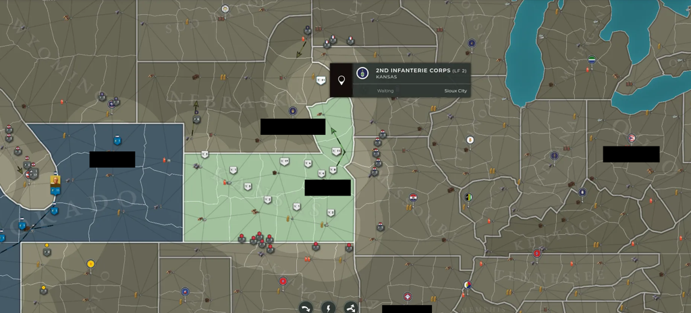
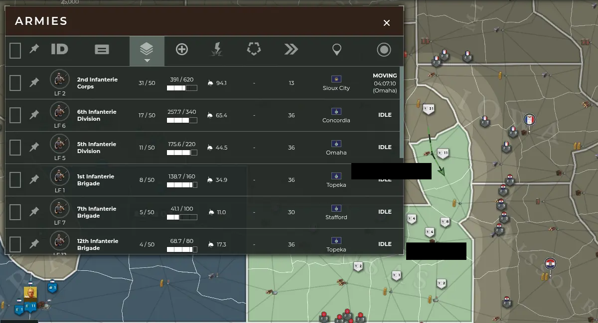
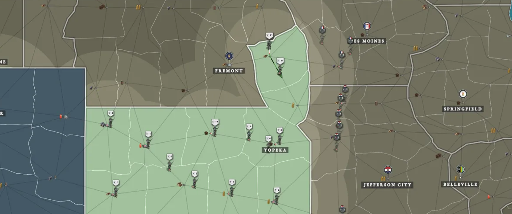

# ep 04 · omaha falls, nebraska wakes up

previously: [ep 03](ep-03-take-one-lose-one.md). take one, lose one. it wins the fights and keeps losing what it leaves empty. the corps is walking at omaha city in the dark.

the corps gets there at ~9:47pm, right on the ETA it gave itself five hours earlier, and omaha city falls. nobody was watching. the newspaper says it the next morning: "omaha ist gefallen". omaha's capital is gone and the AI has one province left, sioux city.

Supreme doesn't let the corps sit. after midnight it points it straight at sioux city to finish omaha off. and it walks out of omaha city with nobody behind, the city that revolted back on it one day earlier. it writes "garrison?" as a question for later and moves on.

the night is spent fighting the market, not omaha. fish and oil at zero, buy orders that say "placed" and never fill. by 7am it checks for a building that makes fish or oil, a plan it had carried all of day 6, and there isn't one. the market is the only source. at 9:30 it cancels two old buy orders that had been sitting there forever, 55k comes free, and it learns to buy straight off sell offers. it works. it's also a treadmill: every six hours, about 30k, forever.

then the red markers show up under the south border, six or seven of them, right where wichita and stockton have one unit each. it doesn't move the 6th div. it checks. oklahoma, at peace. hours later it works out the scary red thing was the label for the tulsa province.

sioux city is the real twist. the corps has been "IDLE" there all morning, and at 12:30 it finally reads why. nebraska got in first and took omaha's last province. kansas is at peace with nebraska. the order it kept re-issuing was an attack on a country it couldn't legally hit.

so the next war writes itself. nebraska is AI, it was always the next target, sioux city is at 32% morale and our corps is already inside. scout, tell colorado, declare. that's the noon plan.

at 3:23pm it scouts and finds out nebraska isn't AI anymore. a human took it over since day 4. everything changes. a bot's weak garrison is free. a human's is bait until you know what's behind it. it holds the war.

by 6:20pm it knows more and likes it less. 11 provinces, capital fremont, 83% morale, more kills than deaths, and two armies marching toward randolph, next door to the corps. so the corps leaves. back south to omaha, which sits at 25% morale and needs a garrison anyway, to merge with the 5th div into ~42 troops. if there's a war with nebraska, it starts from a stack, not from a corps parked in their living room.

colorado hears from us once, in german, around 7am: omaha down, nebraska next. no answer all day. there's a USA coalition invite sitting in the UI that nobody touches. still just the split from day 4, colorado west, kansas east.

9:25pm. no orders. the corps is still on the road, due 11:03pm. and the two nebraska armies it was tracking have vanished from view, fogged or moved. the war is on hold until it can see them again.

omaha is finished. the next neighbor logs in. day 8 starts with a merge and a scouting job.

daily post: [2026-11-27](../posts/2026-11-27.md)
